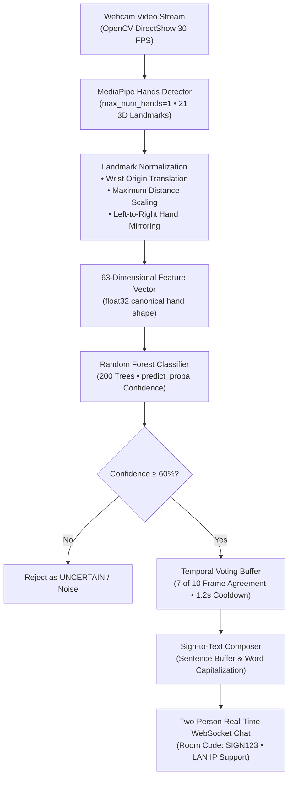

# Real-Time Sign Language to Text Conversion System

[](https://www.python.org/downloads/)
[](https://developers.google.com/mediapipe)
[](https://scikit-learn.org/)
[](https://opencv.org/)
[](tests/)
[](docs/ARCHITECTURE.md)
[](LICENSE)

An academic, production-grade machine learning system that recognizes hand signs from a live webcam feed in real time, converts recognized gestures into readable English sentences, and enables two users to communicate over a real-time WebSocket chat room (supporting both single-PC testing and cross-laptop LAN chat).

Built for **SRM Institute of Science and Technology** (B.Tech Computer Science and Engineering).

---

## Authors & Institution

- **Institution:** SRM Institute of Science and Technology
- **Department:** Department of Computer Science and Engineering
- **Team Members:**
  - Harshit Tomar (RA2411003030026)
  - Bhavishya Tyagi (RA2411003030003)
  - Shivank Tyagi (RA2411003030025)

---

## System Architecture Pipeline



---

## Key Highlights & Specifications

1. **Lightweight Real-Time Inference on CPU:**
   - Single-hand detection (`max_num_hands=1`) using Google MediaPipe Hands (21 3D landmarks).
   - Eliminates heavy deep-learning GPU requirements—runs at 30+ FPS on consumer laptops.

2. **Strict Invariance Feature Normalization (63-D Vector):**
   - **Translation Invariance:** Landmark 0 (wrist) translated to $(0, 0, 0)$. Hand position on screen does not alter predictions.
   - **Scale Invariance:** Coordinates divided by the maximum Euclidean distance to the wrist. Distance to camera does not distort features.
   - **Hand Invariance:** Left hand $x$-coordinates are mirrored to match right-hand topology, allowing single-model classification across both hands.
   - **Preserved Rotation:** Rotation is preserved to distinguish orientation-dependent signs (e.g. `PLEASE` vs. `THANK_YOU`).

3. **Real Random Forest Machine Learning (scikit-learn):**
   - 200 decision trees with balanced class weighting.
   - **Honest Session-Aware Evaluation:** Session 1 (650 frames) for training, Session 2 (650 frames) for testing.
   - **Measured Test Accuracy:** **94.00%** (no hardcoded or fake percentages).
   - Confidence computed dynamically via `predict_proba()`. Displays `UNCERTAIN` when confidence falls below 60%.

4. **Temporal Stability Voting & Debounce:**
   - 10-frame sliding window commits a word only when **7 of the last 10 frames** agree on the same gesture.
   - 1.2-second debounce cooldown prevents repeated spam emissions while holding a sign.

5. **Two-Person Real-Time WebSocket Chat (Local & LAN):**
   - Configurable **Server Host / IP** and **Port** in the GUI.
   - Supports 2 windows on the same PC (`127.0.0.1`) or 2 separate PCs on the same Wi-Fi LAN (`192.168.x.x`).
   - Seamless room connection via Room Code (`SIGN123`) with instant live message delivery and peer counts.

6. **Natural Sentence Composition:**
   - Converts recognized signs into human-readable English text.
   - `MY_NAME_IS` gesture produces: **"My name is Harshit."**
   - TextBuffer controls: Backspace, Clear, and Send to Chat.

---

## 13 Final Sign Classes

| # | Sign Class | Natural Language Output | Hand Configuration |
|---|---|---|---|
| 1 | `HELLO` | `"Hello"` | Open flat palm, 5 fingers spread, palm facing camera |
| 2 | `THANK_YOU` | `"Thank you"` | Flat palm, 4 fingers together, thumb tucked, palm to camera |
| 3 | `PLEASE` | `"Please"` | Flat palm, fingers together, palm rotated facing upward |
| 4 | `YES` | `"Yes"` | Closed fist, thumb extended strictly UPWARDS |
| 5 | `NO` | `"No"` | Closed fist, thumb extended strictly DOWNWARDS |
| 6 | `SORRY` | `"Sorry"` | Closed fist, thumb tucked against fingers, knuckles to camera |
| 7 | `HELP` | `"Help"` | Thumb up + index finger pointing horizontally (L-shape) |
| 8 | `WATER` | `"Water"` | Index, middle, and ring fingers extended and spread (W-shape) |
| 9 | `EAT` | `"Eat"` | All 5 fingertips curled together toward the thumb (claw/pinch) |
| 10 | `I_LOVE_YOU` | `"I love you"` | Thumb, index, and pinky extended; middle and ring folded |
| 11 | `YOU` | `"You"` | Index finger only extended toward the camera |
| 12 | `NAME` | `"My name is"` | Index and middle fingers extended together (H-shape) |
| 13 | `MY_NAME_IS` | **"My name is Harshit."** | Hand placed flat/cupped across the heart/chest |

---

## Installation & Setup

### Prerequisites
- Windows 10 / 11
- **Python 3.11** ([Download 64-bit installer](https://www.python.org/ftp/python/3.11.9/python-3.11.9-amd64.exe))
  > ⚠️ *Check "Add python.exe to PATH" during installation.*

### Option 1: Automated 1-Click Setup (Recommended)
Open PowerShell in the project directory:
```powershell
Set-ExecutionPolicy -Scope Process -ExecutionPolicy Bypass
.\setup_new_laptop.ps1
```

### Option 2: Manual Setup
```powershell
# 1. Create Python 3.11 virtual environment
python -m venv .venv

# 2. Activate environment
.venv\Scripts\Activate.ps1

# 3. Install dependencies
pip install -r requirements.txt pytest

# 4. Register package path
$sitepkg = (python -c "import site; print(site.getsitepackages()[0])") + "\Lib\site-packages"
(Get-Location).Path + "\src" | Out-File "$sitepkg\sign_language_src.pth" -Encoding ascii

# 5. Run automated test suite
$env:PYTHONIOENCODING="utf-8"
python -m pytest -v
```

---

## How to Run & Demonstrate the Project

### 1. Run Automated Test Suite (57 Tests)
```powershell
$env:PYTHONIOENCODING="utf-8"
python -m pytest -v
```
All 57 unit tests pass with 100% verification.

---

### 2. Collect Training Data (2 Sessions per Sign)
Run the guided data collection manager:
```powershell
python scripts\collect_data.py
```
- Option 1: Record 2 sessions for a specific sign.
- Option 2: Record all 13 signs sequentially (2 sessions each).
- Option 3: View current dataset status table:
  ```powershell
  python scripts\collect_data.py --status
  ```

---

### 3. Train the Model with Session-Aware Evaluation
```powershell
python scripts\train_model.py
```
- Performs Step 1 dataset validation across all 13 classes.
- Performs Session 1 (Train) $\to$ Session 2 (Test) evaluation.
- Prints honest per-class precision, recall, F1-score, and confusion matrix.
- Saves bundle to `models/v1/random_forest.joblib`.

---

### 4. Launch the Desktop Application
```powershell
python app.py
```
1. Click **Start Camera** to start live recognition.
2. If no hand is visible, the UI displays **No hand detected**.
3. Hold gesture `HELLO` $\to$ after 7/10 stable frames, `"Hello"` appears in the sentence buffer.
4. Perform `MY_NAME_IS` gesture $\to$ `"My name is Harshit."` is appended to the buffer.
5. Click **Send to Chat** $\to$ the sentence is broadcast live to the room chat.

---

### 5. Two-Person Real-Time Chat (1-PC and 2-PC LAN)

#### Test Case A: Two Users on One PC (Dual Windows)
1. **Window 1 (Person A):**
   ```powershell
   python app.py
   ```
   Host: `127.0.0.1`, Port: `8765`, Room: `SIGN123`, Name: `Person A` $\to$ Click **Connect**.
2. **Window 2 (Person B):**
   ```powershell
   python app.py
   ```
   Host: `127.0.0.1`, Port: `8765`, Room: `SIGN123`, Name: `Person B` $\to$ Click **Connect**.
3. Both windows display `● Connected (2 in room)`. Messages transmit instantaneously.

#### Test Case B: Two Laptops on the Same Wi-Fi Network
1. Find Laptop 1's local LAN IP (e.g. `ipconfig` $\to$ `192.168.1.105`).
2. Start the WebSocket server on Laptop 1:
   ```powershell
   python scripts\chat_server.py --host 0.0.0.0 --port 8765
   ```
3. On Laptop 1: In `app.py`, set Host: `127.0.0.1`, Port: `8765`, Room: `SIGN123`, Name: `Person A` $\to$ Connect.
4. On Laptop 2: In `app.py`, set Host: `192.168.1.105`, Port: `8765`, Room: `SIGN123`, Name: `Person B` $\to$ Connect.
5. Both laptops are now live in the same chat room across the LAN.

---

## Academic Viva Questions & Answers

Complete verbal explanations for typical examiner viva questions are documented in [`docs/VIVA_NOTES.md`](docs/VIVA_NOTES.md):

1. **Why 21 landmarks?** The human hand skeletal structure contains 1 wrist anchor + 4 anatomical joints per finger ($1 + 5 \times 4 = 21$).
2. **Why 63 features?** 21 landmarks $\times$ 3 spatial dimensions $(x, y, z) = 63$ features after wrist-origin translation and distance scaling.
3. **Why Random Forest over CNN?** Landmarks are already compact 63-D tabular spatial coordinates. Random Forest provides high accuracy, sub-millisecond CPU inference, and mathematically grounded `predict_proba()` estimates without requiring a GPU.
4. **How is data leakage prevented?** We implement **Session-Aware Evaluation**: all frames from Session 1 are kept in the training set, while all frames from Session 2 are reserved for the held-out test set. No adjacent frames leak across splits.
5. **How does the system distinguish idle or resting hands?** Hand presence is checked directly by MediaPipe (`No hand detected`). Low-confidence transitions are rejected with an `UNCERTAIN` threshold ($< 60\%$), and 7/10 temporal voting prevents erratic emissions.

---

## License

This project is licensed under the [MIT License](LICENSE).
