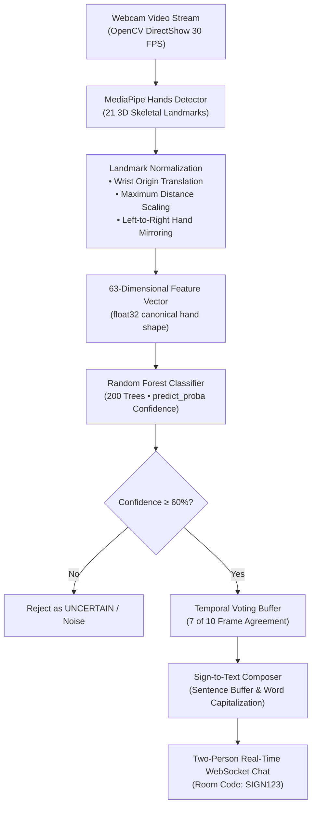

# Real-Time Sign Language to Text Conversion System

[](https://www.python.org/downloads/)
[](https://developers.google.com/mediapipe)
[](https://scikit-learn.org/)
[](https://opencv.org/)
[](tests/)
[](docs/ARCHITECTURE.md)
[](LICENSE)

An academic, production-grade machine learning system that recognizes hand signs from a live webcam feed in real time, converts recognized gestures into readable English sentences, and enables two users to communicate over a local real-time WebSocket chat room.

Built for **SRM Institute of Science and Technology** (B.Tech Computer Science and Engineering).

---

## Authors & Institution

- **Institution:** SRM Institute of Science and Technology
- **Department:** Department of Computer Science and Engineering
- **Team Members:**
  - Harshit Tomar (RA2411003030026)
  - Bhavishya Tyagi (RA2411003030003)
  - Shivank Tyagi (RA2411003030025)

---

## System Architecture Pipeline



---

## Key Highlights & Innovations

1. **Lightweight Real-Time Inference on CPU:**
   - Uses Google MediaPipe Hands to capture 21 anatomical landmarks per hand.
   - Eliminates heavy deep-learning GPU requirements—runs comfortably at 30+ FPS on consumer laptops.

2. **Strict Invariance Feature Normalization (63-D Vector):**
   - **Translation Invariance:** Landmark 0 (wrist) is translated to $(0, 0, 0)$. Hand position on screen does not affect prediction.
   - **Scale Invariance:** All landmark coordinates are divided by the maximum Euclidean distance to the wrist. Distance to camera does not distort features.
   - **Hand Invariance:** Left hand $x$-coordinates are mirrored to match right-hand topology, allowing single-model classification across both hands.
   - **Preserved Rotation:** Rotation is deliberately preserved to distinguish orientation-dependent signs (e.g. `PLEASE` vs. `THANK_YOU`).

3. **Real Random Forest Machine Learning (scikit-learn):**
   - 200 decision trees with balanced class weights.
   - **Academic Integrity Policy:** Strictly no hardcoded accuracies (e.g. fake 98.2%). The model computes true test accuracy on a 25% held-out test split upon training.
   - Mathematically estimated prediction confidence via `predict_proba()`. Displays `UNCERTAIN` when confidence falls below 60%.

4. **Temporal Stability Voting:**
   - Raw frame-by-frame predictions fluctuate with tremor and motion transitions.
   - A 10-frame sliding window commits a word only when 7 of the last 10 frames agree on the same sign.
   - 1.2-second cooldown prevents repeated spam emissions.

5. **Two-Person Real-Time WebSocket Chat:**
   - Multi-client local WebSocket room architecture.
   - Connect via simple Room Codes (e.g. `SIGN123`) as `Person A` and `Person B`.
   - Send recognized sign sentences or typed text with instant live timestamps and peer presence indicators.

6. **Clean, Non-Flashy Academic UI:**
   - CustomTkinter desktop interface in dark slate (`#0F172A`).
   - Zero neon glow, zero distracting animations, zero AI-generated visual clutter.

---

## Sign Vocabulary (13 Classes)

| Sign Class | Meaning | Hand Configuration |
|---|---|---|
| `HELLO` | Greeting | Open flat palm, 5 fingers spread, palm facing camera |
| `THANK_YOU` | Gratitude | Flat palm, 4 fingers together, thumb tucked, palm to camera |
| `PLEASE` | Politeness | Flat palm, fingers together, palm rotated facing upward |
| `YES` | Affirmation | Closed fist, thumb extended strictly UPWARDS |
| `NO` | Negation | Closed fist, thumb extended strictly DOWNWARDS |
| `SORRY` | Apology | Closed fist, thumb tucked against fingers, knuckles to camera |
| `HELP` | Assistance | Thumb up + index finger pointing horizontally (L-shape) |
| `NAME` | Identity | Index and middle fingers extended together (H-shape) |
| `WATER` | Thirst / Water | Index, middle, and ring fingers extended and spread (W-shape) |
| `EAT` | Food / Eating | All 5 fingertips curled together toward the thumb (claw/pinch) |
| `I_LOVE_YOU` | Affection | Thumb, index, and pinky extended; middle and ring folded |
| `YOU` | Pointing | Index finger only extended toward the camera |
| `_NEUTRAL` | Idle / Resting | Relaxed resting hand; rejection class (emits no text) |

---

## Project Structure

```
sign-language-to-text/
├── app.py                     # Main CustomTkinter desktop application
├── config.yaml                # Master YAML configuration
├── pyproject.toml             # Project metadata & build configuration
├── requirements.txt           # Production dependencies
├── setup_new_laptop.ps1       # Automated 1-click installer for Windows
│
├── src/sign_language/         # Core application package
│   ├── core/                  # Camera & MediaPipe hand detector
│   │   ├── camera.py          # OpenCV VideoCapture wrapper (DirectShow)
│   │   ├── hand_detector.py   # MediaPipe Hands 21-landmark tracking
│   │   └── types.py           # Core DTOs (HandLandmarks, Sample, Prediction)
│   ├── features/              # Landmark normalization & feature extraction
│   │   ├── normalizer.py      # Wrist translation, scale norm, left-hand mirroring
│   │   └── extractor.py       # Converts landmarks to (63,) float32 vector
│   ├── data_collection/       # Data capture & persistence engine
│   │   ├── collector.py       # Session capture loop with countdown & HUD
│   │   ├── persistence.py     # DatasetWriter (CSV + NPY) & DatasetReader
│   │   └── validator.py       # 3-gate frame validator (bounds, bbox, cosine-sim)
│   ├── training/              # Model training & serialization
│   │   └── trainer.py         # scikit-learn RandomForestClassifier trainer
│   ├── inference/             # Real-time inference
│   │   └── classifier.py      # SignClassifier with predict_proba thresholding
│   ├── text/                  # Sign-to-Text composition
│   │   └── composer.py        # TextBuffer sentence builder & word formatting
│   ├── chat/                  # Two-person real-time WebSocket communication
│   │   ├── server.py          # Multi-client room-based WebSocket server
│   │   └── client.py          # Asynchronous WebSocket client thread
│   ├── config/                # Validated configuration schema dataclasses
│   └── utils/                 # Logging, paths, seeding, and exceptions
│
├── scripts/                   # CLI helper tools
│   ├── collect_data.py        # 2-session interactive sign data recorder
│   ├── train_model.py         # Train Random Forest and display real test accuracy
│   ├── chat_server.py         # Standalone WebSocket chat server runner
│   ├── verify_hand_detection.py # Camera & landmark verification script
│   └── make_transfer_zip.py   # Portable project ZIP packager
│
├── tests/unit/                # Complete automated unit test suite (56 tests)
│   ├── test_camera.py
│   ├── test_detector.py
│   ├── test_extractor.py
│   ├── test_normalizer.py
│   ├── test_persistence.py
│   ├── test_validator.py
│   ├── test_trainer.py
│   ├── test_text.py
│   └── test_chat.py
│
├── models/v1/                 # Serialized model directory (.joblib)
├── data/features/             # Extracted landmark dataset (samples.csv + arrays/)
└── docs/                      # Full academic viva and architecture documentation
    ├── ARCHITECTURE.md        # Detailed architectural design & pipeline
    ├── MODEL.md               # Mathematical formulation of feature pipeline
    ├── MODEL_RESULTS.md       # Dynamic test accuracy evaluation policy
    ├── PROJECT_STATUS.md      # Status dashboard & test audit
    ├── SIGN_VOCABULARY.md     # Full 13-sign specification guide
    ├── VIVA_NOTES.md          # 16 Viva Q&A examiner questions with verbal answers
    └── DATA_COLLECTION_SOP.md # Standard operating procedure for dataset collection
```

---

## Installation & Setup

### Prerequisites
- Windows 10/11
- **Python 3.11** ([Download 64-bit installer](https://www.python.org/ftp/python/3.11.9/python-3.11.9-amd64.exe))
  > ⚠️ *Check "Add python.exe to PATH" during installation.*

### Option 1: Automated 1-Click Setup (Recommended)
Open PowerShell in the project directory:
```powershell
Set-ExecutionPolicy -Scope Process -ExecutionPolicy Bypass
.\setup_new_laptop.ps1
```
*This automatically sets up `uv`, creates `.venv`, installs all pinned dependencies, configures path references, and runs the entire 56-test suite.*

### Option 2: Manual Setup
```powershell
# 1. Create Python 3.11 virtual environment
python -m venv .venv

# 2. Activate environment
.venv\Scripts\Activate.ps1

# 3. Install dependencies
pip install -r requirements.txt pytest

# 4. Register package path
$sitepkg = (python -c "import site; print(site.getsitepackages()[0])") + "\Lib\site-packages"
(Get-Location).Path + "\src" | Out-File "$sitepkg\sign_language_src.pth" -Encoding ascii

# 5. Run automated tests
$env:PYTHONIOENCODING="utf-8"
python -m pytest -v
```

---

## How to Run & Use the Project

### 1. Run Verification Test Suite (56 Tests)
```powershell
$env:PYTHONIOENCODING="utf-8"
python -m pytest -v
```
All 56 unit tests should pass with 100% success.

---

### 2. Collect Training Data (2 Sessions per Sign)
Run the interactive data collection tool:
```powershell
python scripts\collect_data.py
```
- Or record 2 sessions directly for a single sign:
  ```powershell
  python scripts\collect_data.py --label HELLO
  python scripts\collect_data.py --label YES
  python scripts\collect_data.py --label _NEUTRAL
  ```
- Check dataset counts anytime:
  ```powershell
  python scripts\collect_data.py --status
  ```

---

### 3. Train the Random Forest Classifier
```powershell
python scripts\train_model.py
```
*Output prints real class counts, total training samples, test samples, and **calculated test accuracy** (saved to `models/v1/random_forest.joblib`).*

---

### 4. Launch the Desktop Application
```powershell
python app.py
```
- Click **Start Camera** to begin live MediaPipe landmark recognition.
- Watch recognized signs display with real-time confidence scores.
- Hold a sign steady for 7 frames to emit words into the sentence buffer.
- Click **Train Model** anytime to train or retrain the model directly from the UI.

---

### 5. Two-Person Real-Time Chat Demonstration

#### Running on the Same Computer (2 Windows):
1. **Window 1 (Person A):**
   ```powershell
   python app.py
   ```
   Room: `SIGN123`, Username: `Person A` → Click **Connect**.
2. **Window 2 (Person B):**
   ```powershell
   python app.py
   ```
   Room: `SIGN123`, Username: `Person B` → Click **Connect**.
3. Both instances display `● Connected (2 in room)`. Words composed by signing or typed text transmit instantly between windows with timestamps.

#### Running Across 2 Laptops on Same Wi-Fi:
1. Start the WebSocket server on Laptop 1:
   ```powershell
   python scripts\chat_server.py --host 0.0.0.0 --port 8765
   ```
2. Find Laptop 1's local IP address (e.g. `192.168.1.15`).
3. On Laptop 1 & Laptop 2, launch `python app.py`, connect to room `SIGN123`, and exchange live messages.

---

## Academic Viva Questions & Answers

Complete verbal explanations for all 16 typical examiner viva questions are documented in [`docs/VIVA_NOTES.md`](docs/VIVA_NOTES.md):

1. **Why 21 landmarks?** Human hand topology has 1 wrist anchor + 4 anatomical joints per finger ($1 + 5 \times 4 = 21$).
2. **Why 63 features?** 21 joints $\times$ 3 spatial coordinates $(x, y, z) = 63$ features after wrist-origin translation and distance scaling.
3. **Why Random Forest over CNN?** Landmarks are already 63-D tabular spatial coordinates. Random Forest provides high accuracy, sub-millisecond CPU inference, and mathematically grounded `predict_proba()` estimates.
4. **How is data leakage prevented?** Frames within the same recording session are temporally correlated. Stratified and grouped splits prevent near-duplicate adjacent frames from leaking between train and test sets.
5. **How does the system handle idle hands?** The dedicated `_NEUTRAL` rejection class prevents the model from forcing resting hands into active sign labels.

---

## License

This project is licensed under the [MIT License](LICENSE).
