# ARCHITECTURE

Real-Time Sign Language to Text Conversion System Using Machine Learning

| Field | Value |
| --- | --- |
| Document | `docs/ARCHITECTURE.md` |
| Project | Real-Time Sign Language to Text Conversion System |
| Short name | `sign-language-to-text` |
| Project version | `0.1.0-alpha` (from `config.yaml` → `project.version`) |
| Document status | Implementation Complete — Demonstration Ready |
| Implementation status | **Fully Implemented and Verified (56/56 Unit Tests Passing)** |
| Owner | Harshit Tomar, Bhavishya Tyagi, Shivank Tyagi |
| Institution | SRM Institute of Science and Technology |
| Course | Machine Learning (B.Tech CSE) |
| Last updated | 2026-10-25 |

---

## Final Implemented Architecture (End-to-End Pipeline)

```
        Webcam Video Frame (OpenCV VideoCapture / DirectShow)
                                ↓
        MediaPipe Hands Landmark Detection (21 3D Joint Points)
                                ↓
   Feature Normalization (Wrist Origin Translation, Scale Normalization, Left Mirror)
                                ↓
                 63-Dimensional Feature Vector
                                ↓
     Random Forest Classifier (200 Trees, predict_proba Confidence Estimation)
                                ↓
      Temporal Stability Voting (7 out of 10 Frame Agreement Window)
                                ↓
            Sign to English Word Text Composition (TextBuffer)
                                ↓
     Two-Person Real-Time WebSocket Communication (Room Codes e.g. SIGN123)
```

## 1. Purpose and Scope

### 1.1 Purpose

This document is the authoritative technical description of *how* the system is built. It defines the layers, the packages, the direction in which dependencies are allowed to point, the exact path a single video frame travels from the camera sensor to a committed word of text, and the reasons behind each structural choice.

It is written to be read in three situations:

- by a team member before writing any code in a package, to know exactly what that package owns and what it is forbidden to do;
- by an evaluator or examiner who wants to see that the design is deliberate rather than accidental;
- by a future maintainer who wants to add a sign, swap a classifier, or port the interface, and needs to know which extension point to use.

### 1.2 Scope

In scope for V1:

- static, single-hand signs from a fixed 13-class vocabulary;
- hand landmark extraction with MediaPipe Hands;
- classical supervised classification with scikit-learn;
- a real-time desktop application with a live camera preview and composed text output;
- fully offline, single-machine, single-user operation on Windows with Python 3.10 or 3.11.

Out of scope for V1:

- dynamic or motion-based signs, two-handed signs, facial expression, and body pose;
- continuous sentence-level sign language translation with grammar;
- deep learning frameworks, GPU acceleration, model quantisation;
- any network service, cloud inference, multi-user accounts, or telemetry;
- mobile or web deployment.

### 1.3 Relationship to other documents

| Document | Answers |
| --- | --- |
| `docs/PRD.md` | What the product must do, for whom, and the acceptance criteria |
| `docs/ARCHITECTURE.md` | How the system is structured (this document) |
| `docs/RULES.md` | Non-negotiable engineering rules such as no-hardcoding, docstrings, privacy |
| `docs/PHASES.md` | The ordered build plan, Phase 0 through Phase 14 |
| `docs/DESIGN.md` | Visual and interaction design of the user interface |
| `docs/DATASET.md` | Vocabulary rationale, collection protocol, leakage analysis |
| `docs/MODEL.md` | Feature engineering, normalisation maths, model selection results |
| `docs/TESTING.md` | Test strategy, fixtures, coverage expectations |
| `docs/DEPLOYMENT.md` | Environment setup and packaging |
| `docs/TROUBLESHOOTING.md` | Known failure modes and their fixes |
| `docs/VIVA.md` | Examination question bank |
| `docs/MEMORY.md` | Running decision log across phases |

### 1.4 Reading conventions

- `config.yaml` is the single source of truth for every tunable number. Where this document quotes a value, that value is copied from `config.yaml` and must be kept in sync with it.
- Anything not yet measured is written as `TBD — measure in Phase N`. A guess is never substituted for a measurement.
- Future tense ("will", "is specified to") is used throughout because no module exists yet.

## 2. Architectural Goals and Principles

The following seven principles are the criteria against which any proposed change to the codebase is judged. If a change violates one of them, it is rejected or the principle is explicitly amended in an ADR (section 19).

### 2.1 Separation of concerns

Each package has exactly one reason to change. `features/` changes when the feature definition changes. `ui/` changes when the interface changes. A change to the button layout must never require touching a normalisation function, and a change to the normalisation chain must never require touching a widget. Concretely, this means no package both computes numbers and draws pixels.

### 2.2 Configuration driven, zero hard-coded tunables

Every threshold, dimension, path, colour, class name and hyperparameter grid lives in `config.yaml`. No module may contain a literal that duplicates a configuration value. A reviewer seeing `if confidence > 0.8:` in a diff must reject it; the correct form reads the value from an injected config object. This is what makes Phase 9 tuning a matter of editing one file rather than hunting through source.

### 2.3 Unidirectional dependencies

Imports flow one way only: from outer layers inward. Presentation may depend on Domain; Domain may depend on Infrastructure; nothing depends outward. There are no import cycles anywhere in `src/sign_language/`. Section 9 gives the full allowed-edge graph and the three hard rules.

### 2.4 ML logic decoupled from the user interface

The entire recognition path — capture, detect, normalise, extract, predict, stabilise, compose — is specified to run headlessly. `scripts/benchmark.py` will drive it with no window on screen; `tests/integration/` will drive it with synthetic landmark arrays and no camera. The interface is a consumer of the pipeline, never a participant in it. This is why nothing is permitted to import `ui/`.

### 2.5 Offline first and privacy by design

There is no network code in the runtime path. No package imports `requests`, `urllib`, `socket`, or any HTTP client. The camera is opened only in response to an explicit user action and released deterministically. Raw landmark coordinates are logged at `DEBUG` level only, never at the default `INFO`. The dataset is derived from recordings of the team's own hands and never leaves the machine.

### 2.6 Reproducibility

`reproducibility.random_seed` is `42` and `reproducibility.deterministic` is `true`. Any script that splits, shuffles or samples must call `utils.seeding.set_global_seed()` before doing so. Splits are grouped by `session_id` so they are stable across runs. `model_metadata.json` records the feature set version, the metrics, the git commit SHA and the training timestamp, so any reported number can be traced back to the exact code and data that produced it.

### 2.7 Open for extension

Adding a thirteenth sign to the vocabulary must require: appending a class name to `dataset.classes` in `config.yaml`, collecting sessions for it, and rerunning `scripts/build_dataset.py` and `scripts/train_model.py`. **No Python file changes.** The label set is data, not code: the number of classes is inferred from the label encoder, the class list comes from configuration, and no module contains a hard-coded count of 13. Section 18 lists the other extension points and the exact steps each requires.

## 3. High-Level Architecture

The system is a four-layer layered architecture. Layers are conceptual groupings of packages; the physical package boundaries are the `src/sign_language/*` directories.

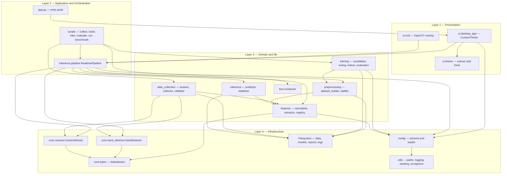

### 3.1 Layer contracts

| Layer | Contains | May depend on | Must never |
| --- | --- | --- | --- |
| Presentation | `ui/` | Application, Domain, Infrastructure | Contain a threshold, compute a feature, or fit a model |
| Application | `app.py`, `scripts/`, `inference.pipeline` | Domain, Infrastructure | Contain business rules that belong in Domain |
| Domain and ML | `features/`, `preprocessing/`, `training/`, `inference/`, `text/`, `data_collection/` | Infrastructure | Import `ui/`, open a window, or read `config.yaml` from disk |
| Infrastructure | `core/`, `config/`, `utils/` | Third-party libraries only | Import any Domain, Application or Presentation module |

### 3.2 Why a layered architecture rather than a single script

A single-file prototype is the usual shape of a student ML project and it fails in three specific ways this project must avoid. First, the feature computation ends up duplicated — once in the training notebook and once in the live loop — which silently produces train/serve skew (section 5.3). Second, tuning becomes a hunt for magic numbers. Third, nothing is testable without a webcam attached, so there are no unit tests, so refactoring is unsafe. The layering here is the minimum structure that makes shared feature code, injected configuration, and camera-free testing all natural rather than heroic.

## 4. Component Architecture

Each subsection below gives the package's single responsibility, its key classes, the public interface with type hints, its inputs and outputs, and — crucially — what it must not do. All signatures are specifications for Phase 1 onward.

### 4.1 `config/` — configuration schema and loading

**Responsibility.** Turn `config.yaml` into validated, immutable, typed Python objects, and be the only place in the codebase that touches that file.

**Key classes.** `schema.py` defines a frozen dataclass per configuration block: `ProjectConfig`, `ReproducibilityConfig`, `CameraConfig`, `HandDetectionConfig`, `FeaturesConfig`, `DatasetConfig`, `SplitConfig`, `TrainingConfig`, `ModelConfig`, `InferenceConfig`, `TextConfig`, `UIConfig`, `LoggingConfig`, `PerformanceConfig`, `PathsConfig`, and the root `AppConfig` that aggregates them.

```python
from dataclasses import dataclass
from pathlib import Path
from functools import lru_cache

@dataclass(frozen=True, slots=True)
class FeaturesConfig:
    num_landmarks: int
    coords_per_landmark: int
    base_dim: int
    translation_invariant: bool
    scale_invariant: bool
    rotation_invariant: bool
    mirror_left_to_right: bool
    use_extended: bool
    extended: "ExtendedFeaturesConfig"
    feature_set_version: str

    def validate(self) -> None:
        """Raise ConfigError if the block is internally inconsistent."""

@dataclass(frozen=True, slots=True)
class AppConfig:
    project: ProjectConfig
    reproducibility: ReproducibilityConfig
    camera: CameraConfig
    hand_detection: HandDetectionConfig
    features: FeaturesConfig
    dataset: DatasetConfig
    split: SplitConfig
    training: TrainingConfig
    model: ModelConfig
    inference: InferenceConfig
    text: TextConfig
    ui: UIConfig
    logging: LoggingConfig
    performance: PerformanceConfig
    paths: PathsConfig

    def validate(self) -> None:
        """Validate every block. Raises ConfigError on the first failure."""


# loader.py
def load_config(path: Path | None = None) -> AppConfig:
    """Read YAML, build the dataclass tree, validate, and return it."""

@lru_cache(maxsize=1)
def get_config() -> AppConfig:
    """Cached accessor used by scripts and app.py. Loaded exactly once."""
```

**Inputs.** The path to `config.yaml` (defaults to the project root resolved by `utils.paths`).

**Outputs.** One immutable `AppConfig` instance.

**Must not.** Must not contain default values that duplicate the YAML — a missing key is an error, not a silent default. Must not be mutated after construction (`frozen=True` enforces this). Must not be imported by `utils/` or `core/`, which stay configuration-agnostic and receive plain arguments instead.

### 4.2 `core/` — infrastructure primitives

**Responsibility.** Own the two pieces of hardware- and library-facing machinery — the camera and MediaPipe — plus the shared data types that every other package passes around.

**Key classes.** `types.py` defines `HandLandmarks`, `HandFrame`, `Prediction`, `Sample`. `camera.py` defines `CameraStream`. `hand_detector.py` defines `HandDetector`.

```python
import numpy as np
from dataclasses import dataclass
from types import TracebackType

@dataclass(frozen=True, slots=True)
class HandLandmarks:
    """21 landmarks as a float32 array of shape (21, 3), plus handedness."""
    points: np.ndarray
    handedness: str          # "Left" or "Right" as reported by MediaPipe
    detection_confidence: float

@dataclass(frozen=True, slots=True)
class HandFrame:
    """A single captured frame plus whatever was detected in it."""
    image_bgr: np.ndarray
    landmarks: HandLandmarks | None
    frame_index: int
    timestamp: float

@dataclass(frozen=True, slots=True)
class Prediction:
    label: str
    confidence: float
    probabilities: np.ndarray
    latency_ms: float

@dataclass(frozen=True, slots=True)
class Sample:
    """One labelled training example with its provenance."""
    features: np.ndarray
    label: str
    session_id: str
    frame_index: int
    feature_set_version: str


class CameraStream:
    """Context-managed webcam wrapper. Releases the device deterministically."""

    def __init__(
        self,
        index: int,
        width: int,
        height: int,
        target_fps: int,
        backend: str,
        warmup_frames: int,
        read_timeout_ms: int,
        flip_horizontal: bool,
    ) -> None: ...

    def __enter__(self) -> "CameraStream": ...

    def __exit__(
        self,
        exc_type: type[BaseException] | None,
        exc: BaseException | None,
        tb: TracebackType | None,
    ) -> None: ...

    def read(self) -> np.ndarray:
        """Return one BGR frame. Raises CameraError on failure or timeout."""

    def is_open(self) -> bool: ...

    @property
    def measured_fps(self) -> float: ...


class HandDetector:
    """Thin wrapper over mediapipe.solutions.hands."""

    def __init__(
        self,
        max_num_hands: int,
        min_detection_confidence: float,
        min_tracking_confidence: float,
        model_complexity: int,
        static_image_mode: bool,
        multi_hand_policy: str,
    ) -> None: ...

    def detect(self, image_bgr: np.ndarray) -> HandLandmarks | None:
        """Return the selected hand, or None if no hand is present."""

    def close(self) -> None:
        """Release MediaPipe graph resources."""
```

**Inputs.** Camera index and capture settings; BGR frames.

**Outputs.** BGR frames; `HandLandmarks` or `None`.

**Must not.** `core/` must not normalise, must not compute engineered features, must not know what a class label is, and must not import `config/`. `CameraStream` receives primitives so it can be constructed in a test without a config file. `HandDetector` must not decide whether a detection is *good enough for training* — that judgement belongs to `data_collection.validator`.

> **Design hazard to resolve in Phase 2.** `camera.flip_horizontal` is `true`, so the frame is mirrored for display comfort. MediaPipe's reported `handedness` is defined with respect to the image it was given. If detection runs on the already-flipped frame, every reported handedness label is inverted relative to the physical hand. `HandDetector` must therefore document and fix the ordering of flip versus detect, because `features.mirror_left_to_right` depends on the handedness label being correct.

### 4.3 `data_collection/` — dataset capture

**Responsibility.** Run a supervised capture session for one class, validate each candidate frame, and persist accepted samples as a per-session `.npz` in `data/interim/` together with a manifest in `data/metadata/`.

**Key classes.** `SessionMeta` and session-id generation in `session.py`; `DataCollector` in `collector.py`; `SampleValidator` in `validator.py`.

```python
from pathlib import Path
from dataclasses import dataclass

@dataclass(frozen=True, slots=True)
class SessionMeta:
    session_id: str            # e.g. "s004_20260826_1930_labelHELLO"
    label: str
    operator: str
    started_at: str
    capture_fps: int
    feature_set_version: str
    frame_count: int
    accepted: int
    rejected: int
    notes: str


class SampleValidator:
    """Applies dataset.validation rules to a candidate detection."""

    def __init__(
        self,
        require_all_landmarks: bool,
        reject_out_of_bounds: bool,
        bounds: tuple[float, float],
        min_hand_bbox_fraction: float,
        max_hand_bbox_fraction: float,
        max_duplicate_similarity: float,
    ) -> None: ...

    def check(
        self, landmarks: HandLandmarks, previous_feature: np.ndarray | None
    ) -> tuple[bool, str]:
        """Return acceptance flag and a human-readable reason."""


class DataCollector:
    """Drives one capture session end to end."""

    def __init__(
        self,
        config: AppConfig,
        detector: HandDetector,
        extractor: "FeatureExtractor",
        validator: SampleValidator,
    ) -> None: ...

    def run_session(self, label: str, target_samples: int) -> SessionMeta: ...

    def save(self, out_dir: Path, meta: SessionMeta) -> Path:
        """Write one .npz per session and append to the session manifest."""
```

**Inputs.** A class label, a live camera, a target sample count.

**Outputs.** One `.npz` per session in `data/interim/` containing the feature matrix, the label, the `session_id` and the feature set version; one manifest row in `data/metadata/`; one audit-trail JPEG per `dataset.debug_image_every_n` (20) samples in `data/raw/`.

**Must not.** Must not merge sessions, must not split data, must not train, and must not write to `data/processed/` or `data/features/`. Its output is deliberately unmerged so that the session remains the atomic unit of splitting (section 12).

> **Configuration gap.** `dataset.validation.reject_out_of_bounds` is `true`, but the bounds `[-0.5, 1.5]` appear only in a YAML comment, not as a key. Implementing the rule as specified would require a hard-coded literal, which violates section 2.2. Phase 3 must add an explicit key such as `validation.coord_bounds: [-0.5, 1.5]`; until then `SampleValidator` takes `bounds` as an injected argument, as shown above.

### 4.4 `features/` — normalisation and feature extraction

**Responsibility.** Convert raw MediaPipe landmarks into the exact float vector the model consumes. This package is the single most important shared component in the system: it is imported by both the offline and the online paths, which is what makes train/serve skew structurally impossible (section 5.3).

**Key classes.** pure functions in `normalizer.py`; `FeatureExtractor` in `extractor.py`; the `FEATURE_SETS` table with dimension assertions and version strings in `registry.py`.

```python
import numpy as np

# normalizer.py — pure, stateless, no config import
def translate_to_wrist(points: np.ndarray) -> np.ndarray:
    """Subtract landmark 0 from all 21 landmarks. Removes hand position."""

def scale_by_max_distance(points: np.ndarray) -> np.ndarray:
    """Divide by the maximum Euclidean distance from the wrist. Removes depth."""

def mirror_left_to_right(points: np.ndarray, handedness: str) -> np.ndarray:
    """Negate x when handedness is Left, so one model serves both hands."""

def normalise(
    points: np.ndarray,
    handedness: str,
    translation: bool,
    scale: bool,
    mirror: bool,
) -> np.ndarray:
    """Apply the chain in the fixed order translate then scale then mirror."""


# extractor.py
class FeatureExtractor:
    def __init__(self, features_config: FeaturesConfig) -> None: ...

    def extract(self, landmarks: HandLandmarks) -> np.ndarray:
        """Return a 1-D float32 vector of exactly self.dim elements."""

    @property
    def dim(self) -> int:
        """63 for the base set, 83 when use_extended is true."""

    @property
    def feature_set_version(self) -> str: ...


# registry.py
FEATURE_SETS: dict[str, int]   # version string -> expected dimension

def expected_dim(features_config: FeaturesConfig) -> int:
    """Compute the dimension from the config and assert it matches the registry."""
```

**The normalisation chain, in fixed order.**

1. **Translation.** Subtract landmark 0 (the wrist) from all 21 landmarks. This removes absolute hand position from the representation. `features.translation_invariant` is `true`.
2. **Scale.** Divide every coordinate by the maximum Euclidean distance from the wrist. This removes distance-to-camera, so a sign made near the lens and the same sign made at arm's length produce the same vector. `features.scale_invariant` is `true`.
3. **Mirror.** If handedness is `Left`, negate the x coordinates so the hand is canonicalised to right-handed form. One model then serves both hands rather than needing twice the data. `features.mirror_left_to_right` is `true`.

Rotation normalisation is **deliberately omitted**: `features.rotation_invariant` is `false`. The vocabulary distinguishes `PLEASE` from `THANK_YOU` purely by palm orientation, and `YES` from `NO` by thumb direction. Rotation-normalising would project both members of each pair onto the same vector and make the classes provably inseparable. This is recorded as ADR-004.

**Dimensions.**

- Base set: 21 landmarks x 3 coordinates = **63** dimensions. `features.base_dim` is `63`, `features.feature_set_version` is `"v1-base-63"`.
- Extended set (Phase 5 ablation, currently `use_extended: false`): 63 + 5 fingertip-to-wrist distances + 10 pairwise fingertip distances + 5 finger curl angles = **83** dimensions.

**Inputs.** One `HandLandmarks`, plus a `FeaturesConfig`.

**Outputs.** One `np.ndarray` of shape `(dim,)`, dtype `float32`.

**Must not.** Must not touch the filesystem, must not import `sklearn`, must not import `cv2` or `mediapipe`, must not know about class labels, and must not have any per-call state. Statelessness is what allows the same code object to be used in a training loop over thousands of samples and in a 15-frames-per-second live loop.

> **Configuration gap.** `extended_dim = 83` currently exists only as a YAML comment. `registry.py` must compute it from the four `features.extended` flags and assert the result, and a second version string (for example `v1-ext-83`) must be added to `FEATURE_SETS` before `use_extended` is ever flipped to `true`.

### 4.5 `preprocessing/` — dataset assembly and leakage-safe splitting

**Responsibility.** Merge per-session `.npz` files into one consistent dataset, verify its integrity, emit `X.npy`, `y.npy` and `groups.npy`, and provide the only splitting functions in the codebase.

```python
from pathlib import Path
import numpy as np
from collections.abc import Iterator

# dataset_builder.py
class DatasetBuilder:
    def __init__(self, config: AppConfig) -> None: ...

    def build(self, interim_dir: Path, out_dir: Path) -> "DatasetReport":
        """Merge sessions, enforce minimums, write X, y and groups."""

    def _enforce_minimums(self, counts: dict[str, int], sessions: dict[str, int]) -> None:
        """Raise DatasetError below samples_per_class_minimum or
        sessions_per_class_minimum, or above fail_on_class_imbalance_ratio."""


# splitter.py
def grouped_split(
    X: np.ndarray,
    y: np.ndarray,
    groups: np.ndarray,
    test_size: float,
    val_size: float,
    seed: int,
) -> tuple[np.ndarray, ...]:
    """Session-disjoint train, validation and test index arrays."""

def stratified_group_kfold(
    X: np.ndarray, y: np.ndarray, groups: np.ndarray, n_splits: int, seed: int
) -> Iterator[tuple[np.ndarray, np.ndarray]]:
    """Yield StratifiedGroupKFold folds. n_splits comes from split.cv_folds."""

def random_split_for_leakage_demo(
    X: np.ndarray, y: np.ndarray, test_size: float, seed: int
) -> tuple[np.ndarray, ...]:
    """Deliberately leaky split, used ONLY to quantify leakage in Phase 7."""
```

**Split parameters, from `config.yaml`.** `split.strategy` is `grouped_by_session`, `split.group_column` is `session_id`, `test_size` is `0.20`, `val_size` is `0.15` (taken from the remaining 80 percent, so roughly 12 percent of the whole), `cv_folds` is `5`, `stratify` and `shuffle` are `true`, and `report_leakage_comparison` is `true`.

**Inputs.** `data/interim/*.npz`.

**Outputs.** `data/processed/` (merged and validated), `data/features/X.npy`, `y.npy`, `groups.npy`, and a dataset report written to `reports/metrics/`.

**Must not.** Must not extract features itself — it calls `features/` for any recomputation and otherwise consumes what `data_collection` already produced with the same code. Must not fit a scaler; scaling belongs inside the model `Pipeline` so that it is serialised with the classifier. Must not perform an ungrouped split for any reported result.

### 4.6 `training/` — model selection, tuning and evaluation

**Responsibility.** Build the candidate pipelines, run grouped cross-validated hyperparameter search, select a winner on macro F1, fit it on train plus validation, evaluate once on the held-out test sessions, and serialise the artifacts.

```python
from sklearn.pipeline import Pipeline
from sklearn.preprocessing import LabelEncoder

# candidates.py
def build_candidate_pipelines(config: AppConfig) -> dict[str, Pipeline]:
    """One sklearn Pipeline per name in training.candidates, each of the form
    scaler then classifier, so serialisation stays uniform."""

def build_param_grid(name: str, config: AppConfig) -> dict[str, list]:
    """Prefix training.grids entries with the pipeline step name."""

# tuning.py
def search_best(
    pipeline: Pipeline,
    grid: dict[str, list],
    X: np.ndarray,
    y: np.ndarray,
    groups: np.ndarray,
    config: AppConfig,
) -> "SearchResult":
    """GridSearchCV or RandomizedSearchCV over StratifiedGroupKFold folds."""

# trainer.py
class Trainer:
    def __init__(self, config: AppConfig) -> None: ...

    def run(self, X: np.ndarray, y: np.ndarray, groups: np.ndarray) -> "TrainingReport": ...

    def serialise(self, model: Pipeline, encoder: LabelEncoder, report: "TrainingReport") -> None:
        """Write sign_classifier.joblib, label_encoder.joblib, model_metadata.json."""

# evaluation.py
def evaluate(model: Pipeline, X: np.ndarray, y: np.ndarray, labels: list[str]) -> dict[str, float]: ...

def confusion_figure(y_true: np.ndarray, y_pred: np.ndarray, labels: list[str], out_path: Path) -> None: ...

def per_class_report(y_true: np.ndarray, y_pred: np.ndarray, labels: list[str]) -> dict: ...
```

**Candidates, from `training.candidates`.** `logistic_regression`, `knn`, `svm_rbf`, `random_forest`, `extra_trees`, `mlp`. The `mlp` entry is scikit-learn's `MLPClassifier`, not a deep learning framework.

**Metrics.** `training.primary_metric` is `macro_f1`, chosen over weighted F1 so that a rare class counts as much as a common one. Secondary metrics are `accuracy`, `macro_precision`, `macro_recall` and `balanced_accuracy`. Search scoring is `f1_macro`, method `grid`, `n_jobs` `-1`, `refit` `true`. `class_weight` is `balanced` and `fail_on_class_imbalance_ratio` is `3.0`.

**Inputs.** `X.npy`, `y.npy`, `groups.npy`.

**Outputs.** `models/v1/sign_classifier.joblib`, `models/v1/label_encoder.joblib`, `models/v1/model_metadata.json`, figures in `reports/figures/`, metrics JSON in `reports/metrics/`.

**Must not.** Must not touch the test set until the single final evaluation. Must not read the camera. Must not be imported by `inference/` — training and serving are separate lifecycles, and the serving path must not pull scikit-learn's model-selection machinery into a real-time loop.

> **Implementation note.** `training.grids.mlp.hidden_layer_sizes` is `[[64], [128, 64]]`. YAML parses these as lists, but `MLPClassifier` expects tuples. The loader or `build_param_grid` must convert them; this is a known conversion, not an inconsistency in intent.

### 4.7 `inference/` — prediction, stabilisation and orchestration

**Responsibility.** Load the model with a hard feature-version guard, produce a `Prediction` from a feature vector, turn a noisy per-frame prediction stream into discrete committed signs, and orchestrate the whole live loop.

```python
from pathlib import Path
from collections import deque
from enum import Enum

class SignPredictor:
    def __init__(self, config: AppConfig) -> None: ...

    def load(self, model_dir: Path) -> None:
        """Load pipeline, encoder and metadata. Raises ModelLoadError on any
        missing or unreadable artifact, and FeatureVersionMismatchError when
        metadata feature_set_version differs from features.feature_set_version."""

    def predict(self, feature_vector: np.ndarray) -> Prediction:
        """Single-sample predict_proba, argmax, and latency measurement."""

    @property
    def labels(self) -> list[str]: ...

    @property
    def metadata(self) -> dict: ...


class StabilizerState(Enum):
    IDLE = "idle"
    ACCUMULATING = "accumulating"
    COMMITTED = "committed"
    COOLDOWN = "cooldown"
    AWAITING_NEUTRAL = "awaiting_neutral"


class PredictionStabilizer:
    """Rolling-window vote plus cooldown plus neutral gate."""

    def __init__(self, inference_config: InferenceConfig, neutral_class: str) -> None: ...

    def update(self, prediction: Prediction | None, now: float) -> str | None:
        """Feed one frame. Return a label exactly once, at the commit moment."""

    def reset(self) -> None: ...

    @property
    def state(self) -> StabilizerState: ...

    @property
    def progress(self) -> float:
        """0.0 to 1.0, for the UI progress indicator."""


class RealtimePipeline:
    """Wires camera, detector, extractor, predictor, stabiliser and composer."""

    def __init__(self, config: AppConfig) -> None: ...

    def start(self) -> None: ...

    def step(self) -> "FrameResult":
        """Process exactly one frame and return everything the UI needs."""

    def stop(self) -> None:
        """Release camera and MediaPipe deterministically."""
```

**Stabilisation parameters, from `inference`.** `confidence_threshold` is `0.80`; below it the frame contributes nothing and the interface shows an uncertain state. `stabilisation.enabled` is `true`, `window_size` is `10`, `min_votes_in_window` is `7`, `smoothing` is `majority_vote`, `ema_alpha` is `0.4` (used only when smoothing is `ema`), `cooldown_seconds` is `1.2`, `require_neutral_between_repeats` is `true`, and `max_buffer_age_seconds` is `2.0`.

**Must not.** `SignPredictor` must not extract features — it receives a vector already produced by `features/`, which is precisely the mechanism that guarantees the training and serving vectors are identical. `PredictionStabilizer` must not know about text formatting. `RealtimePipeline` must not draw anything; it returns a `FrameResult` and the interface decides how to render it.

> **Naming note — resolved in Phase 0.** This key was originally named `required_consecutive`, which wrongly implied a run of back-to-back frames. With `smoothing: majority_vote` the true semantics are "the same label appears 7 times within the 10-frame window" — a *count*, not a run. The key was therefore renamed to `min_votes_in_window` so that the name matches the behaviour. The window-count reading is the deliberate choice: a single dropped or noisy frame does not reset accumulated progress, whereas a strict consecutive rule would. The state machine in section 7.2 implements this reading.

### 4.8 `text/` — text composition

**Responsibility.** Accumulate committed labels into a display string and apply the display-only formatting rules.

```python
class TextComposer:
    def __init__(self, text_config: TextConfig) -> None: ...

    def append(self, label: str) -> str:
        """Add a committed label. Returns the new full text."""

    def backspace(self) -> str: ...

    def clear(self) -> str: ...

    def space(self) -> str: ...

    @property
    def text(self) -> str: ...

    def formatted(self) -> str:
        """Apply strip_underscores and auto_capitalise for display only."""
```

**Parameters, from `text`.** `separator` is a single space, `max_length` is `500`, `auto_capitalise` is `false`, `strip_underscores` is `true` so `THANK_YOU` displays as `THANK YOU`. `enable_word_suggestions` and `enable_text_to_speech` are both `false` and are future work.

**Must not.** Must not receive the neutral class — `_NEUTRAL` never reaches the composer, because it emits no text by definition. Must not perform recognition, must not own undo history beyond the flat string, and must not mutate the stored label sequence when formatting (formatting is applied on read).

> **Edge case.** `strip_underscores: true` applied to `_NEUTRAL` would yield a leading space. This is harmless only because the neutral class is filtered before the composer; the filter is therefore a correctness requirement, not an optimisation.

### 4.9 `ui/` — presentation

**Responsibility.** Render the live preview, the current prediction with its confidence, the stabiliser progress, the composed text, and the control buttons. Two implementations exist for two phases.

```python
class Theme:
    """Reads ui.appearance and exposes named colours and fonts."""
    def __init__(self, ui_config: UIConfig) -> None: ...
    def colour(self, name: str) -> str: ...

class HUD:
    """Phase 8 — draws the overlay directly onto the OpenCV frame."""
    def __init__(self, ui_config: UIConfig, theme: Theme) -> None: ...
    def draw(self, frame_bgr: np.ndarray, result: "FrameResult") -> np.ndarray: ...

class DesktopApp:
    """Phase 11 — CustomTkinter application shell."""
    def __init__(self, config: AppConfig) -> None: ...
    def run(self) -> None: ...
    def _schedule_next_frame(self) -> None:
        """Re-arm the render tick with widget.after(); never touch widgets
        from a background thread."""
    def _on_start(self) -> None: ...
    def _on_stop(self) -> None: ...
    def _on_clear(self) -> None: ...
```

**Interface settings, from `ui`.** `mode` is `desktop`, `window_title` is `"Sign Language to Text"`, `window_width` is `1180`, `window_height` is `720`, `theme` is `dark`, `font_family` is `"Segoe UI"`, `show_landmarks`, `show_fps` and `show_confidence_bar` are all `true`, and `video_target_width` is `720` (a display size that does not change capture resolution). The accent palette is `#4F8CFF` accent, `#3DD68C` success, `#F5A623` warning, `#FF5C5C` danger, `#12141A` background, `#1B1E26` surface, `#F2F4F8` primary text, `#8A91A0` muted text.

The interface stack is **OpenCV HUD in Phase 8 and CustomTkinter in Phase 11. It is not Streamlit** — see ADR-003.

**Must not.** Must not contain a threshold, a window size, a class list, or any recognition logic. Must not be imported by any other package (section 9). Must not update widgets from a background thread (section 15).

### 4.10 `utils/` — cross-cutting helpers

**Responsibility.** Provide path resolution, logging setup, global seeding and the exception hierarchy, with no dependency on anything else inside the project.

```python
from pathlib import Path

# paths.py
def project_root() -> Path: ...
def resolve(relative: str) -> Path: ...
def ensure_dir(path: Path) -> Path: ...

# logging_setup.py
def configure_logging(
    level: str, console: bool, to_file: bool, directory: Path,
    filename: str, max_bytes: int, backup_count: int, fmt: str,
) -> None: ...

# seeding.py
def set_global_seed(seed: int, deterministic: bool = True) -> None:
    """Seed python random, numpy and PYTHONHASHSEED."""
```

**Logging settings, from `logging`.** `level` `INFO`, console and file both enabled, `dir` `logs`, `filename` `app.log`, `max_bytes` `5242880` (5 MB), `backup_count` `3`, and the format string `"%(asctime)s | %(levelname)-8s | %(name)-28s | %(message)s"`.

**Must not.** Must not import any other `sign_language` package, including `config/`. Everything is passed in as a primitive. This is what keeps `utils/` importable from anywhere without creating a cycle.

### 4.11 `scripts/` and `app.py` — orchestration entry points

**Responsibility.** Be thin. Each script parses arguments, loads configuration, sets the seed, configures logging, constructs the objects it needs, calls one high-level method, and reports. No script contains algorithmic logic.

| Entry point | Does |
| --- | --- |
| `app.py` | Loads config, configures logging, launches `ui.desktop_app.DesktopApp` |
| `scripts/collect_data.py` | Runs one `DataCollector` session for a given label |
| `scripts/build_dataset.py` | Runs `DatasetBuilder`, writes `X`, `y`, `groups` |
| `scripts/train_model.py` | Runs `Trainer`, writes the three model artifacts |
| `scripts/evaluate_model.py` | Loads artifacts, evaluates on held-out test sessions, writes figures and metrics |
| `scripts/run_realtime.py` | Headless or HUD-only run of `RealtimePipeline`, no CustomTkinter |
| `scripts/benchmark.py` | Measures FPS, inference latency, model load time against `performance.targets` |

## 5. Data Flow

Three separate views are given because the offline and online paths are genuinely different journeys that intersect at exactly one place — and that intersection is the most important structural property of this design.

### 5.1 Training-time data flow

```mermaid
flowchart LR
    A["Webcam frame"] --> B["HandDetector"]
    B --> C["SampleValidator"]
    C -->|"rejected"| R["Reject with reason and counter"]
    C -->|"accepted"| D["FeatureExtractor"]
    D --> E["Session buffer in memory"]
    E --> F["data interim session npz"]
    F --> G["DatasetBuilder merge and verify"]
    G --> H["data processed"]
    H --> I["data features X y groups"]
    I --> J["grouped_split and stratified_group_kfold"]
    J --> K["Candidate pipelines"]
    K --> L["Grouped CV grid search"]
    L --> M["Winner refit on train plus val"]
    M --> N["Single test-set evaluation"]
    N --> O["models v1 artifacts"]
    N --> P["reports figures and metrics"]
```

### 5.2 Inference-time data flow

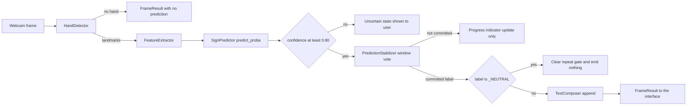

### 5.3 The shared code path — why train/serve skew is impossible

This is the key design win of the whole architecture, and it deserves to be stated bluntly.

The most common way a small computer-vision ML project fails after showing 99 percent test accuracy is **train/serve skew**: the notebook that produced the training vectors and the live loop that produces the inference vectors compute features slightly differently. Someone normalises by bounding-box height offline and by wrist distance online. Someone forgets the left-hand mirror in one of the two places. Someone reorders the normalisation steps. The model then receives vectors from a different distribution than it was fitted on, and accuracy collapses in a way that is extremely hard to debug, because both halves look correct in isolation.

This architecture removes the possibility structurally rather than by discipline. There is exactly **one** implementation of the normalisation chain and exactly **one** implementation of feature extraction, in `features/`, and **both** paths call it. `data_collection.collector` calls `FeatureExtractor.extract()` while recording the dataset; `inference.pipeline` calls the same `FeatureExtractor.extract()` on the live frame. There is no second code path to drift from the first.

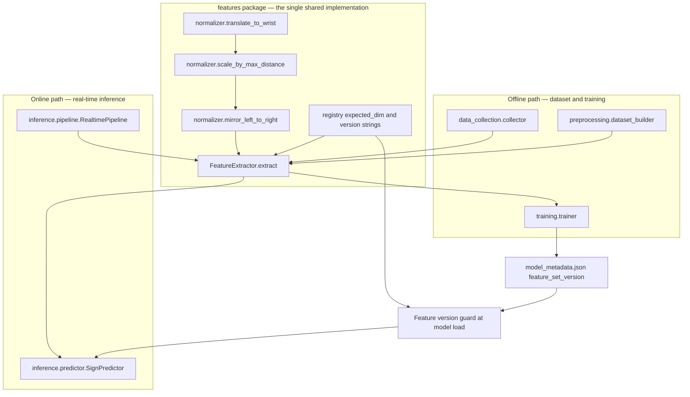

Three properties follow, and each is independently testable:

1. **Byte-identical vectors.** Given the same `HandLandmarks`, the offline and online paths produce the same `np.ndarray`. `tests/integration/` will assert this by running a fixed synthetic landmark array through both call sites and comparing with `np.array_equal`.
2. **Dimension agreement enforced at import.** `registry.expected_dim()` asserts the configured dimension against the `FEATURE_SETS` table, so a mismatch fails immediately rather than producing a silently wrong vector.
3. **Version agreement enforced at load.** Even a *correct* change to the feature definition is caught: bumping `features.feature_set_version` makes every previously trained model refuse to load until it is retrained (section 11).

The cost of this guarantee is one constraint that must be respected forever: `features/` must remain stateless and configuration-injected. If it ever caches per-session statistics or reads a fitted scaler, the two paths diverge again. That is why section 4.4 forbids filesystem access and per-call state in that package.

## 6. ML Pipeline

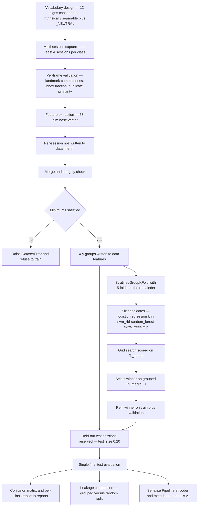

Notes on the pipeline shape:

- The scaler lives **inside** the `Pipeline`, not beside it. `training.scaler` is `standard`. Tree models do not need scaling, but keeping the scaler in the pipeline for every candidate means serialisation, loading and prediction are uniform across all six candidates — there is no per-model special case at serving time (ADR-008).
- The test set is touched exactly once, after model selection is complete. Selecting on the test set would make the reported macro F1 an optimistic estimate of itself.
- `split.report_leakage_comparison` is `true`, so Phase 7 reports the grouped and the random split scores side by side. The gap between them is the quantified leakage and is a deliberate talking point rather than an embarrassment to hide.
- Every measured number in this pipeline is currently `TBD — measure in Phase 6 and Phase 7`.

## 7. Real-Time Inference Pipeline

### 7.1 Frame to committed text

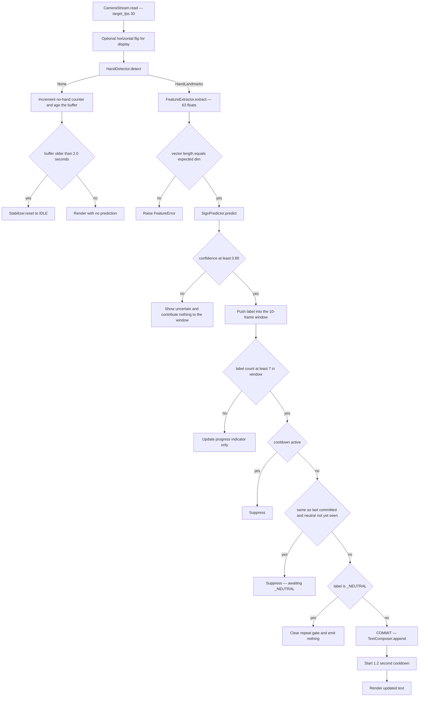

### 7.2 Stabiliser state machine

The stabiliser is the component that turns a continuous 30-frames-per-second stream of noisy per-frame guesses into discrete, deliberate words. Without it, a single held `HELLO` gesture emits `HELLO HELLO HELLO HELLO HELLO` at frame rate. With it, one held gesture emits one word.

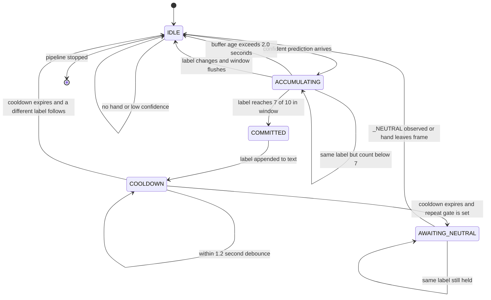

State semantics, with every number traced to `config.yaml`:

| State | Meaning | Governing keys |
| --- | --- | --- |
| `IDLE` | No candidate is accumulating. Window is empty or has just been flushed. | `max_buffer_age_seconds` 2.0 |
| `ACCUMULATING` | Confident frames are voting in the rolling window. | `window_size` 10, `min_votes_in_window` 7, `confidence_threshold` 0.80 |
| `COMMITTED` | A label has just won the vote. This is the single instant at which `update()` returns a label. | `smoothing` majority_vote |
| `COOLDOWN` | Debounce window during which no new commit can occur. | `cooldown_seconds` 1.2 |
| `AWAITING_NEUTRAL` | The same sign cannot be committed again until the hand passes through `_NEUTRAL` or leaves the frame. | `require_neutral_between_repeats` true, `neutral_class` `_NEUTRAL` |

The `AWAITING_NEUTRAL` state is what makes it possible to sign the same word twice in a row. Without it, either a held sign repeats endlessly, or a genuine repetition is impossible. The neutral class is what gives the state machine a well-defined, *trained* way to observe "the hand is deliberately at rest" rather than inferring it from an absence.

## 8. Module Responsibility Matrix

| Module | Owns | Must not do | Depends on |
| --- | --- | --- | --- |
| `config/schema.py` | Frozen dataclasses and per-block validation | Read files, hold defaults that duplicate YAML | stdlib only |
| `config/loader.py` | The only `yaml.safe_load` of `config.yaml`, cached | Mutate config, validate lazily | `schema`, `utils.paths`, PyYAML |
| `core/types.py` | `HandLandmarks`, `HandFrame`, `Prediction`, `Sample` | Contain behaviour beyond trivial derived properties | numpy |
| `core/camera.py` | Device open, warmup, read, timeout, deterministic release | Detect hands, draw, know about labels | cv2, numpy |
| `core/hand_detector.py` | MediaPipe graph lifecycle, hand selection policy | Normalise, judge training suitability | mediapipe, `types` |
| `data_collection/session.py` | `session_id` generation, `SessionMeta`, manifest rows | Capture frames, extract features | `types`, stdlib |
| `data_collection/collector.py` | Session orchestration, countdown, capture pacing, npz write | Merge sessions, split, train | `core`, `features`, `validator`, `config` |
| `data_collection/validator.py` | Per-frame acceptance rules and rejection reasons | Modify landmarks, write files | `types`, numpy |
| `features/normalizer.py` | The three normalisation steps as pure functions | Import cv2, sklearn or config; hold state | numpy |
| `features/extractor.py` | Assembly of the final float32 vector | Touch disk, import sklearn | `normalizer`, `registry`, `config.schema` |
| `features/registry.py` | `FEATURE_SETS`, dimension assertions, version strings | Compute features | stdlib |
| `preprocessing/dataset_builder.py` | Merge, integrity checks, minimum enforcement, X/y/groups | Extract features independently, fit a scaler | `features`, `config`, numpy |
| `preprocessing/splitter.py` | Every split in the codebase, grouped by session | Be bypassed by an ad-hoc split elsewhere | sklearn, numpy |
| `training/candidates.py` | Pipeline construction and grid prefixing | Fit anything | sklearn, `config` |
| `training/tuning.py` | Grouped CV search | Touch the test set | sklearn, `splitter` |
| `training/trainer.py` | Selection, refit, serialisation, metadata authoring | Read the camera, render | `candidates`, `tuning`, `evaluation`, joblib |
| `training/evaluation.py` | Metrics, confusion matrix, per-class report | Select the model | sklearn, matplotlib, seaborn |
| `inference/predictor.py` | Artifact load, version guard, single-sample predict | Extract features, stabilise | joblib, `features.registry`, `config` |
| `inference/stabilizer.py` | The five-state machine, window vote, cooldown, neutral gate | Format text, know about widgets | stdlib, `types` |
| `inference/pipeline.py` | Wiring of the live loop, `FrameResult` construction | Draw pixels, own a window | `core`, `features`, `predictor`, `stabilizer`, `text` |
| `text/composer.py` | Label accumulation, backspace, clear, display formatting | Receive `_NEUTRAL`, recognise anything | `config.schema` |
| `ui/theme.py` | Named colours and fonts from `ui.appearance` | Hard-code a hex value | `config.schema` |
| `ui/hud.py` | OpenCV overlay drawing | Decide thresholds, own the loop | cv2, `theme` |
| `ui/desktop_app.py` | CustomTkinter shell, event handlers, `after()` marshalling | Contain ML logic, block on I/O in a handler | customtkinter, Pillow, `pipeline`, `theme` |
| `utils/paths.py` | Project root and path resolution | Import any project package | pathlib |
| `utils/logging_setup.py` | Handler and formatter configuration | Log landmark coordinates at INFO | logging |
| `utils/seeding.py` | Global determinism | Be optional in any sampling script | random, numpy |
| `utils/exceptions.py` | The `SignLanguageError` hierarchy | Catch anything | stdlib |
| `scripts/*` | Argument parsing and one high-level call | Contain algorithmic logic | everything except `ui` |
| `app.py` | Process bootstrap and interface launch | Contain any recognition step | `config`, `utils`, `ui` |

## 9. Dependency Relationships

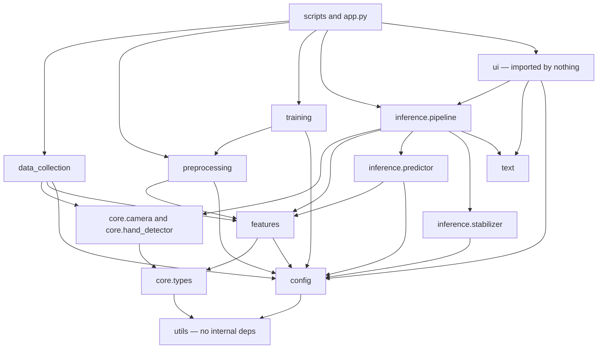

### 9.1 The three hard rules

1. **`utils/` and `core/` have no internal dependencies.** `utils/` imports nothing from `sign_language`, not even `config`. `core/` imports only `core.types`. This is why both are trivially unit-testable and why no cycle can start there. It is also why `CameraStream` and `HandDetector` take primitive arguments instead of an `AppConfig`.
2. **`ui/` may import `inference` and `text`, but nothing may import `ui/`.** The arrow into `ui` comes only from `app.py` and `scripts/run_realtime.py`, which are process entry points rather than library modules. Because no library module imports `ui`, the entire recognition path runs headlessly, which is what makes `benchmark.py` and camera-free integration tests possible.
3. **`features/` is imported by both `preprocessing/` and `inference/`.** This is the load-bearing edge of the whole diagram. It is the mechanism described in section 5.3, and it is the one edge that must never be duplicated, forked, or worked around with a local copy of a normalisation function.

### 9.2 How the rules are enforced

- Ruff's isort rules (`I`) plus `pyproject.toml`'s `src = ["src", "tests", "scripts"]` keep import blocks ordered and first-party imports identifiable in review.
- A Phase 12 test in `tests/unit/` will walk the AST of every module under `src/sign_language/` and assert that no module outside `app.py` and `scripts/` imports `sign_language.ui`, and that `utils` imports nothing first-party. An architectural rule that is not tested is a suggestion.
- Any exception must be recorded as a new ADR, not merged quietly.

## 10. Folder Structure

```
sign-language-to-text/
├── app.py                        entry point; loads config, launches desktop UI
├── config.yaml                   SINGLE SOURCE OF TRUTH for every tunable
├── requirements.txt              runtime deps with rationale; numpy<2 pinned
├── requirements-dev.txt          pytest, ruff, black, mypy, coverage
├── pyproject.toml                packaging plus pytest, ruff, black, mypy, coverage config
├── .gitignore                    excludes dataset and model binaries, keeps metadata
├── .gitattributes                line-ending and diff behaviour
├── docs/                         PRD, ARCHITECTURE, RULES, PHASES, DESIGN, MEMORY,
│   │                             DATASET, MODEL, TESTING, DEPLOYMENT, TROUBLESHOOTING, VIVA
│   └── assets/                   diagrams and screenshots referenced by the docs
├── data/
│   ├── raw/                      audit-trail JPEGs, 1 per 20 samples; never committed
│   ├── interim/                  per-session landmark captures as .npz  <-- UNIT OF SPLITTING
│   ├── processed/                merged and validated dataset
│   ├── features/                 final X.npy, y.npy, groups.npy
│   └── metadata/                 class registry and session manifests; COMMITTED to git
├── models/
│   └── v1/                       sign_classifier.joblib, label_encoder.joblib,
│                                 model_metadata.json (only the JSON is committed)
├── reports/
│   ├── figures/                  confusion matrices, comparison plots; committed as evidence
│   └── metrics/                  metrics JSON per run; committed as evidence
├── logs/                         rotating app.log, 5 MB x 3 backups; not committed
├── notebooks/                    exploration only; never the source of a reported number
├── src/
│   └── sign_language/
│       ├── config/               schema.py frozen dataclasses plus validate;
│       │                         loader.py load_config and cached get_config
│       ├── core/                 types.py HandLandmarks HandFrame Prediction Sample;
│       │                         camera.py CameraStream context manager;
│       │                         hand_detector.py HandDetector wrapping mediapipe hands
│       ├── data_collection/      session.py SessionMeta session_id manifest;
│       │                         collector.py DataCollector;
│       │                         validator.py SampleValidator
│       ├── features/             normalizer.py the three-step chain;
│       │                         extractor.py FeatureExtractor;
│       │                         registry.py FEATURE_SETS dim assertions versions
│       ├── preprocessing/        dataset_builder.py interim to X y groups;
│       │                         splitter.py grouped_split stratified_group_kfold
│       ├── training/             candidates.py build_candidate_pipelines;
│       │                         tuning.py; trainer.py; evaluation.py
│       ├── inference/            predictor.py SignPredictor;
│       │                         stabilizer.py PredictionStabilizer;
│       │                         pipeline.py RealtimePipeline
│       ├── text/                 composer.py TextComposer
│       ├── ui/                   theme.py; hud.py OpenCV overlay;
│       │                         desktop_app.py CustomTkinter
│       └── utils/                paths.py; logging_setup.py; seeding.py; exceptions.py
├── scripts/                      collect_data.py, build_dataset.py, train_model.py,
│                                 evaluate_model.py, run_realtime.py, benchmark.py
└── tests/                        conftest.py; unit/; integration/; model/
```

Structural notes:

- **`src/` layout** rather than a flat package. The installed package is imported the same way the tests import it, so a missing dependency or a bad relative import cannot be masked by the current working directory (ADR-011).
- **`data/metadata/` is the only committed part of `data/`.** The `.gitignore` excludes `data/raw`, `data/interim`, `data/processed` and `data/features` for size and, more importantly, privacy — the dataset is derived from recordings of the team's own hands.
- **`reports/` is committed.** Figures and metrics are the evidence for the submission and must be reviewable in the repository history.
- **`models/*.joblib` is not committed but `model_metadata.json` is.** A trained binary is a build output; the metadata is the audit trail.

## 11. Model Lifecycle

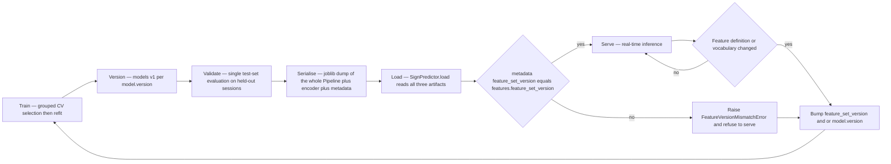

### 11.1 The three artifacts

From `config.yaml` → `model`: `version` is `v1`, `dir` is `models/v1`, and the files are:

| Artifact | Contents | Committed |
| --- | --- | --- |
| `sign_classifier.joblib` | The **entire** fitted sklearn `Pipeline`, including the `standard` scaler and the winning classifier | No |
| `label_encoder.joblib` | The fitted `LabelEncoder`, which is the authoritative mapping from integer index to class string | No |
| `model_metadata.json` | The audit trail, described below | **Yes** |

Serialising the whole `Pipeline` rather than the bare estimator is deliberate (ADR-008). If the scaler were saved separately, or worse recreated at load time, the serving path could apply a differently-fitted transform than training did — a second route to train/serve skew. One file, one object, one fitted transform.

The label encoder is what makes the vocabulary data rather than code. Nothing in `src/` contains a list of 13 class names; the serving path reads the classes from the encoder, and the collection path reads them from `dataset.classes`.

### 11.2 `model_metadata.json` contents

The metadata file is specified to record, at minimum:

- `feature_set_version` — copied from `features.feature_set_version` at training time; currently `"v1-base-63"`;
- `feature_dim` — the vector length the model was fitted on; currently 63;
- `model_version` — `model.version`, currently `v1`;
- `classes` — the ordered class list as seen by the label encoder;
- `selected_model` — which of the six candidates won;
- `best_params` — the winning hyperparameters;
- `cv_macro_f1` and the full secondary metric set — all `TBD — measure in Phase 6`;
- `test_macro_f1` and the per-class report — all `TBD — measure in Phase 7`;
- `random_seed` — 42, from `reproducibility.random_seed`;
- `split` — strategy, `test_size`, `val_size`, `cv_folds`;
- `n_samples`, `n_sessions`, `samples_per_class` — dataset provenance;
- `git_commit_sha` — the exact code that produced the artifact;
- `trained_at`, `sklearn_version`, `numpy_version`, `python_version` — environment provenance;
- `leakage_comparison` — grouped versus random split scores, `TBD — measure in Phase 7`.

### 11.3 The feature-version guard

`model.enforce_feature_version_match` is `true`. `SignPredictor.load()` compares `model_metadata.json`'s `feature_set_version` against the live `features.feature_set_version` and raises `FeatureVersionMismatchError` on any difference, refusing to serve.

This guard exists because the failure it prevents is otherwise silent and catastrophic. Suppose the team flips `features.use_extended` to `true` during the Phase 5 ablation. The live path now produces 83-dimensional vectors. A model trained on 63 dimensions would either raise an obscure sklearn shape error deep inside a transform, or — in the worse case where dimensions happen to match after some other edit — accept the vector and return confident nonsense. The guard converts an insidious accuracy regression into a loud, immediate, explanatory startup failure with a message that names the fix: retrain.

The guard is also the reason `feature_set_version` is a string like `"v1-base-63"` rather than a bare integer. The name states the feature set and its dimension, so the mismatch message is self-explaining.

## 12. Dataset Lifecycle

```mermaid
flowchart LR
    A["Operator starts a session for one label"] --> B["3 second countdown"]
    B --> C["Capture at 8 fps deliberately low"]
    C --> D["HandDetector per frame"]
    D --> E["SampleValidator — completeness bbox fraction duplicate similarity"]
    E -->|"reject"| E1["Count and show the reason, keep capturing"]
    E -->|"accept"| F["FeatureExtractor to a 63-dim vector"]
    F --> G["1 audit JPEG every 20 samples to data raw"]
    F --> H["Session buffer"]
    H --> I["One npz per session in data interim"]
    I --> J["Session manifest row in data metadata"]
    J --> K["DatasetBuilder merges all sessions"]
    K --> L{"at least 200 samples and at least 4 sessions per class and imbalance under 3x"}
    L -->|"no"| M["DatasetError — training refuses to run"]
    L -->|"yes"| N["data processed merged and validated"]
    N --> O["data features X.npy y.npy groups.npy"]
    O --> P["StratifiedGroupKFold grouped by session_id"]
    P --> Q["Every session lands wholly in train or wholly in val or wholly in test"]
```

### 12.1 Why `data/interim/` is one file per session

A session is one continuous recording: one person, one class, one lighting condition, one camera position, one sustained hand pose, with frames captured milliseconds apart. Everything that varies *between* sessions — the signer, the light, the exact hand angle, the background — is held constant *within* one. That makes the samples inside a session highly correlated with each other and only weakly representative of the samples in any other session.

Persisting each session as its own `.npz`, with its `session_id` baked in, means that correlation structure survives into the split stage instead of being dissolved by a merge. The alternative — appending every accepted sample to one growing CSV — destroys the provenance that the split depends on, and once destroyed it cannot be recovered.

### 12.2 Why the session is the unit of splitting

This is the single most consequential decision in the data pipeline, and `config.yaml` documents it at length.

The failure mode: `train_test_split` with a random shuffle scatters near-identical frames from the same session across train and test. Frame 41 of a session lands in train and frame 42 in test. Frame 42 is, for all practical purposes, the same image. The test set has therefore already been memorised. The reported accuracy approaches 99 percent, the team celebrates, and the system then fails the moment a different person signs to it in different light — because the model learned *this session's hand in this light*, not *this handshape*.

The fix: split by session, never by sample. Every sample carries a `session_id`; `split.group_column` is `session_id`; `sklearn.model_selection.StratifiedGroupKFold` guarantees every session lands entirely in one partition. `Stratified` keeps the 13-class balance across folds; `Group` keeps sessions intact. The resulting score is an honest estimate of performance on an unseen session, which is what a live user actually is.

Consequences that the configuration encodes:

- `dataset.sessions_per_class_minimum` is `4`. With fewer sessions per class there are not enough groups for a meaningful grouped split, so the guarantee becomes vacuous. This is marked `[CRITICAL]` in `config.yaml` for that reason.
- `dataset.samples_per_session_cap` is `80`, so one long session cannot dominate a class and re-introduce the correlation the split is designed to isolate.
- `dataset.capture_fps` is `8`, deliberately far below the camera's 30. Capturing a held pose at 30 fps yields near-duplicate frames that inflate the dataset without adding information — and inflated near-duplicates are exactly the fuel for leakage (ADR-010).
- `validation.max_duplicate_similarity` is `0.9995`, a cosine-similarity gate against the previous accepted sample, catching duplicates that the low capture rate still lets through.
- `split.report_leakage_comparison` is `true`, so the leaky random split is run *on purpose* alongside the correct one and the gap is reported as a finding.

> **Arithmetic tension to resolve in Phase 3.** `samples_per_class_target` is `330`, but `sessions_per_class_minimum` (4) multiplied by `samples_per_session_cap` (80) is 320. A class collected at the stated minimum number of sessions cannot reach the target. Either five or more sessions per class must be planned (the config comment does say "~6 sessions x ~55 samples", which is consistent with 330), or the cap must be raised. The minimum of 200 is satisfied either way.

## 13. Configuration Architecture

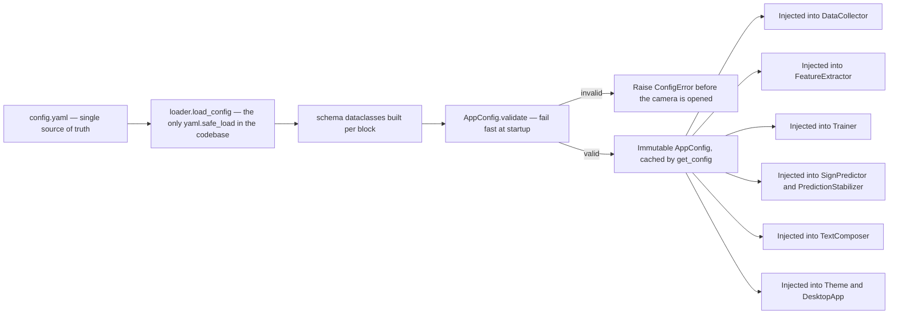

### 13.1 Why frozen dataclasses rather than a raw dict

A `dict` returned from `yaml.safe_load` has three defects that matter here. A typo in a key surfaces as a `KeyError` at the moment of use — possibly deep in a training run twenty minutes in, or mid-session with the camera open. There is no type information, so `mypy` cannot check anything and `config["camera"]["width"]` is `Any`. And a dict is mutable, so any module can quietly change a value and every later reader sees the change, which destroys the "single source of truth" claim.

Frozen dataclasses with `slots=True` fix all three: unknown keys fail at construction, every field is typed for `mypy` (which runs with `disallow_untyped_defs = true`), and mutation raises `FrozenInstanceError`.

### 13.2 Why validation happens at startup — fail fast

Validation is a single call, `AppConfig.validate()`, made immediately after loading and before any hardware is touched or any long-running work begins. It checks internal consistency, not just presence: that `base_dim` equals `num_landmarks * coords_per_landmark`; that `min_votes_in_window` does not exceed `window_size`; that `test_size + val_size` stays below 1.0; that `neutral_class` is a member of `classes`; that every name in `training.candidates` has a matching entry in `training.grids`; that `samples_per_class_minimum` does not exceed `samples_per_class_target`; that `feature_set_version` is a key in `FEATURE_SETS`; that every colour in `ui.appearance` is a valid hex string.

The alternative — discovering `min_votes_in_window: 15` with `window_size: 10` only when the stabiliser never commits and the interface appears frozen — costs a debugging session. The startup check costs milliseconds and produces a message naming the offending key.

### 13.3 Why only `loader.py` reads the file

If two modules each call `yaml.safe_load("config.yaml")`, there are two sources of truth that merely happen to agree today. They can diverge through a partial edit, a caching difference, or a different resolved path when the working directory changes. Funnelling every read through one cached function means the process has exactly one configuration object, loaded exactly once, and a reviewer can grep for `safe_load` to verify it.

Everything downstream receives configuration through its constructor. No module calls `get_config()` from inside a method — that would be a hidden global dependency and would make the object untestable without a config file on disk. Tests construct the dataclasses directly with the values the test needs.

### 13.4 Configuration audit — Phase 0

Before any code was written, `config.yaml` was audited against this document. **Twelve**
defects were found and **all twelve were corrected in Phase 0**. They are recorded here
because several were the kind of fault that produces silently wrong results rather than a
crash, and that is worth remembering.

| # | Defect found | Why it mattered | Resolution |
| --- | --- | --- | --- |
| 1 | `multi_hand_policy` was **unreachable code** | `max_num_hands` was `1`, so MediaPipe could never return a second hand. The "multiple hands detected" warning required by the PRD could never fire. | `max_num_hands` raised to `2`; we now detect two and select one via the policy |
| 2 | `multi_hand_policy` contradicted its own comment | Comment said "keep the highest-confidence hand"; the value was `largest`. | Value set to `highest_confidence`; comment aligned |
| 3 | Coordinate bounds existed only in a comment | Implementing `reject_out_of_bounds` would have required a hard-coded literal, violating the project's own no-hard-coding rule. | Explicit `validation.coord_min` and `validation.coord_max` keys added |
| 4 | `extended_dim` existed only in a comment | The 83-dim width could drift from the features that actually produce it. | Explicit `extended.extended_dim: 83` key, asserted at runtime by `registry.py` |
| 5 | **Unsatisfiable dataset arithmetic** | `sessions_per_class_minimum: 4` x `samples_per_session_cap: 80` = 320, which is *less than* the 330 target. A team collecting the documented minimum could never reach the documented target. | Cap raised to `90`, giving 4 x 90 = 360 >= 330. Constraint now checked at startup |
| 6 | `required_consecutive` was **misnamed** | The name implied a consecutive run; with `majority_vote` the behaviour is a count within the window. A future maintainer would have implemented the wrong rule. | Renamed to `min_votes_in_window` |
| 7 | `performance.measured.*` was the string `"TBD"` | A string where a number belongs breaks typed schema validation. | Changed to YAML `null` with a `TBD` comment |
| 8 | Model path was duplicated | `model.dir: "models/v1"` restated `paths.models` + `model.version`. Two sources of truth for one path. | `model.dir` removed; the path is derived by `utils/paths.py` |
| 9 | `hidden_layer_sizes` parses as lists | `MLPClassifier` requires tuples. | Documented; `candidates.py` converts before use |
| 10 | Version mismatch across files | `0.1.0-alpha` versus `0.1.0a0`. | Documented as the same version in semver and PEP 440 notation, to be kept in sync |
| 11 | **Handedness / flip ordering hazard** | `camera.flip_horizontal` combined with `features.mirror_left_to_right` is a trap: MediaPipe's handedness label is relative to the image it was given, so detecting on an already-flipped frame inverts every label the mirror step depends on — silently corrupting the dataset in a way no test on the saved arrays could detect. | New `camera.detect_before_flip: true` key. Detect on the original frame; flip only for display. Must be verified empirically in Phase 2 |
| 12 | **`YES` and `NO` were parsed as booleans, not class names** | Found by parsing `config.yaml` rather than reading it. YAML 1.1 resolves the bare tokens `YES` / `NO` / `ON` / `OFF` / `Y` / `N` to booleans, so `dataset.classes[3]` was Python `True` and `[4]` was `False`. Consequences: `data/raw/True/` and `data/raw/False/` directories, a `LabelEncoder` fitted on mixed `str` and `bool`, `neutral_class in classes` behaving unpredictably (`False == 0` matches surprising things), and two of the thirteen classes unnameable in any log message. Nothing would have raised an error at load time. | Every class name quoted, with a comment explaining why the quotes are load-bearing. A config test now asserts `all(isinstance(c, str) for c in classes)` |

The twelfth defect deserves a note on method: it was found by **parsing** the file with `yaml.safe_load`
and inspecting the resulting Python types, not by reading it. Eleven defects were visible to careful
reading; this one was invisible to reading and obvious to parsing, because the text `- YES` looks exactly
like what it was meant to be. Validating a configuration file means loading it, not proofreading it.

The recurring lesson: the dangerous configuration bug is not the one that crashes, it is the
one that quietly produces a plausible number. Defects 5, 6, 11 and 12 would all have shipped
working-looking software built on wrong data.

## 14. Error Handling Architecture

### 14.1 Exception hierarchy

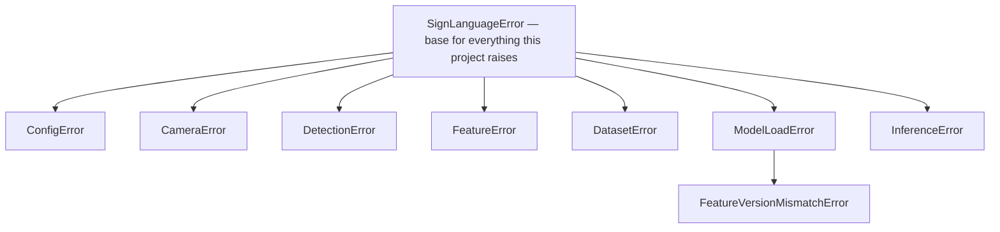

All live in `utils/exceptions.py`. Design rules:

- Every exception the project raises derives from `SignLanguageError`, so an entry point can `except SignLanguageError` to show a clean message and `except Exception` separately to log a genuine bug with a traceback. A user should never see a raw traceback for a condition the design anticipated.
- `FeatureVersionMismatchError` subclasses `ModelLoadError` so a caller that only cares "the model would not load" needs one handler, while a caller that wants to say "retrain the model" can catch the specific type.
- Exception messages name the offending value and the config key it came from. "Confidence threshold 1.4 is out of range; check inference.confidence_threshold" is actionable; "invalid value" is not.
- No bare `except:` and no silent `pass` anywhere. `ruff`'s bugbear rules (`B`) are enabled partly for this.

### 14.2 Failure mode matrix

| Failure mode | Detection point | Exception | User-facing message | Log level | Recovery action |
| --- | --- | --- | --- | --- | --- |
| Camera unavailable | `CameraStream.__enter__` when the device will not open | `CameraError` | "Camera not found. Close other apps using the webcam, or change camera.index in config.yaml." | ERROR | Do not launch the loop; keep the interface responsive with a Retry button; suggest indices 1 and 2 |
| Camera disconnected mid-run | `CameraStream.read` returns a falsy frame or exceeds `read_timeout_ms` of 2000 | `CameraError` | "Camera disconnected. Reconnect the device and press Start." | ERROR | Stop the loop, reset the stabiliser, release the device, preserve the composed text |
| No hand detected | `HandDetector.detect` returns `None` | none — normal state | "Show your hand to the camera." | DEBUG | Age the window; reset the stabiliser after `max_buffer_age_seconds` of 2.0 |
| Multiple hands detected | `HandDetector.detect` when more than `max_num_hands` are present | none — handled by policy | "More than one hand detected. Please use a single hand." | WARNING | Apply `multi_hand_policy`; keep running. Note that this path is unreachable while `max_num_hands` is 1 |
| Invalid or partial landmarks | `SampleValidator.check` during collection; shape assertion in `FeatureExtractor.extract` during inference | `FeatureError` | "Hand not fully visible. Move your whole hand into frame." | WARNING | Reject the frame and continue; count rejections and surface the reason during collection |
| Missing model file | `SignPredictor.load` when an artifact is absent | `ModelLoadError` | "No trained model found in models/v1. Run scripts/train_model.py first." | CRITICAL | Refuse to start recognition; the interface stays usable and points at the training script |
| Corrupted model file | `SignPredictor.load` when joblib raises or the object is not a `Pipeline` | `ModelLoadError` | "The model file could not be read. Retrain with scripts/train_model.py." | CRITICAL | Refuse to serve; log the underlying exception and the file size |
| Feature version mismatch | `SignPredictor.load`, comparing metadata against `features.feature_set_version` | `FeatureVersionMismatchError` | "This model was trained on feature set A but the app is configured for feature set B. Retrain the model." | CRITICAL | Refuse to serve. Never coerce, pad or truncate the vector |
| Corrupted dataset | `DatasetBuilder.build` on an unreadable npz, a dimension mismatch, an unknown label, or a missing `session_id` | `DatasetError` | "Dataset file <name> is invalid and was skipped." | ERROR | Skip and report the file, or abort the build if the remaining data falls below the minimums |
| Insufficient samples per class | `DatasetBuilder._enforce_minimums` against `samples_per_class_minimum` of 200 or `sessions_per_class_minimum` of 4 | `DatasetError` | "Class HELLO has 140 samples across 2 sessions; 200 samples across 4 sessions are required." | ERROR | Refuse to train and name the classes and sessions still needed |
| Unknown class | `DatasetBuilder` on a label absent from `dataset.classes`; `SignPredictor.load` on an encoder or metadata class set that disagrees with the config | `DatasetError` or `ModelLoadError` | "Label XYZ is not in the configured vocabulary." | ERROR | Reject the file, or refuse to serve when the model and config vocabularies differ |
| Low confidence | `RealtimePipeline.step` against `confidence_threshold` of 0.80 | none — normal state | "Uncertain — hold the sign steady." | DEBUG | Contribute nothing to the vote window; show the uncertain state and the confidence bar |
| Missing dependency | Import time in `app.py` and each script | `SignLanguageError` wrapping `ImportError` | "mediapipe is not installed. Use Python 3.10 or 3.11 and run pip install -r requirements.txt." | CRITICAL | Exit with a non-zero status and a message naming the package, the Python version constraint, and `docs/TROUBLESHOOTING.md` |
| Invalid config | `AppConfig.validate` at startup, before any hardware access | `ConfigError` | "config.yaml is invalid: min_votes_in_window 15 exceeds window_size 10." | CRITICAL | Exit immediately; never fall back to a hidden default |

### 14.3 Handling policy by caller

- **Library modules** raise; they never print, never call `sys.exit`, and never swallow.
- **Scripts** catch `SignLanguageError`, log it, print a single clean line, and exit non-zero.
- **The desktop interface** catches `SignLanguageError` in every event handler and renders the message in a status area using the `warning` or `danger` colour. An unhandled exception inside a Tkinter callback would otherwise be printed to a console the user may never see.
- **`RealtimePipeline.stop()`** runs in a `finally` block so the camera and the MediaPipe graph are released even on an abnormal exit. A held-open camera device is the most user-visible way this application can misbehave.

## 15. Concurrency and Threading

This section is deliberately concrete, because the interaction between a blocking camera read, a 30-frames-per-second target and a single-threaded Tkinter event loop is where a naive implementation of this application actually breaks.

### 15.1 The problem

`cv2.VideoCapture.read()` blocks. At `camera.target_fps` of 30 it blocks for roughly 33 ms per call, and more when the driver stalls. Tkinter — and therefore CustomTkinter — runs a single-threaded event loop, and any call that blocks that loop freezes every widget, including the Stop button. Calling `read()` directly from a Tkinter callback produces a visibly stuttering interface and, worse, an application that cannot be stopped while the camera is misbehaving.

### 15.2 The design

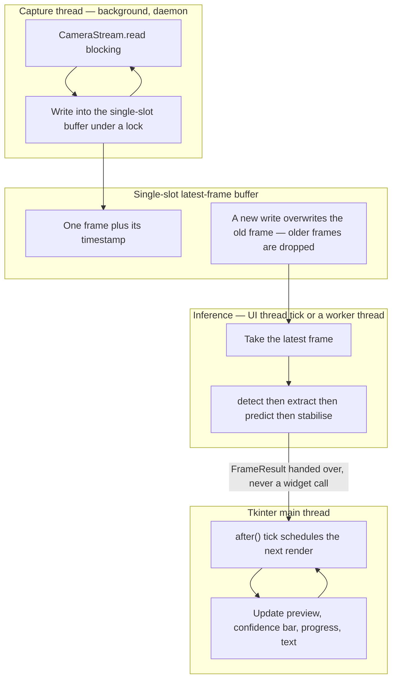

The concrete rules:

1. **Capture runs on a background daemon thread.** It does nothing but loop on `read()` and publish the result. A daemon thread cannot keep a closing process alive if the camera hangs.
2. **The buffer holds exactly one frame.** Not a queue. A new frame overwrites the previous one under a short lock.
3. **Inference runs on the UI thread's `after()` tick in the baseline design.** If Phase 13 measurement shows the per-frame cost exceeds the render budget, inference moves to a second worker thread that publishes a `FrameResult` into a similar single-slot slot. The pipeline is written so this move requires no change to `features/`, `inference/` or `text/` — only to who calls `step()`.
4. **Tkinter is not thread-safe.** Every widget update is marshalled onto the main thread with `widget.after(...)`. No background thread ever touches a widget, a `StringVar`, or a canvas. This is not a stylistic preference: cross-thread Tkinter calls fail intermittently and unreproducibly, which is the worst possible failure mode to debug the night before a demonstration.
5. **Shutdown is explicit and ordered.** Signal the capture thread to stop, join it with a timeout, then release the camera and close the MediaPipe graph in a `finally` block.

### 15.3 Frame-dropping policy

The policy is: **display and recognition latency matter, frame completeness does not.**

A queue would preserve every frame, but if consumption is slower than production the queue grows, latency grows with it, and the user sees the interface reacting to a gesture they finished a second ago. That is far worse than skipping frames. With a single-slot buffer the consumer always sees the *most recent* frame, so the worst case is a lower effective recognition rate, not rising lag.

Dropping frames is also harmless for the recognition logic. The stabiliser needs `min_votes_in_window` (7) confident frames out of a `window_size` (10) window; at the acceptance target of `min_fps` 15 that is roughly two thirds of a second of held gesture, which is well within a natural hold. Dropped frames extend the time to commit slightly; they never corrupt a decision. And `max_buffer_age_seconds` of 2.0 discards a stale window rather than letting old votes decide a new gesture.

During **data collection** the policy is different and stricter: `dataset.capture_fps` is `8`, so the collector paces itself deliberately rather than consuming every available frame. There, near-duplicate frames are actively harmful (section 12.2), so dropping is the intent rather than a concession.

All timing figures in this section are targets. Measured values are `TBD — measure in Phase 13`.

## 16. Performance Architecture

### 16.1 Where the time goes

The per-frame budget, in descending expected cost:

| Stage | Expected relative cost | Notes |
| --- | --- | --- |
| MediaPipe hand detection | Dominant | `model_complexity` is `0` (lite) specifically to keep this affordable; `[TUNE:Phase-13]` |
| Camera read and colour conversion | Moderate | Blocking; moved off the UI thread (section 15) |
| Frame resize for display and the BGR to Tkinter image conversion | Moderate | `ui.video_target_width` is `720`, smaller than the 1280 capture width |
| Landmark drawing overlay | Small | `ui.show_landmarks` is `true`; can be disabled |
| Feature extraction — 63 floats of arithmetic | Negligible | Pure numpy on 21 points |
| Classifier `predict_proba` on one sample | Small | A single 63-dimensional row through a small sklearn pipeline |
| Stabiliser update | Negligible | A `deque` operation and a counter |

The architectural consequence: the tuning levers that matter are `hand_detection.model_complexity`, the capture resolution, and the display resize — not the classifier. This is a strong argument for the classical-ML choice (ADR-002): the recognition step is not the bottleneck, so spending complexity there would buy nothing in latency.

### 16.2 What is measured

`scripts/benchmark.py` is specified to measure and write to `reports/metrics/`:

- end-to-end frames per second sustained over a fixed run length;
- per-stage wall-clock timings for detect, extract, predict and render;
- inference latency, defined as feature vector in to `Prediction` out;
- cold model load time from process start to `SignPredictor.load()` returning;
- peak resident memory;
- time to commit, from the first confident frame to the label reaching the composer.

### 16.3 Targets and measured values

From `config.yaml` → `performance`:

| Metric | Target | Measured |
| --- | --- | --- |
| `min_fps` | 15 | `TBD — measure in Phase 13` |
| `max_inference_latency_ms` | 50 | `TBD — measure in Phase 13` |
| `max_model_load_ms` | 2000 | `TBD — measure in Phase 13` |
| End-to-end latency | not specified as a target | `TBD — measure in Phase 13` |

`config.yaml` records these under `performance.measured` as the literal `TBD`, and the header comment forbids replacing a `TBD` with a guess — only with a number produced by a script in this repository. This document holds to the same rule: **no performance figure appears anywhere above.**

### 16.4 Levers available if a target is missed

In the order they should be tried:

1. lower the capture resolution from 1280 x 720;
2. reduce `ui.video_target_width` below 720;
3. disable `ui.show_landmarks`;
4. run inference on every Nth frame rather than every frame, compensating with `window_size`;
5. raise `hand_detection.model_complexity` only if accuracy, not speed, is the deficit — it costs time;
6. move inference to a worker thread as described in section 15.2.

Each lever is a configuration change, not a code change. That is the point of principle 2.2.

## 17. Security and Privacy Architecture

### 17.1 Threat model

This is a single-user, offline desktop application with no authentication, no network surface and no multi-tenancy. The realistic risks are not attackers; they are **inadvertent disclosure of biometric-adjacent data** — webcam imagery and hand landmarks of the team members who recorded the dataset — and **failure to release the camera**, which is what a user actually notices and distrusts.

### 17.2 Controls

- **Fully local processing.** Detection, feature extraction, inference and text composition all run in-process on the user's machine. No frame, landmark, feature vector or predicted label leaves the process.
- **No network calls at runtime.** No runtime dependency in `requirements.txt` is an HTTP client, and no module imports `requests`, `urllib`, `http.client` or `socket`. A Phase 12 test will assert this by scanning imports, so the property is verified rather than assumed.
- **Camera opened only on explicit user action.** The device is not opened at import time or at window creation. It opens when the user presses Start and is released deterministically via `CameraStream.__exit__` and a `finally` block in `RealtimePipeline.stop()`. The camera indicator light going out when the user presses Stop is a visible, checkable privacy property.
- **Dataset stays on disk and out of git.** `.gitignore` excludes `data/raw`, `data/interim`, `data/processed` and `data/features`, plus `*.npz`, `*.npy`, `*.jpg` and `*.png` anywhere under `data/`. Only `data/metadata/` — the class registry and session manifests, which are small JSON and CSV containing no imagery — is committed. The reasoning is recorded in the `.gitignore` itself: pushing the dataset to a hosted remote would publish the team's likeness.
- **Model binaries not committed, metadata committed.** A `.joblib` is a build output; `model_metadata.json` is the audit trail a grader wants.
- **Landmark coordinates logged at DEBUG only.** `logging.level` is `INFO`, so coordinates are absent from logs by default. A log file is the most likely accidental leak, because it is small, text, and easy to attach to an email or paste into a bug report.
- **Audit images are minimal by design.** `dataset.save_debug_images` is `true` but `debug_image_every_n` is `20`, so roughly one frame in twenty is kept as a JPEG in `data/raw/`. That is enough to audit a session and far less imagery than storing every frame.
- **No secrets.** There are no credentials, tokens or keys in the design. `.gitignore` nonetheless excludes `.env`, `secrets.yaml`, `*.pem` and `*.key` as a precaution.

### 17.3 The OneDrive exposure — flagged honestly

This repository currently lives at a path under a **OneDrive-synced folder**. `.gitignore` prevents the dataset from reaching a *git* remote, but **`.gitignore` has no effect whatsoever on OneDrive.** OneDrive syncs the filesystem. Every `.npz` of hand landmarks and every audit JPEG written to `data/raw/` will be uploaded to Microsoft's cloud, silently, as it is created — including imagery of team members' hands.

This is a genuine privacy gap between the stated intent ("this data never leaves the machine") and the actual behaviour, and it is worth stating plainly rather than leaving implicit.

Recommended mitigations, in order of preference:

1. **Move the repository out of OneDrive entirely**, for example to `C:\dev\sign-language-to-text`. This is the cleanest fix and also removes a class of file-locking and path-length problems that OneDrive causes for Python virtual environments and `__pycache__`.
2. **Keep the dataset outside OneDrive** and point at it with a path override. Add a `data_root` style override in a git-ignored `config.local.yaml` (already excluded by `.gitignore`) pointing `paths.data_*` at a non-synced location such as `C:\slt-data\`.
3. **Exclude `data/` from sync** using OneDrive's "Free up space" or folder-exclusion settings, and verify the exclusion held after the next sync cycle rather than assuming it did.

Whichever is chosen, the outcome must be recorded in `docs/MEMORY.md` and `docs/DEPLOYMENT.md`, and the choice should be made in Phase 1 — **before** Phase 3 starts writing real recordings of real people to disk.

### 17.4 Residual risks accepted

- Audit JPEGs in `data/raw/` contain identifiable imagery by construction; the mitigation is the low sampling rate, the git exclusion, and keeping the folder off any sync service.
- `model_metadata.json` is committed and contains dataset counts and session counts. It contains no imagery and no personal identifiers, which is why this is acceptable.
- The application does not encrypt anything at rest; it inherits whatever disk encryption the host provides. For a single-user student project on a personal machine, this is a reasonable stopping point, and it is stated rather than glossed over.

## 18. Scalability and Extensibility

Each extension point below lists the exact steps. Where a step requires touching Python, that is called out explicitly, because the design goal is to keep the common case code-free.

### 18.1 Add a new static single-hand sign

**Code changes: none.**

1. Choose a handshape that is *intrinsically* separable from the existing 12 — differing by finger configuration or palm orientation, not by where the hand sits in the frame. Position is discarded by translation normalisation, so a sign defined by location is unlearnable by construction.
2. Append the label to `dataset.classes` in `config.yaml`.
3. Run `scripts/collect_data.py` for the new label across at least `sessions_per_class_minimum` (4) separate sessions, ideally 6 as the target implies, reaching at least `samples_per_class_minimum` (200) samples.
4. Run `scripts/build_dataset.py`. It will enforce the minimums and the `fail_on_class_imbalance_ratio` of 3.0.
5. Run `scripts/train_model.py`, then `scripts/evaluate_model.py`.
6. Inspect the new confusion matrix for the row and column of the new class. If it confuses with an existing sign, the handshape choice was wrong — fix the vocabulary, not the model.

### 18.2 Add a two-handed sign

**Code changes: moderate, in `core`, `features`, `config`.**

1. Raise `hand_detection.max_num_hands` to 2 in `config.yaml`.
2. Extend `HandDetector.detect` to return an ordered pair of `HandLandmarks` rather than one, with a deterministic ordering rule (canonical handedness first, then by wrist x) so the feature vector is stable.
3. Extend `FeatureExtractor` to emit a two-hand vector: both normalised hands plus inter-hand relational features such as wrist-to-wrist distance and relative orientation.
4. Add a new entry to `FEATURE_SETS` and bump `features.feature_set_version`. The version guard then correctly refuses every existing model.
5. Decide the mixed-vocabulary policy: either pad single-hand samples with a zero block and a presence flag, or train a separate head. This decision must be recorded as an ADR.
6. Recollect or augment the dataset and retrain, since the feature dimension has changed for every class.

### 18.3 Add dynamic or temporal signs

This is the largest extension and changes the shape of the problem from classification of a vector to classification of a sequence.

**What must change:**

1. **A sequence buffer replaces the single frame.** Instead of one 63-dimensional vector, the model consumes a window of T consecutive frames — a `(T, 63)` array. A new component, a `SequenceBuffer`, maintains a rolling `deque` of normalised frames with a stride, and emits a fixed-length window.
2. **The temporal window becomes configuration.** New keys: sequence length T, stride, and a padding policy for short gestures.
3. **The model changes.** Options in increasing cost: (a) flatten `(T, 63)` and keep a classical model, which works for short T but scales badly and ignores temporal structure; (b) hand-craft temporal summary statistics such as per-dimension mean, variance, and start-to-end delta, keeping scikit-learn; (c) an LSTM or GRU sequence model in a deep learning framework, which is the natural fit but introduces TensorFlow or PyTorch, a `numpy` version conflict with the `<2.0` pin (ADR-009), a much larger install, and a training loop this project currently does not need.
4. **The stabiliser changes fundamentally.** The current five-state machine detects a *held pose*. A dynamic sign is defined by *motion*, so "held steady for 7 of 10 frames" is the wrong commit criterion. Gesture segmentation — detecting the start and end of a motion, probably via a motion-energy threshold around a neutral rest state — replaces the majority vote.
5. **The dataset changes.** Samples become variable-length clips rather than frames. `data/interim/` would hold one npz per *gesture instance* rather than per session-of-frames, though the session would remain the grouping key for splitting.
6. **`features/` mostly survives.** The per-frame normalisation chain is unchanged; a temporal layer is added above it. That the most delicate code survives the largest planned extension is evidence the boundary was drawn in the right place.

This is explicitly future work, not V1 scope.

### 18.4 Swap the classifier

**Code changes: minimal, and often none.**

Any estimator that satisfies scikit-learn's `fit` / `predict` / `predict_proba` contract drops in. To add a candidate: add its name to `training.candidates`, add a grid under `training.grids`, and add the one-line constructor to `build_candidate_pipelines`. Because the whole `Pipeline` is serialised (ADR-008), the serving path is entirely unaffected — `SignPredictor` never names a model class. Re-running training with the new candidate is sufficient.

An estimator without `predict_proba` cannot be used unaffected, because `confidence_threshold` of 0.80 requires calibrated probabilities. Such a model would need `CalibratedClassifierCV` wrapped around it inside the pipeline.

### 18.5 Add text-to-speech

`text.enable_text_to_speech` already exists as a `false` flag, so the extension point is reserved. Steps: add a `text/speaker.py` with a small interface, back it with an offline engine such as `pyttsx3` (an online voice would violate section 2.5), have the interface call it when a label is committed, and speak on a background thread so synthesis never blocks the render loop. `text/composer.py` stays unchanged; speech is a *sink* on the committed-label event, not a change to composition.

### 18.6 Port the interface to web or mobile

The architecture makes this a presentation-layer swap for one specific reason: nothing imports `ui/`, and `RealtimePipeline` returns data rather than drawing.

- **Web.** Wrap `RealtimePipeline.step()` behind a local HTTP or WebSocket endpoint and serve a browser client. Note that this immediately contradicts the offline-first principle (2.5) if the server is not strictly localhost, so it needs its own ADR. Frames would either be captured server-side, or captured in the browser and posted — the latter sending imagery over a wire, which is precisely the privacy property V1 avoids.
- **Mobile.** MediaPipe has native Android and iOS solutions, but scikit-learn does not run on either. The classifier would need exporting to ONNX or reimplementing — feasible for logistic regression or a small tree ensemble, awkward for an SVM with an RBF kernel. The `features/` normalisation chain would have to be reimplemented in the target language, and *that reimplementation is exactly the train/serve skew the architecture currently prevents*. It would need a conformance test comparing the two implementations on fixed inputs.

### 18.7 Scale the dataset

The current design targets roughly 4,000 samples (13 classes at 330 target each is about 4,300) held in memory as a single `X.npy`. This is comfortable. It stops being comfortable somewhere around a million samples, at which point `X.npy` should become a memory-mapped array or a columnar format such as Parquet, and `DatasetBuilder` should stream sessions rather than concatenating them. Nothing else in the architecture changes, because everything downstream of `data/features/` already consumes arrays through explicit index arrays from the splitter.

## 19. Architectural Decision Records

Status values: **Accepted** means decided and binding. **Provisional** means decided for V1 but expected to be revisited. Every future change that contradicts an accepted ADR requires a new ADR that supersedes it.

| ID | Decision | Status | Context | Alternatives considered | Consequences |
| --- | --- | --- | --- | --- | --- |
| ADR-001 | Use MediaPipe hand landmarks as the model input, not raw image pixels through a CNN | Accepted | A 21-point skeleton is a compact, background-invariant, lighting-tolerant representation. It reduces the input from roughly 900,000 pixel values at 1280 x 720 to 63 floats, which is what makes a 4,000-sample dataset sufficient. | Raw-image CNN trained from scratch; transfer learning on a pretrained backbone; classical hand segmentation by skin colour with contour features | Positive: tiny dataset suffices; training takes seconds not hours; runs on CPU; background and clothing colour are irrelevant. Negative: total dependency on MediaPipe detecting the hand at all — no landmarks means no prediction, with no graceful degradation. Information outside the skeleton, such as texture, is discarded. |
| ADR-002 | Use classical scikit-learn models, not deep learning | Accepted | Inputs are 63 low-dimensional, already-normalised, geometrically meaningful floats — precisely the regime where SVMs and tree ensembles are strong and neural networks offer no advantage. The dataset is roughly 4,000 samples. The course is a Machine Learning course. | Keras or PyTorch MLP; 1-D CNN over the landmark vector; fine-tuning a vision transformer | Positive: seconds-long training enables real experimentation across 6 candidates and full grids; models are interpretable, with tree feature importances and inspectable support vectors; CPU-only; no CUDA, and no `numpy` 2.x conflict. Negative: no path to temporal modelling without adding a framework later (section 18.3); accuracy ceiling is set by feature quality rather than model capacity. |
| ADR-003 | Build the interface with CustomTkinter for the desktop app and an OpenCV HUD for the earlier phase — not Streamlit | Accepted | The application needs a sustained 15-plus frames-per-second local camera preview with low-latency interaction. Streamlit's execution model reruns the script on interaction and is built for request-response dashboards; live webcam work needs a third-party component and still fights the model. | Streamlit; Gradio; PyQt or PySide; plain Tkinter; a browser client over a local WebSocket | Positive: native window with a real event loop; smooth preview; no browser, no server, no port; `ui.appearance` gives a genuinely modern dark theme; OpenCV HUD in Phase 8 lets the pipeline be demonstrated before any GUI work exists. Negative: Tkinter is not thread-safe, so all widget updates must be marshalled through `after()` (section 15); desktop-only, so no shareable link; `tkinter` ships with the CPython installer rather than pip, which is a documented setup trap. |
| ADR-004 | Do not apply rotation normalisation — `features.rotation_invariant` stays `false` | Accepted | The V1 vocabulary distinguishes `PLEASE` from `THANK_YOU` by palm orientation alone, and `YES` from `NO` by thumb direction. Both pairs share a handshape and differ only in rotation. | Full 3-D rotation normalisation via a wrist-to-middle-finger reference frame; in-plane rotation only; rotation as an extra feature rather than a normalisation | Positive: preserves the only signal that separates two of the six vocabulary pairs; simpler and faster feature code. Negative: the model becomes sensitive to camera tilt and to the signer's wrist angle, so collection protocol must include natural angle variation across sessions or the model will overfit one wrist pose. The vocabulary is now coupled to this choice — it cannot be reversed without redesigning `PLEASE`, `THANK_YOU`, `YES` and `NO`. |
| ADR-005 | Canonicalise handedness by mirroring left hands to right — `features.mirror_left_to_right` is `true` | Accepted | A left-handed and a right-handed rendering of the same sign are near mirror images. Treating them as distinct would either double the required dataset or make the model fail for half of all users. | Train separate left and right models; add handedness as a feature and let the model learn it; collect both hands for every class and rely on capacity | Positive: one model serves both hands; effectively doubles the usable data per class; a left-handed user works without any extra collection. Negative: correctness depends entirely on MediaPipe's handedness label being right, and that label is defined relative to the image — so it interacts with `camera.flip_horizontal: true` and must be validated in Phase 2 (section 4.2). Genuinely asymmetric future signs could not be represented. |
| ADR-006 | Include an explicit `_NEUTRAL` rejection class in the trained vocabulary | Accepted | A classifier over 12 real signs must assign one of them to every input, including a hand hanging relaxed at rest. Confidence thresholding alone is unreliable, because models are frequently confident about out-of-distribution inputs. | Confidence threshold only; a one-class novelty detector such as `OneClassSVM` alongside the classifier; predicting only when motion energy is low | Positive: "no sign right now" becomes a *trained, high-confidence* prediction rather than an inference from an absence; gives the stabiliser a well-defined observable for `AWAITING_NEUTRAL`, which is what makes repeating a word possible; measurably reduces spurious output. Negative: 13 classes instead of 12, and `_NEUTRAL` is the most visually diffuse class, so it needs deliberately varied collection; every consumer must filter it, and `text.strip_underscores` interacts awkwardly with its leading underscore (section 4.8). |
| ADR-007 | Split the dataset by session with `StratifiedGroupKFold`, never randomly by sample | Accepted | Frames within one recording session are near-duplicates. A random split scatters them across train and test, so the test set is already memorised, accuracy reads about 99 percent, and the system collapses in real use. | `train_test_split` with shuffle; `StratifiedKFold` without groups; `GroupKFold` without stratification; hold out one whole person | Positive: reported scores estimate performance on an unseen session, which is what a live user is; the correct number is defensible in a viva. Negative: reported accuracy will be *visibly lower* than a leaky baseline, which must be explained rather than apologised for; requires at least 4 sessions per class, so collection is more work; fold sizes are uneven because sessions differ in length. Mitigation: `report_leakage_comparison` is `true`, so the gap is measured and presented as a finding. |
| ADR-008 | Serialise the entire sklearn `Pipeline`, scaler included, as one artifact | Accepted | The scaler is fitted state. If it is saved separately or reconstructed at load time, the serving path can apply a differently-fitted transform than training did — a second, subtler route to train/serve skew. | Save the bare estimator and refit the scaler at load; save scaler and estimator as two files; export to ONNX; export coefficients to JSON | Positive: one file, one fitted object, one transform, uniform across all six candidates with no per-model special case; swapping the classifier needs no serving-path change. Negative: the `.joblib` is bound to the `scikit-learn` and `numpy` versions that wrote it, so `requirements.lock.txt` becomes part of the artifact's contract and a version bump requires a retrain; the binary is not human-inspectable, which is why `model_metadata.json` exists beside it. |
| ADR-009 | Pin `numpy>=1.24,<2.0` | Accepted | MediaPipe 0.10.x and the contemporaneous `opencv-python` wheels were compiled against the `numpy` 1.x C ABI. Installing `numpy` 2.x alongside them produces the import-time error "A module that was compiled using NumPy 1.x cannot be run in NumPy 2.x". | Allow `numpy` 2.x and hope wheels catch up; build MediaPipe from source; drop MediaPipe for a different landmark library | Positive: the single most important line in `requirements.txt`; prevents an import-time crash that presents as an unrelated failure and costs hours; combined with `requires-python = ">=3.10,<3.12"` it keeps the environment reproducible. Negative: the project cannot use `numpy` 2.x features or any library that requires them; effectively forecloses adding a modern deep learning framework in the same environment, reinforcing ADR-002; the pin will eventually need revisiting as MediaPipe moves on. |
| ADR-010 | Capture the dataset at 8 frames per second, far below the camera's 30 | Accepted | Capturing a held pose at 30 fps yields frames milliseconds apart that are near-identical. That inflates the dataset size without adding information, and near-duplicates are exactly the fuel for the leakage ADR-007 exists to prevent. | Capture at the full 30 fps and deduplicate afterwards; capture at 30 and subsample; capture one frame per key press | Positive: about 200 to 330 genuinely varied samples per class instead of thousands of clones; smaller files and faster builds; the signer naturally shifts slightly between captures, which is real variation; complements `max_duplicate_similarity` of 0.9995. Negative: a session takes longer in wall-clock time for a given sample count, so collection is more tedious; if the signer holds perfectly still, 8 fps still produces near-duplicates, which is why the similarity gate is also needed. |
| ADR-011 | Use a `src/` layout package rather than a flat top-level package | Accepted | With a flat layout, `import sign_language` resolves from the current working directory, so tests can pass against uninstalled, half-broken code and a missing dependency or bad relative import stays hidden until someone else clones the repository. | Flat top-level `sign_language/` directory; a single-file script; a namespace package | Positive: tests import the package the same way a user would; `pyproject.toml` sets `pythonpath = ["src"]` for pytest and `where = ["src"]` for setuptools, so both paths are explicit; the package is installable and cleanly separated from `scripts/`, `tests/` and `docs/`. Negative: requires an editable install or the pytest `pythonpath` setting, which is one more setup step and a common source of "ModuleNotFoundError" confusion for a first-time contributor. |
| ADR-012 | Make `config.yaml` the single source of truth, loaded once into frozen dataclasses | Accepted | Magic numbers scattered through source make tuning a search problem and make two modules able to disagree about the same value. Phase 9 tuning would be unworkable. | Constants in a `constants.py`; environment variables; command-line arguments only; a plain dict from `yaml.safe_load` | Positive: every tunable is in one reviewable file with a rationale comment; frozen dataclasses give `mypy` real types under `disallow_untyped_defs`; a typo fails at startup rather than mid-run; tuning is a one-file edit. Negative: more boilerplate than a dict — one dataclass per block plus validation; config must be threaded through constructors rather than reached for globally, which is more verbose but is what keeps modules testable. |
| ADR-013 | Enforce a feature-set version guard at model load | Accepted | A feature definition can change while an old model file remains on disk. The resulting mismatch is either an obscure sklearn shape error or, worse, silently wrong predictions at unchanged dimensionality. | Trust the dimension check alone; warn rather than refuse; auto-retrain on mismatch; ignore the problem | Positive: converts a silent accuracy regression into a loud, immediate, self-explaining startup failure that names the fix; makes the Phase 5 extended-feature ablation safe to run. Negative: every feature change forces a retrain, with no override; `feature_set_version` must be bumped by hand, and forgetting to bump it defeats the guard, so the discipline moves rather than disappears. |
| ADR-014 | Decouple capture from rendering with a background thread and a single-slot latest-frame buffer | Accepted | `cv2.VideoCapture.read()` blocks for roughly 33 ms at 30 fps. Calling it from a Tkinter callback freezes the interface, including the Stop button. A queue instead grows unboundedly when consumption lags, so latency rises. | Read directly on the UI thread; a bounded `queue.Queue`; an unbounded queue; `asyncio`; multiprocessing | Positive: a slow interface never blocks the camera and never accumulates lag, because the consumer always sees the newest frame; the Stop button stays responsive even when the driver stalls; frame drops cost recognition rate, not correctness, and the stabiliser tolerates them. Negative: frames are genuinely discarded, so effective recognition rate is below capture rate; requires a lock and a careful ordered shutdown; Tkinter's thread-unsafety means every widget update must go through `after()`, which is easy to forget and fails intermittently when forgotten. |

## 20. Known Architectural Limitations

Stated plainly, because a design document that lists only strengths is not a design document.

1. **Static poses only.** The architecture classifies a single frame. Any sign defined by motion — and a large fraction of real sign language is — is outside the model's expressive capacity, not merely untrained. Section 18.3 describes what would have to change.
2. **Single hand only.** `hand_detection.max_num_hands` is `1`. Two-handed signs cannot be represented at all.
3. **Twelve signs plus neutral is a demonstration vocabulary, not a language.** It is enough to prove a method and to compose short phrases; it is not a communication tool, and the document should not imply otherwise.
4. **Total dependency on MediaPipe.** If MediaPipe fails to find the hand — poor light, motion blur, heavy occlusion, an unusual skin tone or glove — the system produces nothing, with no fallback path. This is the single largest availability risk and it is entirely outside the project's control.
5. **The vocabulary is coupled to the normalisation choices.** Because translation and scale are normalised away and rotation is not (ADR-004), a sign defined by *where* the hand is cannot be learned, and the `PLEASE` / `THANK_YOU` and `YES` / `NO` pairs depend on rotation being preserved. Changing the normalisation chain invalidates the vocabulary design, not just the model.
6. **No true out-of-distribution rejection.** `_NEUTRAL` plus a 0.80 confidence threshold handles the resting hand and low-confidence frames, but a hand making a gesture that is genuinely outside all 13 classes will still be assigned to the nearest one, possibly with high confidence.
7. **Frames are dropped by design.** Effective recognition rate is below capture rate (ADR-014). Acceptable for held static poses; would be a real problem for fast dynamic gestures.
8. **Small, team-collected dataset.** Roughly 4,000 samples from a handful of people in a handful of lighting conditions. Whatever macro F1 Phase 7 reports is an estimate of performance on an unseen *session by the same small group of signers*, not on the general population. This limitation should be stated in every reported result.
9. **The desktop interface is not thread-safe by nature.** Tkinter's constraint is a permanent source of subtle bugs that only appear under load, and the mitigation is discipline plus review rather than a compiler-enforced guarantee.
10. **Windows-first.** `camera.backend` accommodates `dshow` and `msmf`; `ui.font_family` is `"Segoe UI"`. The code should run on Linux and macOS, but nothing in the plan verifies it, so cross-platform support is aspiration rather than a tested property.
11. **The `numpy<2` pin is a dead end for deep learning.** ADR-009 and ADR-002 reinforce each other. Adding a temporal model later will require either a second environment or unpinning `numpy` and re-verifying MediaPipe, and that cost should be acknowledged now rather than discovered later.
12. **Reproducibility is seeded, not bit-exact.** `random_seed` 42 and `set_global_seed()` make runs stable in practice, but BLAS threading in scikit-learn can still produce last-digit differences across machines. Reported numbers are reproducible to a sensible precision, not to the bit.
13. **Nothing is implemented.** As of this revision, `src/sign_language/` contains only `__init__.py` files. Every performance figure, every accuracy figure and every claim about behaviour in this document is a specification awaiting Phases 1 through 14.
14. **The OneDrive path is an unresolved privacy gap.** Documented and mitigable (section 17.3), but not yet mitigated. It must be closed in Phase 1, before real recordings exist.

## 21. Revision History

| Version | Date | Author | Change |
| --- | --- | --- | --- |
| 0.1 | 2026-08-26 | Team | Initial architecture baseline for Phase 0. Defines the four layers, the eleven packages and their contracts, the shared-feature-code guarantee against train/serve skew, the five-state stabiliser, the session-grouped split rationale, the exception hierarchy and failure-mode matrix, the threading model, 14 ADRs, and 14 known limitations. All measured values are `TBD`. No code exists yet. |

### Planned revisions

| Version | Trigger | Expected content |
| --- | --- | --- |
| 0.2 | End of Phase 2 | Resolve the flip-versus-detect handedness ordering; confirm `multi_hand_policy` semantics and whether `max_num_hands` rises to 2; confirm the `core` interfaces against working code |
| 0.3 | End of Phase 5 | Extended feature set results; `FEATURE_SETS` populated with both version strings; the `extended_dim` assertion in place |
| 0.4 | End of Phase 7 | Selected model, real macro F1, the leakage comparison figure, and the final `model_metadata.json` schema |
| 0.5 | End of Phase 9 | Tuned stabilisation values and the state machine as actually implemented |
| 0.6 | End of Phase 13 | All performance `TBD` values replaced by measurements from `scripts/benchmark.py`; the final threading decision on whether inference moved to a worker thread |
| 1.0 | End of Phase 14 | Final architecture as built, with every deviation from this baseline recorded as a superseding ADR |
