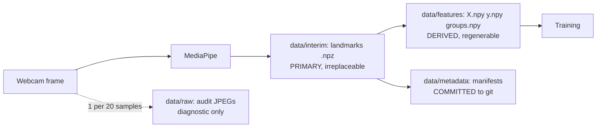
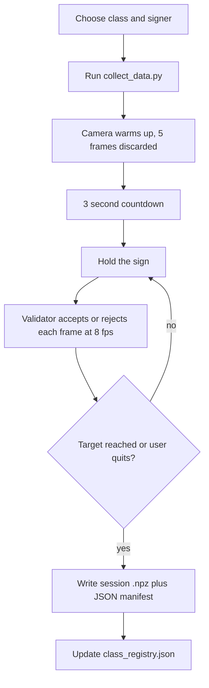
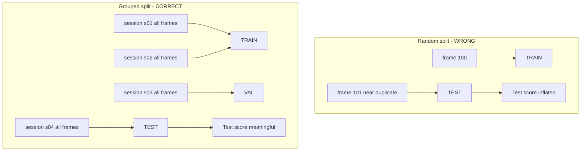

# DATASET.md — Dataset Design, Collection Protocol and Leakage Prevention

**Project:** Real-Time Sign Language to Text Conversion System
**Document version:** 1.0
**Status:** **NO DATA HAS BEEN COLLECTED YET.** This document is the plan and the protocol.
**Last updated:** 2026-08-26

> Every numeric value here mirrors `config.yaml`, which is the single source of truth. If they
> disagree, `config.yaml` is correct.
>
> **Read §9 (Data Leakage Prevention) before you touch anything else in this file.** It is the most
> important section in the entire project documentation, and it is the section most likely to be
> examined in the viva.

---

## 1. Status and honesty statement

| Item | Value |
|---|---|
| Data collected so far | **None.** 0 samples, 0 sessions. |
| Classes defined | 13 (12 signs + 1 rejection class) |
| Collection tool | Not yet implemented — Phase 3 |
| Samples per class (actual) | **TBD — populate in Phase 3** |
| Sessions per class (actual) | **TBD — populate in Phase 3** |
| Total dataset size on disk | **TBD — populate in Phase 3** |
| Rejection-rate statistics | **TBD — populate in Phase 3** |

No number in this document describes data that exists. Targets and minimums are design decisions;
counts and measurements are `TBD` until a script in this repository produces them.

---

## 2. Design philosophy

Four principles drive every decision below.

**Store the most reusable representation, not the most convenient one.** The thing we save should let
us change our minds later without re-recording anything.

**Make the unit of data collection the unit of statistical independence.** A "session" — one
continuous recording of one class by one person — is the atom of this dataset. Samples inside a
session are correlated; sessions are (approximately) independent. Every downstream decision, above
all the train/test split, respects that boundary.

**Design the vocabulary around the features, not despite them.** Our normalisation deliberately
destroys certain information. Signs that differ only in the destroyed information are unlearnable. So
we choose the vocabulary knowing what the features preserve.

**Prefer a small honest dataset to a large deceptive one.** Capturing at 30 FPS for 30 seconds gives
900 "samples" that contain perhaps 20 samples' worth of information. We capture at 8 FPS across
multiple sessions instead, and we report the real number.

---

## 3. What we store, and why

The brief asked explicitly whether to save raw images, hand landmarks, or processed numerical
features. The honest answer is that these are not mutually exclusive, and each serves a different
purpose — but exactly one of them must be the **primary artifact**.

### 3.1 The three candidates compared

| Property | Raw images (JPEG/PNG) | **Hand landmarks (21×3)** | Final feature vectors (63-dim) |
|---|---|---|---|
| Size per sample | ~50–200 KB | ~252 bytes (`float32`) | ~252 bytes |
| Size for 13 classes × 330 | ~1–8 GB | ~1–2 MB | ~1–2 MB |
| Privacy exposure | **High** — contains faces, room, clothing | **Low** — 63 numbers, not visually identifying | **Low** |
| Information retained | Everything | Hand geometry only | Hand geometry, minus position and scale |
| Can re-engineer features later? | Yes (re-run MediaPipe) | **Yes (recompute from landmarks)** | **No — normalisation is lossy and irreversible** |
| Can switch to a CNN later? | Yes | No | No |
| Training speed | Slow (decode + detect every epoch) | Fast (load an array) | Fastest |
| Depends on MediaPipe version? | No | Yes (landmarks were produced by it) | Yes |
| Human-inspectable? | Yes, trivially | Only via plotting | Barely |
| Regenerable if deleted? | No — the moment is gone | No | **Yes — from landmarks** |

### 3.2 The decision

**Hand landmarks are the primary stored artifact.** Raw images are kept as a *sparse audit trail*.
Final feature vectors are treated as a *derived, disposable build product*.

The decisive argument is the "re-engineer features later" row. Consider what happens in Phase 5 when
we test whether adding fingertip distances helps:

- If we had stored only final 63-dim vectors, we could not compute fingertip distances — the
  normalisation has already collapsed the information we would need, and the mapping is not
  invertible. We would have to **re-record the entire dataset**.
- Because we store landmarks, we recompute a new feature set from the same recordings in seconds.

That single property is worth more than everything else in the table. Landmarks sit at exactly the
right level of abstraction: raw enough to be reusable, processed enough to be small and private.

**Why not raw images as primary?** Three reasons. Size — gigabytes, in a OneDrive-synced folder, in a
git repository we must keep clean. Privacy — images of real people's faces and homes are the one
artifact in this project that is genuinely sensitive. Training cost — decoding and running MediaPipe
on thousands of images for every experiment would dominate our iteration time, and we would be
recomputing exactly the same landmarks every time.

**Why keep any images at all?** Because when a class trains badly, the first question is "what did we
actually record?", and 63 numbers cannot answer it. One JPEG per 20 samples (`debug_image_every_n: 20`)
gives roughly 16 images per session — enough to see that the hand was framed correctly, the lighting
was reasonable, and the sign was the one we intended. They also supply the figures for the final
report. That is a few megabytes total: a rounding error for enormous diagnostic value.

**Why treat feature vectors as disposable?** Because `data/features/X.npy` is a *build output*, like a
compiled binary. It is fully determined by `data/interim/` plus the feature configuration. Treating it
as precious would tempt us to hand-edit it; treating it as disposable forces the pipeline to stay
reproducible. If `X.npy` is deleted, one command rebuilds it. If `data/interim/` is deleted, the
project is over.

### 3.3 The resulting three-tier layout



`data/processed/` exists in the tree as a reserved slot for a future intermediate stage (for example,
cached per-session normalised arrays if rebuilds ever become slow). In V1 it stays empty, which is
better than pretending it has a job.

---

## 4. Vocabulary design — the 13 classes

### 4.1 The classes

| # | Label | Handshape (as performed in this project) | Distinguishing property |
|---|---|---|---|
| 1 | `HELLO` | Open palm, all 5 fingers extended and **spread**, palm to camera | Maximum finger spread |
| 2 | `THANK_YOU` | Flat palm, fingers extended and **together**, palm to camera, fingers up | Extended but unspread |
| 3 | `PLEASE` | Flat palm, fingers together, palm **rotated to face upward** | Same shape as THANK_YOU, different palm orientation |
| 4 | `YES` | Closed fist, thumb extended **up** | Fist + thumb up |
| 5 | `NO` | Closed fist, thumb extended **down** | Fist + thumb down |
| 6 | `SORRY` | Closed fist, thumb **tucked**, knuckles to camera | Fist, no thumb |
| 7 | `HELP` | Thumb up + index extended sideways (L shape) | Two-finger right angle |
| 8 | `NAME` | Index + middle extended, held **together** | Two fingers, touching |
| 9 | `WATER` | Index + middle + ring extended and **spread** (W shape) | Three fingers, spread |
| 10 | `EAT` | All fingertips curled toward the thumb (claw / pinch) | Fingertips converge |
| 11 | `I_LOVE_YOU` | Thumb + index + pinky extended, middle + ring folded | Non-adjacent fingers |
| 12 | `YOU` | Index finger only, extended | Single finger |
| 13 | `_NEUTRAL` | Relaxed / idle hand — **emits no text** | Rejection class |

### 4.2 Why *these* signs — the constraint most students miss

This is the part to be ready to explain.

Our feature pipeline sets `translation_invariant: true`, which subtracts the wrist landmark from every
other landmark. That is desirable: it means a sign is recognised the same way whether the hand is on
the left or right of the frame. But it has a consequence that is easy to overlook:

> **Absolute hand position is completely destroyed.** After normalisation, the feature vector contains
> no information whatsoever about *where* in the frame the hand was.

`scale_invariant: true` does the same for size: dividing by the maximum distance from the wrist erases
*how far* the hand was from the camera.

So any two signs that differ **only** by hand location or distance are, after normalisation,
represented by *identical* vectors. No classifier can separate them — not a better model, not more
data. The information is gone before the model ever sees it.

This matters because many real sign languages distinguish signs precisely by location relative to the
body — a handshape at the forehead versus the chin can be two different words. **We cannot represent
that distinction at all**, because we track only the hand, and we then discard its position.

Therefore every class above was chosen to differ **intrinsically**: by finger configuration or palm
orientation, both of which survive normalisation. Worked examples:

- **HELLO vs THANK_YOU** — both have five extended fingers. They differ by *spread*: relative
  distances between fingertips change, so the normalised vectors differ. **Separable.**
- **THANK_YOU vs PLEASE** — identical handshape, differing only in palm orientation. This is
  separable **only because `rotation_invariant: false`**. Had we added rotation normalisation, we
  would have made these two classes mathematically identical. This is the single clearest reason
  rotation invariance is switched off, and it is a good viva answer to "why didn't you normalise
  rotation, isn't that standard?" — because standard is not correct here.
- **NAME vs WATER** — two fingers together versus three fingers spread. Clearly separable.
- **YOU vs HELP** — one finger versus two at a right angle. Separable.
- **YES / NO / SORRY** — **the hard case.** All three are closed fists. The only difference is the
  thumb: up, down, or tucked. Nearly all 21 landmarks are in almost the same relative arrangement;
  only the four thumb landmarks (1–4) move. This is flagged **now, before any data exists**, as the
  most likely confusion group. Phase 7 must inspect these three rows of the confusion matrix
  specifically. Mitigations, in order: exaggerate thumb extension in the protocol; collect extra
  samples for the trio; test whether the extended feature set (which includes fingertip distances)
  helps; if all fail, drop `SORRY` — it is the first descope candidate in `PHASES.md`.

### 4.3 Why `_NEUTRAL` exists

A standard classifier is a **closed-set** model: given any input, it outputs a probability
distribution over exactly the classes it was trained on, and those probabilities sum to 1. It has no
way to say "none of these".

Without a neutral class, a hand resting on the desk would be forced into one of the 12 real signs.
The model would pick whichever is geometrically nearest — and, worse, it would often be *confident*,
because the resting hand is far from all training data and softmax/vote-based confidence is not a
reliable distance measure. The text buffer would fill with garbage whenever nobody was signing.

`_NEUTRAL` gives the model a legitimate place to put "nothing is happening". It is a **rejection
class**, and `text/composer.py` explicitly emits no text for it. Combined with
`confidence_threshold: 0.80`, we get two independent guards: the model can actively say "this is
neutral", and the threshold can suppress anything it is unsure about.

This is not full open-set recognition — a genuinely novel gesture may still be misclassified with high
confidence. Being clear about that limit is part of the honest story.

### 4.4 An essential honesty caveat about ISL

**These are not authenticated Indian Sign Language signs.** They are static handshapes chosen by us,
inspired by ISL and ASL conventions, and adapted to be (a) static, (b) single-handed, and (c)
distinguishable under our normalisation.

Real ISL differs in ways that matter:

- Many ISL signs are **two-handed**; we track one hand.
- Many are **dynamic**, defined by movement; we capture single frames.
- **Facial expression and body posture** carry grammatical meaning; we ignore both.
- ISL has its own grammar and word order; it is not signed Hindi or signed English.

So the correct description of this project is: *a static single-hand gesture recognition system
demonstrated on an ISL-inspired vocabulary.* Claiming to "recognise Indian Sign Language" would be
false, and an examiner who knows the field would catch it immediately. Volunteering the limitation
before being asked is a much stronger position.

---

## 5. Data card

A compact summary in the style used for published datasets.

| Field | Value |
|---|---|
| Name | SLTT-V1 (Sign Language To Text, version 1) |
| Version | 1.0 (not yet created) |
| Collected by | The three project members, signer IDs `HT` / `BT` / `ST` (roster in `PRD.md` §1) |
| Purpose | Training a static single-hand sign classifier for an academic project |
| Modality | MediaPipe hand landmarks derived from webcam video |
| Classes | 13 (12 signs + `_NEUTRAL`) |
| Sample = | One accepted frame's 21×3 landmark array |
| Target size | 330 samples/class → ~4,290 samples |
| Minimum size | 200 samples/class → 2,600 samples (training refuses below this) |
| Actual size | **TBD — Phase 3** |
| Signers | 3 (all team members) |
| Sessions per class | ≥ 4 required; ~6 planned |
| Capture rate | 8 samples/second |
| Resolution of source video | 1280×720 |
| Feature dimensionality | 63 (base); 83 (optional extended) |
| Storage format | `.npz` per session, `float32` |
| Total disk footprint | landmarks ~2 MB + audit images ~50 MB (est.) — **TBD** |
| Licence | Not publicly released. Internal academic use only. |
| Known biases | 3 signers; similar age group; controlled indoor lighting; plain backgrounds; right-hand dominant |
| Ethical review | Not applicable (all subjects are the authors, who consent) |

---

## 6. Directory layout and file formats

### 6.1 Layout

```text
data/
├── raw/                       # sparse audit JPEGs — gitignored
│   └── HELLO/
│       └── HELLO__S1__s01__20260901-142530__0000.jpg
├── interim/                   # PRIMARY ARTIFACT — per-session landmarks — gitignored
│   └── HELLO/
│       ├── HELLO__S1__s01__20260901-142530.npz
│       └── HELLO__S2__s02__20260902-101500.npz
├── processed/                 # reserved for future use; empty in V1
├── features/                  # DERIVED build output — gitignored
│   ├── X.npy                  # float32 (N, 63)
│   ├── y.npy                  # int32   (N,)
│   ├── groups.npy             # <U40    (N,)   session_id per sample
│   └── build_manifest.json
└── metadata/                  # COMMITTED to git — no personal data, no coordinates
    ├── class_registry.json
    └── sessions/
        └── HELLO__S1__s01__20260901-142530.json
```

Naming convention, used everywhere:

```text
{CLASS}__{signer_id}__s{NN}__{YYYYMMDD-HHMMSS}
```

Double underscores separate fields so that a single underscore can appear inside a class name
(`THANK_YOU`, `I_LOVE_YOU`) without ambiguity. The timestamp guarantees uniqueness even if two
sessions get the same index. `signer_id` is a pseudonym (`S1`, `S2`, `S3`) — the mapping to real names
lives in `PRD.md`, not in filenames, so the dataset carries no personal identifier.

### 6.2 Session `.npz` schema

```python
np.savez_compressed(
    path,
    landmarks=...,    # float32, shape (N, 21, 3) — RAW MediaPipe output, NOT normalised
    handedness=...,   # <U5,     shape (N,)       — "Left" or "Right" per sample
    confidence=...,   # float32, shape (N,)       — MediaPipe detection score
    timestamps=...,   # float64, shape (N,)       — monotonic seconds since session start
)
```

Stored as JSON in the archive's metadata sidecar (or as extra 0-d arrays):

```json
{
  "session_id": "HELLO__S1__s01__20260901-142530",
  "class_label": "HELLO",
  "signer_id": "S1",
  "capture_fps": 8,
  "n_samples": 55,
  "n_rejected": 12,
  "rejection_reasons": {"incomplete_landmarks": 4, "duplicate": 6, "bbox_too_small": 2},
  "config_hash": "sha256:...",
  "app_version": "0.1.0-alpha",
  "mediapipe_version": "0.10.14",
  "created_at": "2026-09-01T14:25:30+05:30",
  "notes": "afternoon daylight, plain wall"
}
```

Two design points worth stating explicitly:

**We store RAW landmarks, not normalised ones.** Normalisation happens in `features/`, at build time.
If we normalised at collection time, changing the normalisation would require re-recording — exactly
the mistake §3 exists to avoid.

**We store `config_hash`.** If someone changes `capture_fps` or the validation bounds halfway through
collection, the sessions are no longer comparable. The hash makes that detectable instead of
invisible.

### 6.3 `class_registry.json` (committed)

```json
{
  "feature_set_version": "v1-base-63",
  "classes": [
    {"label": "HELLO", "index": 0, "emits_text": true,
     "description": "open palm, five fingers spread, palm to camera"},
    {"label": "_NEUTRAL", "index": 12, "emits_text": false,
     "description": "relaxed idle hand, rejection class"}
  ],
  "sessions_summary": {"HELLO": {"sessions": 0, "samples": 0}},
  "last_updated": "TBD"
}
```

Counts start at zero and are updated by `build_dataset.py`. They are never edited by hand.

---

## 7. Collection protocol — the runbook

This is meant to be followed literally, not read once.

### 7.1 Environment setup (once per session)

1. **Background:** plain wall, no moving objects, no other people in frame.
2. **Lighting:** bright and reasonably even. Avoid a strong window directly behind you — backlight
   makes the hand a silhouette and MediaPipe loses landmarks.
3. **Distance:** roughly 50–80 cm from the camera. The hand should occupy noticeably more than 4% and
   well under 90% of the frame (the validator enforces both).
4. **Clothing:** avoid sleeves or patterns that match skin tone at the wrist.
5. **Camera:** wipe the lens. Close Zoom, Teams, and any browser tab holding the camera.
6. **Reference:** keep the handshape table (§4.1) visible. Consistency across sessions matters more
   than anyone's opinion of the "correct" handshape.

### 7.2 Per-session procedure



During capture, **vary within the session**: shift the hand slightly left/right/up/down (position is
normalised away, but it changes what MediaPipe sees and how it estimates landmarks), move slightly
nearer and further, tilt the wrist a few degrees each way, and let the fingers relax and re-form the
shape a few times. What you must **not** do is freeze like a statue — a rigid hold produces 55
near-identical frames, most of which the duplicate filter will reject anyway, and the ones that
survive teach the model that the sign has exactly one appearance.

**Vary across sessions** — this is where real diversity comes from: different signer, different time
of day, different lighting (daylight vs room light), different background, different clothing,
different room if possible. **Record at least one session in the room where the demo will happen** if
that room is known.

### 7.3 The session budget

```text
Per class:  3 signers × 2 sessions each = 6 sessions
            6 sessions × ~55 accepted samples = ~330 samples   ✓ target
Per class minimum acceptable: 4 sessions × 50 = 200 samples    ✓ hard floor

Whole dataset: 13 classes × 6 sessions = 78 sessions
```

**Honest time estimate.** One session of ~55 accepted samples at 8 fps is about 7 seconds of pure
capture — but the real cost is everything around it: launching the tool, the countdown, re-taking
after rejections, re-reading the handshape, and switching classes. Budget **2–4 minutes per session**
in practice. That gives **roughly 2.5 to 5 hours of total collection time**, spread over at least two
different days (which is required anyway, for lighting diversity).

Split three ways, that is about **1–1.5 hours per person**. This is the single most tedious phase of
the project and the one most likely to be quietly under-done. Under-collecting is worse than
collecting slowly: the 200-sample floor exists to make under-collection fail loudly at training time
rather than silently as a mediocre model.

### 7.4 Special protocol for `_NEUTRAL`

`_NEUTRAL` must be collected **differently** from the other twelve, and the difference is important.

For a real sign, we want *low* variance — every sample should look like that sign. For a rejection
class, we want *high* variance — it must cover as much of "not a sign" space as possible.

Collect `_NEUTRAL` samples of: a relaxed open hand hanging naturally; a loosely curled hand; the hand
in transition between two signs (deliberately caught mid-movement); the hand at the edge of frame;
the hand rotated away from the camera; fingers in a shape that is not any of the 12 (e.g. only the
ring finger up); the hand holding a pen; the hand resting palm-down.

The reason is structural. `_NEUTRAL` is the class that has to absorb everything the user does when
they are *not* signing, and that set is enormous and unbounded. A `_NEUTRAL` class collected as one
fixed pose would only recognise *that* pose as neutral, and every other non-sign would still be forced
into a real sign — defeating the entire purpose. Because of this breadth, expect `_NEUTRAL` to have
the lowest recall of any class, and expect it to be the most common source of confusion. That is
acceptable and expected; it should be reported, not hidden.

Consider collecting **more** than 330 `_NEUTRAL` samples — but respect
`fail_on_class_imbalance_ratio: 3.0`, which caps the largest class at 3× the smallest.

---

## 8. Quality assurance and validation rules

Enforced by `data_collection/validator.py` on every frame, before it is accepted.

| Rule (config key) | Value | What it catches | Action |
|---|---|---|---|
| `require_all_landmarks` | true | MediaPipe returned a partial hand (occlusion, clipping) | Reject; count `incomplete_landmarks` |
| `reject_out_of_bounds` + `coord_min` / `coord_max` | −0.5 / 1.5 | Hand partly outside the frame, so landmarks are extrapolated guesses | Reject; count `out_of_bounds` |
| `min_hand_bbox_fraction` | 0.04 | Hand too far away — landmark precision collapses at small pixel scales | Reject; count `bbox_too_small` |
| `max_hand_bbox_fraction` | 0.90 | Hand too close — fingers clipped at the frame edge | Reject; count `bbox_too_large` |
| `max_duplicate_similarity` | 0.9995 | Frame nearly identical to the previous accepted one | Reject; count `duplicate` |
| detection confidence | `min_detection_confidence: 0.7` | MediaPipe itself is unsure | Reject |
| hand count | `max_num_hands: 2` + `multi_hand_policy` | Two hands in frame | Warn; select one by highest confidence |

**On the coordinate bounds.** MediaPipe normalises x and y to roughly [0, 1] relative to the image,
but it *can* return values slightly outside that range when the hand is partly off-screen — it
extrapolates. A little slack is normal and healthy, so we do not reject at exactly 0 and 1. Far
outside means the hand is clipped and those landmarks are fiction. Hence explicit `coord_min: -0.5`
and `coord_max: 1.5` config keys rather than magic numbers buried in code. Note that **z is not
bounded this way** — MediaPipe's z is a relative depth estimate on a different, weakly-constrained
scale, so applying x/y bounds to it would be wrong.

**On the duplicate threshold.** 0.9995 cosine similarity is deliberately very close to 1. We are not
trying to remove similar samples — similar samples are the whole point of collecting many. We are
removing *sensor-identical* ones: consecutive frames where the hand genuinely did not move and the
only difference is camera noise. Those add file size and zero information. Setting this too
aggressively (say 0.99) would reject legitimate variation and make collection maddening.

The live HUD shows accepted count, target, and a rejection breakdown, so the signer can correct
themselves immediately. A session that rejects 80% of frames is telling you something — usually that
the hand is too far away or the lighting is bad — and you want to know that during the session, not
afterwards.

---

## 9. Data leakage prevention — the core of this project

This section is the intellectual centre of the project. If you can explain only one thing in the viva,
explain this.

### 9.1 The simple version

Imagine studying for an exam using a practice paper, and then the real exam turns out to contain the
same questions. You score 95%. Your score measures *memory*, not *understanding*, and it predicts
nothing about a different exam.

Data leakage is that situation, created accidentally, inside a machine learning pipeline. The test set
is supposed to stand in for "data the model has never seen". If information from the test set has
already reached the model during training, the test score is inflated and meaningless.

### 9.2 Why our project is unusually exposed to it

We capture at 8 frames per second while the signer *holds* a pose. Consider two consecutive accepted
samples: they are the same hand, the same person, the same lighting, the same background, the same
pose, taken about **125 milliseconds apart**. Numerically, their 63-dim feature vectors are nearly
identical.

Statistically, they are **not two independent samples**. They are two measurements of one event —
closer to one sample measured twice than to two samples.

Now suppose we call `train_test_split(X, y, test_size=0.2, random_state=42)`. It shuffles all ~4,290
rows and takes 20% for testing. For any given test sample, its immediate temporal neighbours — nearly
identical vectors — are overwhelmingly likely to be sitting in the training set.

So the model is tested on data it has effectively already memorised. A k-NN classifier would find a
near-duplicate at distance ≈ 0 and be right almost every time. Reported accuracy would likely land
somewhere in the high nineties.

Then you run `app.py`, sign at the camera, and it performs noticeably worse. Nothing broke. The
number was never measuring what it claimed to measure.

> **This is the most common serious flaw in student gesture-recognition projects.** Reported accuracy
> of 98–99% on a self-collected webcam dataset is very often this bug rather than a good model. Being
> able to name it, explain it, and show that you prevented it is worth more than a high number.

### 9.3 Which kind of leakage this is

Precision matters here, because an examiner may push on it.

| Type | Mechanism | Present here? |
|---|---|---|
| **Target leakage** | A feature encodes the label (e.g. a `session_folder_name` column) | **No** — our features are geometry only |
| **Preprocessing leakage** | A transform is fitted on all data before splitting, so test statistics reach training | **Prevented** — see §9.4 |
| **Sample-dependence leakage** | Train and test rows are not independent; near-duplicates straddle the split | **This is our main risk** |

Someone may object: "no label information touched the features, so how is it leakage?" The answer is
that leakage does not require label contamination. It requires the **independence assumption between
train and test to be violated**. Holdout evaluation is valid only if test samples are independent of
training samples. Near-duplicate frames violate that directly. The information that leaks is not the
label — it is *the sample itself*, appearing on both sides of the split in near-identical form.

### 9.4 Preprocessing leakage — the second, quieter one

`StandardScaler` computes a mean and standard deviation and subtracts/divides. Fit it on the full
dataset before splitting, and the scaler's parameters encode information from the test rows; every
training row is then transformed using statistics that partly describe the test set. The effect is
smaller than sample-dependence leakage but it is real, and it is trivially avoidable.

Our fix is structural rather than procedural:

```python
Pipeline([
    ("scaler", StandardScaler()),          # refitted inside every CV fold
    ("clf", SVC(probability=True)),
])
```

Because the scaler is a **step inside the Pipeline**, scikit-learn refits it on the training portion
of each cross-validation fold automatically. There is no way to get this wrong by forgetting a step,
which is exactly why we prefer it to "remember to fit the scaler after splitting". Serialising the
Pipeline as one artifact has a second benefit: inference cannot possibly apply a different scaler than
training used, because they are the same object.

### 9.5 The fix for sample dependence: group by session

Every sample carries a `session_id`. The rule is:

> **All samples from one session go entirely to train, or entirely to validation, or entirely to
> test. A session is never split.**

Since near-duplicates only occur *within* a session, keeping sessions intact guarantees no
near-duplicate pair straddles the boundary. The test set then consists of *recordings the model has
never seen* — a different sitting, different lighting, different hand placement. That is a meaningful
estimate of live performance.

scikit-learn supports this directly:

| Purpose | Estimator | Why |
|---|---|---|
| Held-out test split | `GroupShuffleSplit` | Respects groups |
| Model selection CV | `StratifiedGroupKFold` | Respects groups **and** keeps class balance per fold |
| Signer generalisation | `LeaveOneGroupOut` with `groups = signer_id` | Stricter protocol, §9.8 |

`StratifiedGroupKFold` requires scikit-learn ≥ 1.3, which is why `requirements.txt` pins that floor.



### 9.6 Why `capture_fps` is 8, and why `sessions_per_class_minimum` is 4

Two config values exist purely to serve this section.

**`capture_fps: 8`** attacks the problem at the source. At 30 fps, holding a pose for 10 seconds gives
300 samples that are almost all redundant — inflating the dataset without adding information, and
maximising the number of near-duplicate pairs. At 8 fps we get 80 samples with meaningfully more
variation between them. Fewer, better samples. This also keeps the duplicate filter from doing all the
work.

**`sessions_per_class_minimum: 4`** is a hard requirement for grouped CV to be possible at all, not a
style preference. The arithmetic:

- `cv_folds: 5` means we need to partition sessions into 5 folds.
- With 4 sessions per class you cannot form 5 folds each containing that class.
- With ~6 sessions per class (our plan: 3 signers × 2 sessions), 5-fold grouped CV is feasible, with
  each fold holding out roughly 1 session per class.

So the practical relationship is: **`sessions_per_class ≥ cv_folds` is the comfortable condition, and
4 is the absolute floor below which the training script refuses to proceed.** If we ever cannot meet
it, the correct response is to reduce `cv_folds` (and say so), not to silently fall back to random
splitting.

There is a related constraint that `config.yaml` validates at startup:

```text
sessions_per_class_minimum × samples_per_session_cap ≥ samples_per_class_target
4 × 90 = 360 ≥ 330   ✓
```

Without this check, a team collecting only the minimum number of sessions could never reach the target
and would not know why. (This constraint was violated in an earlier draft of the config — the cap was
80, giving 320 < 330 — and was caught by the Phase 0 audit recorded in `ARCHITECTURE.md` §13.4.)

### 9.7 The planned experiment: quantify the leakage

`split.report_leakage_comparison: true` instructs Phase 7 to train and evaluate **both ways** and
report them side by side.

| Split strategy | Accuracy | Macro F1 | Interpretation |
|---|---|---|---|
| Random (sample-level) | **TBD — Phase 7** | **TBD — Phase 7** | Inflated. Reported only to demonstrate the pitfall. |
| **Grouped by session** | **TBD — Phase 7** | **TBD — Phase 7** | **Our reported result.** |
| Gap | **TBD — Phase 7** | **TBD — Phase 7** | The quantified leakage. |

Rules for this experiment, agreed in advance:

1. The **grouped** number is the project's result. It goes in the report, the slides, and `MEMORY.md`.
2. The random number appears **only** in this comparison, always labelled as invalid, never as an
   achievement.
3. Whatever the gap turns out to be, we report it. A large gap is a strong finding — it shows the
   problem was real and that we caught it. A small gap is also a finding — it suggests the duplicate
   filter and low capture rate did their job.
4. We do not know the gap yet, and we will not guess it.

### 9.8 The limitation we must not paper over: signer generalisation

Session-grouped splitting fixes near-duplicate leakage. It does **not** fix everything.

With 3 signers each recording ~2 sessions per class, a grouped split will typically place *some*
sessions from signer S1 in training and *another* S1 session in test. So the model is tested on an
unseen recording, but often not on an unseen **person**. It may have learned S1's particular hand
proportions and habits.

The stricter protocol is **leave-one-signer-out (LOSO)**: train on S1 + S2, test on S3; then rotate.
Now the test person is genuinely unseen.

We will run LOSO as a secondary evaluation and report per-signer scores. Two predictions, stated now
so they cannot be presented later as surprises:

- **LOSO scores will be lower than session-grouped scores.** That is the expected outcome, not a bug.
- **With only 3 signers, LOSO is noisy.** Each fold trains on 2 people, so a single unusual signer
  swings the result. It indicates a direction, not a precise number.

The honest framing: session-grouped is our headline metric because it matches our actual use case (the
same three people demonstrating the system). LOSO tells us how it would generalise to a stranger, and
we expect that to be meaningfully worse. Recruiting more signers is the top V2 priority for exactly
this reason.

| Protocol | Groups | What it measures | Result |
|---|---|---|---|
| Random | none | Nothing useful — inflated | **TBD** |
| Session-grouped (headline) | `session_id` | Unseen recording, familiar signer | **TBD** |
| Leave-one-signer-out | `signer_id` | Unseen person | **TBD** |

---

## 10. Splitting strategy — worked example

Assume 6 sessions per class: `s01, s02` from S1; `s03, s04` from S2; `s05, s06` from S3.

**Step 1 — held-out test set.** `GroupShuffleSplit(test_size=0.20)` on session groups. Roughly one
session per class (~20% of sessions) goes to test. Say `s06` is held out for HELLO. It is now
untouchable until the final evaluation — no tuning against it, no peeking.

**Step 2 — model selection.** On the remaining sessions (`s01`–`s05`), run
`StratifiedGroupKFold(n_splits=5)` grouped by `session_id`. Each fold holds out one session's worth of
data for validation. All hyperparameter tuning happens here.

**Step 3 — final evaluation.** Refit the winning configuration on all of `s01`–`s05`, evaluate **once**
on `s06`. That number is the reported test result.

**Step 4 — LOSO, separately.** Regroup by `signer_id` and run leave-one-signer-out for the secondary
generalisation estimate.

Verification is a test, not a hope — `tests/unit/test_splitter.py` asserts:

```python
assert set(train_sessions) & set(val_sessions) == set()
assert set(train_sessions) & set(test_sessions) == set()
assert set(val_sessions)   & set(test_sessions) == set()
```

An empty-intersection assertion is cheap and catches the mistake permanently. If someone later
"optimises" the splitter and reintroduces random splitting, this test fails immediately.

---

## 11. Class balance

Target is 330 per class for all 13, so the dataset should be close to balanced by construction. Two
guards handle drift:

**`fail_on_class_imbalance_ratio: 3.0`** — if `max_class_count / min_class_count > 3.0`, training
aborts with a `DatasetError`. Severe imbalance makes accuracy misleading (a classifier can score well
by ignoring rare classes) and quietly biases the model toward whatever was easiest to collect.

**`class_weight: "balanced"`** — mild residual imbalance is handled by weighting each class inversely
to its frequency, so the loss cannot be minimised by neglecting a small class.

**`primary_metric: "macro_f1"`** is the third, most important guard. Macro-F1 averages per-class F1
**unweighted**, so a class with 200 samples counts exactly as much as one with 330. Accuracy and
weighted-F1 would both let a broken small class hide behind good performance on large ones. This is
also why `ACC-03` in `PRD.md` requires per-class recall ≥ 0.70 in addition to a macro target — an
average can conceal a single failure.

---

## 12. Ethics, consent and privacy

**Data subjects.** The only people recorded are the three team members, who are also the authors.
Consent is explicit and informed: each member knows what is captured, where it is stored, and that it
is not published. No bystanders, no third parties, no faces of anyone outside the team.

**What is actually stored.** Landmark arrays (63 numbers per sample) plus a sparse set of audit
JPEGs. The landmarks are not biometrically identifying in any practical sense — they describe a hand
pose, not a person. The **JPEGs are the sensitive artifact**, since they may include face and room.
They are gitignored and stay local.

**No unnecessary personal data.** No names, emails, ages, or identifiers in the dataset. Signers are
pseudonymous `S1`/`S2`/`S3`; the mapping lives only in `PRD.md`. This means the dataset directory could
in principle be shared without exposing who produced it.

**Local processing only.** Frames are captured, processed, and discarded in memory. No network calls
exist in the runtime path. Nothing is uploaded, and there is no analytics or telemetry.

**Camera activation.** The camera opens only on an explicit user action and is released on stop and on
every exit path, including exceptions. The hardware indicator light is the user's ground truth, and it
should go dark when they press Stop.

**Version control.** `data/` is gitignored except `data/metadata/`, which contains only counts and
pseudonymous identifiers. The reason is both size and privacy: git history is effectively permanent,
so a single accidental commit of images cannot be cleanly undone.

**The OneDrive problem — a real, current issue.** This repository currently lives at
`C:\Users\harsh\OneDrive\ドキュメント\ML PROJECT\`, which is a **cloud-synced folder**. That means:

- Every audit JPEG and `.npz` written to `data/` would be **uploaded to Microsoft's servers**,
  contradicting the local-only privacy claim.
- OneDrive may lock files mid-write, producing corrupt `.npz` files.
- Concurrent editing across machines can create `file-Copy.npz` conflict duplicates that would silently
  enter the dataset as extra samples.

Mitigation, to be decided in Phase 1 (`OQ-08`): either exclude `data/` from OneDrive sync via *Choose
folders*, or relocate the repository outside OneDrive entirely (preferred). Until that is resolved,
the privacy statement above is aspirational rather than true, and saying so is the point. Details in
`DEPLOYMENT.md`.

**Scope disclaimer.** The UI must display that this is an academic prototype, not an assistive device.
No deaf or hard-of-hearing user has evaluated it. Presenting it as an accessibility tool without that
testing would overstate what has been demonstrated.

---

## 13. Reproducibility

| Mechanism | Detail |
|---|---|
| Global seed | `random_seed: 42` applied to `random`, `numpy`, and passed to every sklearn estimator |
| Config hash | SHA-256 of `config.yaml` stored in every session file and in model metadata |
| Deterministic split | Seeded `GroupShuffleSplit` / `StratifiedGroupKFold` — same sessions, same folds, every run |
| Feature versioning | `feature_set_version: "v1-base-63"`; models refuse to load against a different version |
| Committed manifests | Session and class metadata in git, so dataset composition is auditable even though the data is not committed |
| Regenerable derivatives | `X.npy` / `y.npy` / `groups.npy` rebuilt by one command from `data/interim/` |
| Environment lock | `requirements.lock.txt` from `pip freeze` after Phase 1 verification |
| Recorded library versions | MediaPipe version stored per session — landmark output can change between versions |

Acceptance test for reproducibility: delete `data/features/` and `models/v1/`, rerun
`build_dataset.py` then `train_model.py`, and obtain **identical** metrics. If the numbers move,
something unseeded is in the pipeline and must be found.

---

## 14. Adding a new sign — no source changes required

This is goal G-09 in `PRD.md`. The full procedure:

1. **Edit `config.yaml`** — add the label to `dataset.classes`, with a comment describing the
   handshape. This is the only file edited.
2. **Check separability first** (§4.2): does the new sign differ from all 13 existing ones by finger
   configuration or palm orientation, rather than by hand position or size? If not, it cannot work —
   redesign the handshape before collecting anything.
3. **Collect** — `python scripts/collect_data.py --class NEW_SIGN --signer S1`, repeated across ≥ 4
   sessions and ideally all 3 signers.
4. **Rebuild** — `python scripts/build_dataset.py`. New class appears; counts validated.
5. **Retrain** — `python scripts/train_model.py`. All candidates retrain; the winner may change, which
   is fine and interesting.
6. **Evaluate** — `python scripts/evaluate_model.py`. **Check the confusion matrix for the new class
   specifically**, and check that no *existing* class degraded. Adding a confusable sign can damage a
   class that previously worked.
7. **Bump the model version** — `model.version: v1` → `v2` if the class set changed. The class set is
   part of the model's contract.
8. **Update docs** — the class table here, counts in `MEMORY.md`.

Note what is *not* on this list: no Python file is edited, no label mapping is hand-written, no UI
change is needed. Class names flow from config through the label encoder to the UI automatically. If
adding a sign ever *does* require a code change, that is a design defect to fix, not a step to
document.

---

## 15. Known dataset limitations

Stated plainly for the report and the viva.

1. **Three signers.** Minimal diversity in hand size, proportion, skin tone, and signing habit. The
   dominant limitation.
2. **Similar demographics.** All three are students of similar age. No children, no elderly hands.
3. **Controlled conditions.** Plain backgrounds, indoor lighting, hand facing the camera. Performance
   outside these conditions is untested.
4. **Static signs only.** Movement-based signs are unrepresentable in this format.
5. **Single hand only.** Excludes a large fraction of real ISL.
6. **Handshape only.** No facial expression, no body pose, no context.
7. **Project-defined vocabulary.** ISL-inspired, not authenticated ISL (§4.4).
8. **No occlusion handling.** If MediaPipe loses the hand, there is nothing to classify.
9. **Closed set.** `_NEUTRAL` plus a confidence threshold approximate rejection; this is not true
   open-set recognition.
10. **MediaPipe dependency.** Our landmarks are the output of a specific pre-trained model. A version
    change could shift the feature distribution, which is why the version is recorded per session.
11. **Self-labelled.** The signer chooses the label, so a sloppily performed sign still gets the
    intended label. No independent annotator verified the recordings.
12. **Never validated with deaf users.** No claim about real-world usability is supported.

---

## 16. Dataset changelog

| Version | Date | Change | Samples |
|---|---|---|---|
| — | 2026-08-26 | Dataset **designed** in Phase 0: 13 classes, storage schema, protocol, leakage strategy. No data collected. | 0 |
| 1.0 | TBD | First collection pass (Phase 3) | TBD |

---

## 17. Revision history

| Version | Date | Change |
|---|---|---|
| 1.0 | 2026-08-26 | Initial dataset design: storage decision, vocabulary rationale, collection protocol, validation rules, leakage prevention, ethics, limitations. All counts `TBD`. |

---

## 18. Related documents

`PRD.md` §12 (dataset requirements) · `ARCHITECTURE.md` (dataset lifecycle, module design) ·
`MODEL.md` (feature engineering, evaluation protocol) · `RULES.md` §Dataset-Rules ·
`PHASES.md` Phase 3–4 · `DEPLOYMENT.md` (OneDrive) · `TESTING.md` (split assertions).
