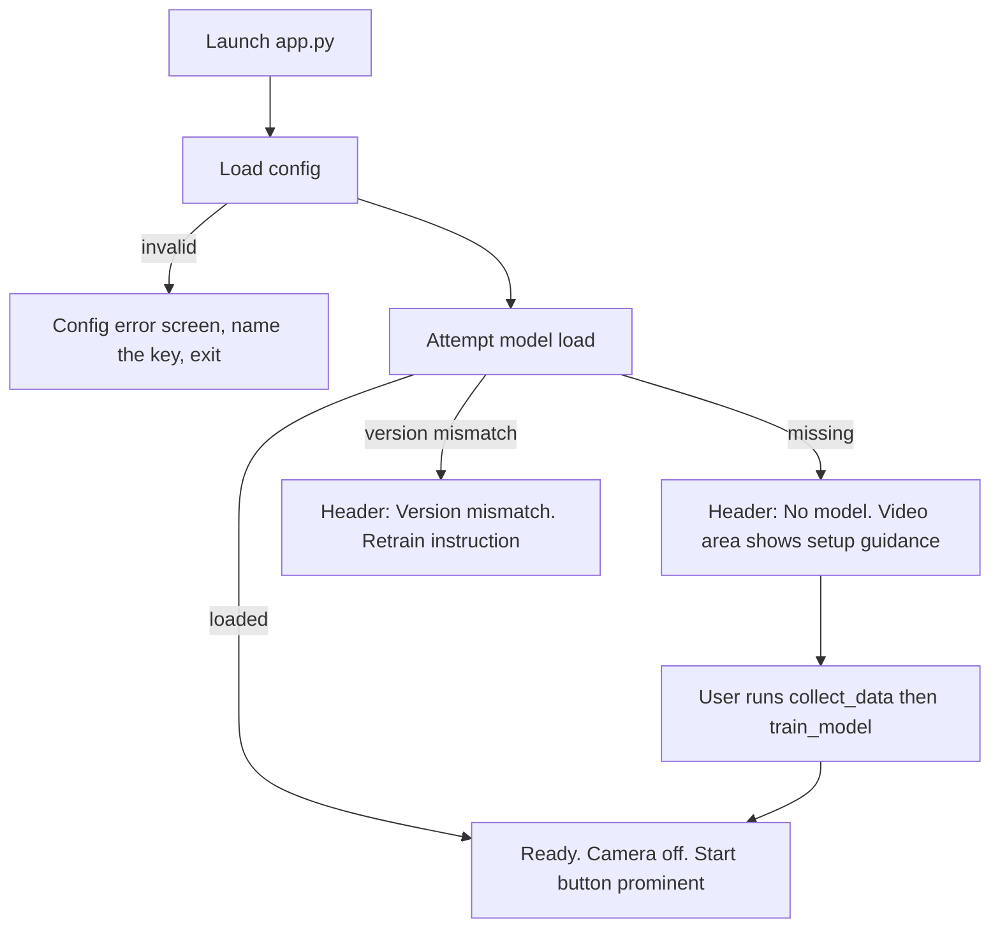
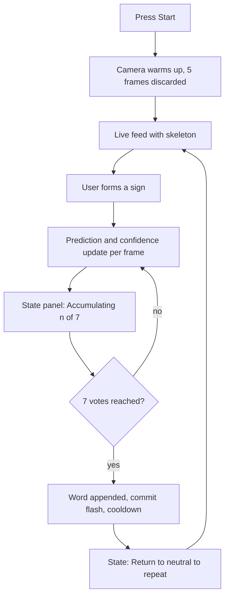

# DESIGN.md — UI / UX Specification

**Project:** Real-Time Sign Language to Text Conversion System
**Document version:** 1.0
**Status:** Design complete (Phase 0). **No UI code written yet** — built in Phases 8 and 11.
**Last updated:** 2026-08-26

> Every colour, dimension and font in this document comes from the `ui:` block of `config.yaml`.
> **No widget may hard-code a colour or size** (`RULES.md` §No-Hardcoding). If this document and
> `config.yaml` disagree, `config.yaml` is correct.

---

## 1. Design goal

The interface must read as a **machine learning application**, not a college script with an OpenCV
window bolted on. Concretely that means: a deliberate visual identity rather than default grey Tk
widgets; the model's *uncertainty* shown as a first-class element rather than hidden behind a label;
every failure state designed rather than discovered; and text large enough to be read across a room,
because this will be demonstrated to an audience rather than used at arm's length.

A secondary goal drives several decisions below: the UI should make the system's *behaviour* legible.
When a sign is not being recognised, the user should be able to tell **why** — no hand detected, low
confidence, still accumulating votes, or in cooldown. A UI that only shows the final answer makes the
system feel arbitrary; one that shows the state makes it feel like an instrument.

---

## 2. Framework decision

### 2.1 Two-stage plan

| Stage | Framework | Phase | Purpose |
|---|---|---|---|
| Development HUD | OpenCV `imshow` overlay | 8 | Fast iteration while building inference. Throwaway-grade, kept for debugging. |
| **Deliverable app** | **CustomTkinter** | 11 | The presented artifact. |

Building the HUD first is deliberate: it lets Phases 8–9 focus entirely on inference correctness
without any GUI concerns, and it survives afterwards as a debug tool (`ui/hud.py`) that is far easier
to reason about than the full app when something goes wrong.

### 2.2 Why CustomTkinter, and why not Streamlit

| Criterion | CustomTkinter | Streamlit |
|---|---|---|
| Live webcam | Native — read frames, display via Pillow | Requires `streamlit-webrtc` + `aiortc` |
| Latency | Direct, in-process | Frames traverse a WebRTC pipeline to the browser |
| Extra dependencies | `customtkinter`, `Pillow` | `streamlit`, `streamlit-webrtc`, `aiortc`, `av` |
| Failure modes | Standard desktop | Browser permissions, port conflicts, WebRTC negotiation |
| Offline | Fully | Runs a local server; still browser-dependent |
| Appearance | Modern themed widgets | Polished, but generic dashboard look |
| Demo-day risk | Low | Higher — more moving parts |

**Decision: CustomTkinter.** The brief allowed Streamlit, and it is a reasonable default for ML demos —
but its strength is *sharing* an app over a network, which we explicitly do not want (privacy: frames
must not leave the machine). For a local, single-user, real-time video application it adds a browser,
a local server, and a WebRTC stack between the camera and the screen, each of which is a thing that can
fail five minutes before a demo. CustomTkinter gives us tkinter's reliability with a modern appearance
and no new failure surface.

The cost, stated honestly: tkinter is **not thread-safe** and has some genuinely awkward behaviour
(§9). Those are known, bounded problems with known solutions. Streamlit's problems would be
distributed across a stack we do not control.

---

## 3. Visual identity

### 3.1 Palette (from `config.yaml`)

| Token | Hex | Use |
|---|---|---|
| `bg` | `#12141A` | Window background — near-black, slightly blue |
| `surface` | `#1B1E26` | Panels, cards, elevated regions |
| `accent` | `#4F8CFF` | Primary actions, active state, focus rings |
| `success` | `#3DD68C` | High confidence, model loaded, camera live |
| `warning` | `#F5A623` | Borderline confidence, two hands, non-fatal issues |
| `danger` | `#FF5C5C` | Low confidence, errors, destructive actions |
| `text_primary` | `#F2F4F8` | Body and headings |
| `text_muted` | `#8A91A0` | Labels, hints, secondary information |

**Why dark.** Three reasons, in order of weight. The webcam feed is the visual centre of the interface,
and a dark surround stops the UI competing with it — the same reason video editors and photo tools are
dark. Demonstrations often happen in dimmed rooms with a projector, where a large white panel is
genuinely uncomfortable to look at. And a saturated accent colour reads more clearly against a dark
surface, which matters because the confidence indicator has to be legible at a glance from a distance.

**Why these particular hues.** `bg` is `#12141A` rather than pure black: pure black against bright
video creates harsh edge contrast and makes the panel boundaries look like holes. A slight blue tint
also reads as "technical" rather than "empty". The semantic three — green/amber/red — are deliberately
conventional; this is not the place for originality, because a confidence indicator must be
instantly interpretable by someone who has never seen the app. They are desaturated from pure RGB so
they sit in the same tonal family as the accent instead of vibrating against the dark background.

**Accessibility.** All foreground/background pairs target WCAG AA (≥ 4.5:1) for body text.
`text_primary` on `bg` is comfortably above that. `text_muted` on `bg` is intended for labels and
hints, never for information the user must read to operate the app. **Colour is never the sole
carrier of meaning** — every colour-coded state also has a text label and, where useful, an icon
glyph. This matters for colour-blind users and also, practically, for projectors that shift hues.

### 3.2 Typography

`font_family: "Segoe UI"` — the Windows system font, so it renders natively with no bundled font file
and no licensing question. Falls back gracefully elsewhere.

| Role | Size | Weight | Notes |
|---|---|---|---|
| App title | 20 | Bold | Header bar |
| Section label | 11 | Semibold, letter-spaced, uppercase | `text_muted` |
| **Prediction** | **48** | **Bold** | The largest element in the UI, by design |
| Confidence % | 26 | Semibold | Colour-coded |
| Text buffer | 22 | Regular | Must be readable across a room |
| Body / status | 13 | Regular | |
| Hint / footnote | 11 | Regular | `text_muted` |

The prediction is set at 48 px because it is the answer to the question the user is asking. Everything
else is supporting information, and the type scale should say so without needing a caption.

### 3.3 Spacing and shape

An 8 px base unit (8 / 16 / 24 / 32) for all padding and gaps — a single rhythm is what separates a
designed layout from an arbitrary one. Panel corner radius 10 px, buttons 8 px. Panels are separated by
16 px gutters and lifted from the background by surface colour rather than borders or shadows, which
tkinter renders poorly.

---

## 4. Screen structure

Window: 1180 × 720 (`ui.window_width` / `window_height`), minimum 1000 × 640.

```text
┌──────────────────────────────────────────────────────────────────────────────┐
│  SIGN LANGUAGE TO TEXT              ● Model v1 loaded    ● Camera live  24 FPS │  56px
├──────────────────────────────────────────────────┬───────────────────────────┤
│                                                  │  PREDICTION               │
│                                                  │                           │
│                                                  │      H E L L O            │
│              LIVE CAMERA FEED                    │                           │
│              (720 px wide, 4:3 or 16:9)          │  CONFIDENCE               │
│              hand skeleton overlaid              │  ████████████░░░  92%     │
│                                                  │                           │
│                                                  │  STATE                    │
│                                                  │  ▸ Accumulating  7/10     │
│                                                  │                           │
│                                                  │  HINT                     │
│                                                  │  Hold the sign steady     │
├──────────────────────────────────────────────────┴───────────────────────────┤
│  GENERATED TEXT                                                              │
│  HELLO THANK YOU                                                             │  120px
│                                                                              │
├──────────────────────────────────────────────────────────────────────────────┤
│  [ ■ Stop Camera ]   [ ⌫ Backspace ]   [ ✕ Clear ]        [ ? Instructions ] │  64px
├──────────────────────────────────────────────────────────────────────────────┤
│  Academic prototype — not an assistive device. Video is processed locally.    │  28px
└──────────────────────────────────────────────────────────────────────────────┘
```

**Why this arrangement.** Video takes the left ~62% because it is what the user looks at while signing.
Prediction sits at eye level to the right of the video, so a signer watching their own hand can see the
result with a small saccade rather than a head movement. Generated text spans the full width at the
bottom because it grows horizontally and is the artifact the user is building. Controls are below the
text they act on. The disclaimer is a permanent footer, not a dismissible dialog — FR-70 requires it to
be visible, and a dialog would be closed once and never seen again.

### 4.1 Panel inventory

| Panel | Purpose |
|---|---|
| Header | Title, model status, camera status, FPS |
| Video | Live feed with landmark overlay |
| Prediction | Current label, large |
| Confidence | Bar + percentage, colour-coded |
| **State** | What the stabiliser is doing right now — the panel that makes behaviour legible |
| Hint | One contextual line of guidance |
| Text buffer | Accumulated output |
| Controls | Start/Stop, Backspace, Clear, Instructions |
| Footer | Disclaimer |

---

## 5. Component design

### 5.1 Video panel

Displays frames at `video_target_width: 720`, scaled for display only — capture stays at 1280 × 720
(`ui.video_target_width` explicitly "does NOT change capture resolution"). Aspect ratio is preserved;
letterboxed with `bg` if it does not fit.

The frame shown is **mirrored** (`flip_horizontal: true`) because a mirror view is what people expect
when they see themselves. Critically, **detection runs on the unmirrored frame** — see
`MODEL.md` §5.4 for why this ordering is not cosmetic.

Overlay when `show_landmarks: true`: 21 points and their connecting bones, drawn in `accent`, with the
wrist emphasised slightly since it is the normalisation origin. When two hands are detected, the
**selected** hand is drawn in `accent` and the ignored one in `text_muted` — so the user can see which
hand the system is actually reading, rather than guessing why it picked the wrong one.

Idle state (camera stopped): centred camera glyph, "Camera is off", and a "Start Camera" button, over
`surface`. Never a black rectangle — a black rectangle is indistinguishable from a crash.

### 5.2 Prediction panel

48 px bold, `text_primary`, centred. Underscores stripped for display (`THANK_YOU` → `THANK YOU`),
matching the text buffer.

Special renderings:

| Situation | Display | Colour |
|---|---|---|
| Confident sign | `HELLO` | `text_primary` |
| Below threshold | `— uncertain —` | `warning` |
| Neutral class | `— neutral —` | `text_muted` |
| No hand | `— no hand —` | `text_muted` |
| Committed (brief flash) | `HELLO ✓` | `success` |

The commit flash is a 300 ms confirmation that a word was appended. Without it, a user holding a sign
cannot tell whether the word already landed in the buffer or is still pending, and they tend to hold
too long and then repeat.

`— uncertain —` is deliberately not blank. A blank panel reads as "broken"; "uncertain" reads as "the
model has an opinion but not a confident one", which is the truth and is far more useful.

### 5.3 Confidence display

A horizontal bar plus a percentage, both colour-coded against `confidence_threshold` (0.80):

| Range | Colour | Meaning |
|---|---|---|
| ≥ 0.80 | `success` | Above threshold — will count toward a commit |
| 0.60–0.80 | `warning` | Detected, but not trusted |
| < 0.60 | `danger` | Low |

A thin vertical tick is drawn on the bar **at the threshold position**, so the user can see the bar in
relation to the bar it must clear. This is a small detail that does a lot of work: it converts an
abstract number into a visible target, and it makes the threshold itself a visible design parameter
rather than hidden behaviour.

One honest caveat that belongs in the UI's own documentation and in the instructions panel: this
number is a **classifier score, not a calibrated probability** (`MODEL.md` §11, threat 4). 92% does not mean
"92% chance of being right". The UI should not label it "probability".

### 5.4 State panel — showing the stabiliser

This panel exists because the stabiliser deliberately introduces ~1 second of latency, and latency
without feedback feels like a fault.

| Stabiliser state | Display | Colour |
|---|---|---|
| Idle | `Waiting for a sign` | `text_muted` |
| Accumulating | `Accumulating  5/7 votes` | `accent` |
| Committed | `Committed: HELLO` | `success` |
| Cooldown | `Cooldown  0.8s` | `warning` |
| Awaiting neutral | `Return to neutral to repeat` | `warning` |
| Two hands | `Two hands — using the clearer one` | `warning` |

`Accumulating 5/7` is the single most useful element for a first-time user. It tells them the system is
working and that holding a moment longer will produce a word — instead of leaving them to conclude
nothing is happening and give up.

`Return to neutral to repeat` teaches the repeat mechanism (`MODEL.md` §9.4) at exactly the moment it
is needed, rather than in documentation nobody reads.

### 5.5 Text buffer

22 px, wrapping, scrollable, left-aligned, `surface` background, `max_length: 500` with front-trimming.
Underscores stripped for display; stored labels remain canonical (`strip_underscores` is a display
concern only, per `config.yaml`). Empty state shows the placeholder `Your text will appear here` in
`text_muted`. Auto-scrolls to the end as text grows. The most recently committed word is briefly
highlighted in `accent` so the user can see what just arrived.

### 5.6 Controls

| Control | Key | Style | Behaviour |
|---|---|---|---|
| Start / Stop Camera | `Space` | `accent` filled → `danger` outline when live | Toggles capture; releases the device on stop |
| Backspace | `Backspace` | Outline | Removes the last **word** |
| Clear | `Ctrl+L` | `danger` outline | Empties the buffer; confirms if > 5 words |
| Instructions | `F1` | Ghost | Opens the help panel |

Every button carries a keyboard equivalent (FR-69 in spirit, and simple accessibility). Buttons have
visible hover and pressed states and a focus ring in `accent` for keyboard navigation.

**Backspace deletes a word, not a character.** This is unusual enough to need a tooltip, because the
name suggests otherwise. The reason is that the unit of input in this application is a sign, so the
unit of undo should be a sign — deleting one character of `HELLO` would leave `HELL` in the buffer,
which is not a state the user can reach any other way.

`Clear` confirms only above 5 words: always confirming is annoying, never confirming risks losing a
demo sentence to a mis-click.

### 5.7 Header status indicators

Dot + label, with both colour and text (never colour alone):

| Indicator | States |
|---|---|
| Model | `● Model v1 loaded` (success) · `● No model — run training` (danger) · `● Version mismatch — retrain` (danger) |
| Camera | `● Camera live` (success) · `○ Camera off` (muted) · `● Camera error` (danger) |
| FPS | `24 FPS` — `text_muted`, `success` above 15, `warning` below (`show_fps`) |

Model status is permanently visible because "why is nothing happening?" is most often "no model is
loaded", and that should be answerable without opening a log file.

---

## 6. UX flows

### 6.1 First run, no model



The no-model state is a **designed screen**, not an error dialog. It states what is missing and the
exact commands to fix it. A first-time user cloning this repository will hit this state, and it is the
UI's job to route them forward rather than to report a failure.

### 6.2 Normal signing loop



### 6.3 Error recovery

Every error keeps the app alive and offers a route out. Camera unavailable → message plus Retry, app
still responsive. Camera lost mid-session → stop capture, show the error, keep the accumulated text
(losing a user's text because a USB cable moved would be unforgivable). Bad frame → skipped silently;
no user-facing noise for a transient event.

---

## 7. State catalogue

Every state below has a defined appearance. "Undefined state" is how a UI ends up showing a raw
traceback to an examiner.

### 7.1 Loading states

| State | Appearance |
|---|---|
| App starting | Splash panel, "Loading configuration…" |
| Model loading | `Loading model…` with an indeterminate bar; UI already visible |
| Camera opening | `Opening camera…` over the video area (can take 1–3 s on Windows) |
| Camera warming | `Adjusting exposure…` during `warmup_frames` |

Camera opening gets its own state specifically because the Windows MSMF backend can take seconds. With
no feedback, the user concludes the app has hung and clicks Start again — usually making it worse.

### 7.2 Empty states

| State | Appearance |
|---|---|
| Camera off | Camera glyph, "Camera is off", Start button |
| No text yet | `Your text will appear here` in `text_muted` |
| No hand detected | Video plays; prediction `— no hand —`; hint "Show your hand to the camera" |

### 7.3 Error states

| Error | Message | Recovery |
|---|---|---|
| `ConfigError` | "Configuration problem: `<key>` — `<reason>`" | Exit with guidance; the app cannot run |
| `CameraError` (open) | "Cannot open camera. It may be in use by another app." | Retry button; suggest closing Zoom/Teams |
| `CameraError` (lost) | "Camera disconnected." | Stop capture, keep text, offer Retry |
| `ModelLoadError` | "No trained model found. Run `scripts/train_model.py`." | Show exact commands |
| `FeatureVersionMismatchError` | "Model expects `<a>`, config produces `<b>`. Retrain." | Show both versions |
| `DetectionError` | Logged only | Frame skipped silently |
| Unexpected exception | "Something went wrong. See `logs/app.log`." | Log the traceback; keep the app alive |

Two rules. **No raw traceback on screen** — it tells a user nothing and looks broken. **Every message
names the next action** — "Cannot open camera" alone is a dead end; adding "it may be in use by
another app" is a fix.

### 7.4 Warning states

Two hands → `warning` state text plus the ignored hand dimmed in the overlay. Low FPS (< 15) → FPS
counter turns `warning`. Hand too close or too far → hint text, since this is the most common reason
detection degrades and it is trivially fixable by the user.

---

## 8. Accessibility

| Consideration | Approach |
|---|---|
| Colour blindness | Colour is never the only signal — every state has text; indicators pair a dot with a label |
| Contrast | AA (≥ 4.5:1) for all body text; `text_muted` reserved for non-essential content |
| Font size | Prediction 48 px, buffer 22 px — readable at demo distance |
| Keyboard | Every control has a shortcut; visible focus ring in `accent` |
| Motion | No animation beyond a 300 ms commit flash and a confidence-bar ease; nothing flashing or looping |
| Error clarity | Plain language, no jargon, no error codes |
| Handedness | Left and right hands both supported via mirroring — the system does not assume right-handedness |
| Screen readers | **Not supported.** Honest limitation: tkinter's accessibility support is poor and a live-video app is a difficult target. Noted as future work. |

The last row is worth stating rather than omitting. An application aimed at accessibility that is
itself not screen-reader accessible is an irony best acknowledged directly, especially since an
examiner may well raise it.

---

## 9. Implementation notes for Phase 11

Three tkinter-specific hazards, all of which have caused hours of confusion in similar projects.

**Threading.** Tkinter is **not thread-safe**; touching a widget from a non-main thread causes
intermittent, hard-to-reproduce crashes. Camera capture and inference must run on a worker thread, and
results must be handed to the UI through a queue that the main thread drains via `root.after(...)`.
Doing capture on the main thread instead makes the window unresponsive — the single most common
tkinter + OpenCV mistake.

```python
# worker thread: capture, detect, predict -> queue.put(result)
# main thread:
def _drain(self) -> None:
    while not self._queue.empty():
        self._render(self._queue.get_nowait())
    self.root.after(15, self._drain)
```

**Keep a reference to every `PhotoImage`.** Pillow images passed to a tkinter label are garbage-collected
if nothing else holds a reference, and the symptom is a silently blank video panel with no error. Store
it on the instance (`self._current_photo = photo`).

**Release the camera on window close.** Bind `WM_DELETE_WINDOW`; otherwise the camera LED stays on
after the window disappears, which is both a bug and a visible privacy failure.

**Layering.** `ui/theme.py` reads the palette from config and exposes tokens. `ui/desktop_app.py`
composes widgets and calls the inference API. **No ML logic in `ui/`, and `inference/` must never import
`ui/`** (goal G-08) — enforced by an import test in Phase 12.

---

## 10. What the OpenCV HUD shows (Phase 8)

Deliberately minimal, since it is a development tool: hand skeleton, predicted label and confidence as
overlay text, FPS, and the stabiliser state. Same colour tokens as the app so the two look related.
Keys: `q` quit, `c` clear text, `s` toggle skeleton. It is retained after Phase 11 as a debugging
surface that isolates inference from all GUI complexity.

---

## 11. Screenshots to capture in Phase 14

Ready state (model loaded, camera off) · live feed with a confident prediction · low-confidence state ·
no-hand state · accumulating state showing the vote counter · text buffer with a multi-word sentence ·
two-hands warning · no-model error state · instructions panel. **TBD — capture in Phase 14.**

---

## 12. Revision history

| Version | Date | Change |
|---|---|---|
| 1.0 | 2026-08-26 | Initial UI/UX specification: framework decision, palette and typography rationale, layout, component design, flows, full state catalogue, accessibility, tkinter implementation hazards. |

---

## 13. Related documents

`PRD.md` §13 (UI requirements FR-60…FR-70) · `ARCHITECTURE.md` (threading model, error matrix) ·
`MODEL.md` §9 (stabiliser states shown in the State panel) · `PHASES.md` Phases 8, 11 ·
`TESTING.md` (manual UI checklist) · `RULES.md` §No-Hardcoding.
