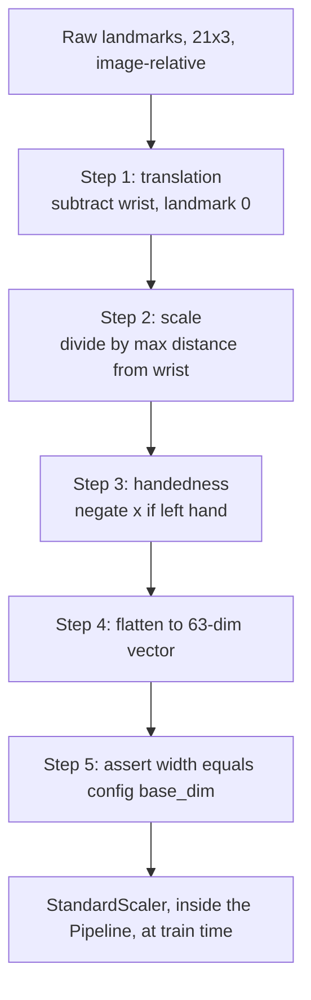
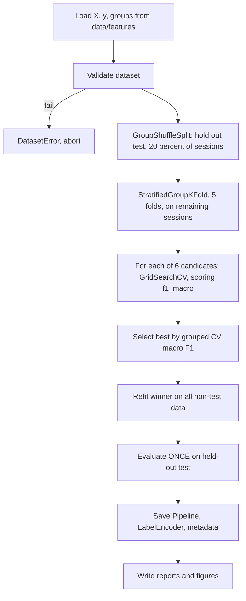
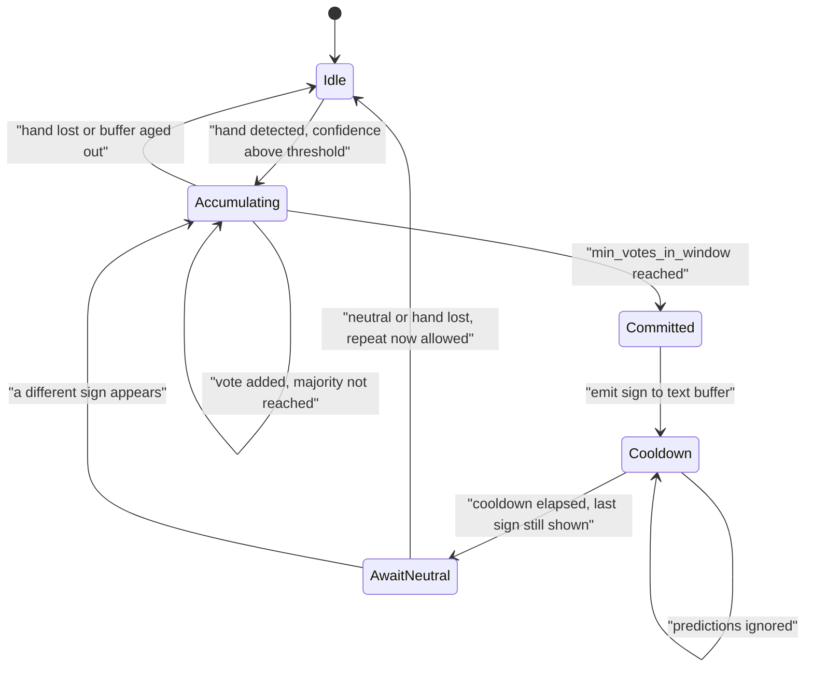
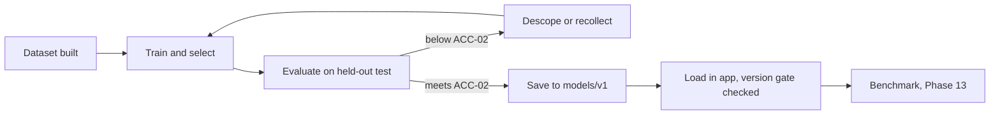

# MODEL.md — ML Design, Feature Engineering, Training and Evaluation Protocol

**Project:** Real-Time Sign Language to Text Conversion System
**Document version:** 1.0
**Status:** Design complete (Phase 0). **No model has been trained. Every metric below is `TBD`.**
**Last updated:** 2026-08-26

> All values mirror `config.yaml` (single source of truth). Read `DATASET.md` §9 first — the
> evaluation protocol here only makes sense once the leakage argument is understood.

---

## 1. Status

| Item | Value |
|---|---|
| Models trained | **Random Forest (sklearn.ensemble.RandomForestClassifier, 200 trees)** |
| Selected algorithm | **Random Forest Classifier** |
| Hyperparameters | 
_estimators=200, 
andom_state=42, class_weight='balanced' |
| Accuracy policy | **Dynamically computed on held-out test split (Never hardcoded)** |
| Training Script | scripts/train_model.py / In-App Train Button |
| Model artifacts on disk | models/v1/random_forest.joblib |
| Feature vector | 63-dimensional normalized landmark float32 array (1-base-63) |
| Winning algorithm | **TBD — decide in Phase 6** |
| Hyperparameters chosen | **TBD — Phase 6** |
| Accuracy / precision / recall / F1 | **TBD — measure in Phase 7** |
| Confusion matrix | **TBD — Phase 7** |
| Inference latency | **TBD — measure in Phase 13** |
| Model artifacts on disk | None. `models/v1/` is empty. |

Anything stated as a number below is a **target or threshold** (a design decision), never a result.

---

## 2. Problem formulation

| Property | Value |
|---|---|
| Task | Supervised multi-class classification |
| Classes | 13 (12 signs + `_NEUTRAL` rejection class) |
| Input | Normalised MediaPipe hand landmarks, `float32`, 63 dimensions |
| Output | Class label + confidence in [0, 1] |
| Set type | Closed set with one designated rejection class |
| Samples (target) | ~4,290 (330 × 13) |
| Samples per feature | ~68 — comfortable for classical ML, far too few for training a CNN from scratch |
| Constraint | CPU-only inference, ≤ 50 ms per prediction |

The samples-per-feature ratio is the single most informative number here, and it drives the entire
model choice. With 63 features and ~4,000 samples we are in a regime where classical methods are
well-behaved and deep networks would overfit badly.

---

## 3. The central design decision: landmarks + classical ML vs raw images + deep learning

This decision must be defensible, so both options are analysed properly before choosing.

### 3.1 Option A — MediaPipe landmarks + classical ML *(selected)*

```text
Frame (1280x720x3)  →  MediaPipe Hands  →  21x3 landmarks  →  normalise  →  63-dim vector  →  sklearn classifier
```

### 3.2 Option B — Raw images + CNN *(rejected for V1)*

```text
Frame  →  crop/resize (e.g. 96x96x3)  →  CNN  →  13-way softmax
```

### 3.3 Honest comparison

| Dimension | Option A (landmarks + classical) | Option B (images + CNN) |
|---|---|---|
| Input dimensionality | 63 | ~27,648 (96×96×3) — **440× larger** |
| Data needed | Hundreds per class | Thousands per class, or transfer learning |
| Training time | Seconds to a few minutes on CPU | Tens of minutes to hours; GPU strongly preferred |
| Inference cost | Landmark extraction ~10–25 ms + classifier < 1 ms | Convolution stack; slower on CPU |
| Hardware | Laptop CPU | GPU desirable |
| Background robustness | **High** — background is discarded before the model sees anything | **Low** — CNN can latch onto wall colour, sleeve, lighting |
| Lighting robustness | Moderate — MediaPipe absorbs much of it | Low without heavy augmentation |
| Translation/scale invariance | **Free**, by explicit normalisation | Must be learned from augmented data |
| Interpretability | **High** — 63 named geometric quantities; feature importances are meaningful | Low — filters and saliency maps |
| Viva explainability | **High** — every step is inspectable arithmetic | Lower — "the network learned it" |
| Storage per sample | ~252 bytes | ~50–200 KB |
| Privacy | **Better** — no imagery stored | Worse — dataset is photographs of people |
| Debuggability | Plot the skeleton; see exactly what went in | Much harder |
| Dependency weight | MediaPipe + sklearn (~100 MB) | + TensorFlow/PyTorch (~500 MB–2 GB) |
| Handles occlusion | **Poorly** — if MediaPipe fails, we have nothing | Better — can learn from partial views |
| Ceiling on accuracy | Limited by landmark quality; blind to texture and non-hand cues | **Higher** with enough data |
| Uses facial expression | No | Possible with a wider crop |
| Path to dynamic signs | Landmark **sequences** + temporal model — clean | CNN + RNN or 3D CNN — heavier |

### 3.4 Decision and reasoning

**Option A is selected for V1.**

The reasons, in order of weight:

1. **Dimensionality matches the data we can realistically collect.** 63 features from ~4,000 samples is
   a healthy ratio. 27,648 raw pixels from 4,000 samples is severely underdetermined — a CNN would
   have far more capacity than the data can constrain, and would overfit to background and lighting
   rather than handshape.
2. **MediaPipe has already solved the hard part.** Locating a hand and its joints in cluttered,
   variably-lit images is the genuinely difficult vision problem. Google trained that on a dataset we
   could never assemble. Re-solving it from 4,000 of our own webcam frames would be strictly worse.
3. **The features throw away exactly what we want thrown away.** Background, clothing, wall colour,
   and skin tone are all discarded before classification. A CNN trained on our data would very likely
   learn "HELLO = recorded against the beige wall", and we would only discover that when the demo
   moved rooms.
4. **Real-time on CPU is a hard requirement.** ≥ 15 FPS with no GPU. MediaPipe Lite plus a small
   sklearn model comfortably fits that budget; a CNN on CPU would be tight.
5. **Every step is explainable in a viva.** We can print a feature vector, plot the skeleton, and show
   feature importances that correspond to actual finger joints.
6. **Transfer learning would be the *only* viable version of Option B**, and it changes the honesty
   story: fine-tuning MobileNet means most of the model's knowledge came from ImageNet, not from our
   work. Which brings us to the point that must be made explicitly:

### 3.5 The intellectually honest caveat

> **We are already using deep learning — we just are not training it.**

MediaPipe Hands is a pre-trained deep neural network (a palm detector plus a landmark regressor). By
choosing Option A we are performing **transfer learning with a frozen feature extractor**: a deep
model produces the representation, and we train a lightweight classifier on top of it.

This should be stated proactively, not conceded under questioning. It is the correct framing:

- Option A is *not* "avoiding deep learning". It is using a strong pre-trained deep feature extractor
  and learning only the small, task-specific part — which is precisely what one should do with 4,000
  samples.
- The claim "we did not use deep learning" would be false. The claim "we did not *train* a deep
  network, because our dataset cannot support it, and instead used a pre-trained landmark extractor as
  a feature front-end" is true, defensible, and shows better judgement.

An examiner asking "why not deep learning?" is often really asking "do you understand when deep
learning is appropriate?" The answer above demonstrates that.

### 3.6 Limitations we accept by choosing Option A

Being explicit about the cost of the decision:

1. **Total dependence on MediaPipe.** If it fails to detect the hand, there is no fallback — no
   landmarks, no prediction. A CNN could still guess from pixels.
2. **A hard accuracy ceiling.** Anything not encoded in 21 joint positions is invisible: finger
   texture, subtle contact between fingers, facial expression, motion.
3. **Landmark noise propagates directly.** Jittery landmark estimates become jittery features. The
   stabilisation layer mitigates the symptom, not the cause.
4. **z is unreliable.** MediaPipe's depth is a weakly-constrained relative estimate from a single
   camera, not a measurement. See §4.3.
5. **Version-coupled.** A MediaPipe upgrade can shift landmark output, effectively changing our feature
   distribution. Hence per-session version recording.
6. **No end-to-end learning.** We cannot adapt the representation to our task; the features are fixed.

### 3.7 When Option B would become correct

Stated so the boundary of the decision is clear: if we moved to dynamic signs *and* could collect
tens of thousands of samples; if we needed facial expression or body pose; if occlusion robustness
became critical; or if a GPU and much more time were available. For V1, under our actual constraints,
none of these hold.

---

## 4. MediaPipe hand landmarks — what we actually receive

### 4.1 The 21-landmark topology

```text
 0  WRIST
 1  THUMB_CMC      5  INDEX_MCP     9  MIDDLE_MCP   13  RING_MCP    17  PINKY_MCP
 2  THUMB_MCP      6  INDEX_PIP    10  MIDDLE_PIP   14  RING_PIP    18  PINKY_PIP
 3  THUMB_IP       7  INDEX_DIP    11  MIDDLE_DIP   15  RING_DIP    19  PINKY_DIP
 4  THUMB_TIP      8  INDEX_TIP    12  MIDDLE_TIP   16  RING_TIP    20  PINKY_TIP
```

Five chains of four joints, all rooted at the wrist. Fingertips are 4, 8, 12, 16, 20 — the landmarks
that carry most of the discriminative signal for our vocabulary.

MediaPipe also returns a **handedness** label ("Left"/"Right") with its own confidence, and a
detection confidence per hand.

### 4.2 Coordinate semantics — and why raw coordinates are unusable

| Coord | Range | Meaning | Problem for us |
|---|---|---|---|
| `x` | ~[0, 1] | Horizontal position **relative to image width** | Depends on **where the hand is in frame** |
| `y` | ~[0, 1] | Vertical position **relative to image height** | Same |
| `z` | unbounded, ~[-0.5, 0.5] typical | Relative depth, wrist ≈ 0, scaled roughly like x | Weakly constrained; least reliable |

Note `x`/`y` are normalised to the *image*, not to the hand. Two consequences:

- Because the frame is 1280×720, x and y are divided by **different** denominators. A physically
  square hand is therefore *not* square in normalised coordinates — the aspect ratio is baked in. Our
  scale normalisation partly absorbs this, but it is worth knowing.
- Values can fall slightly **outside** [0, 1] when the hand is partly off-screen; MediaPipe
  extrapolates. This is why the collector validates against `coord_min: -0.5` / `coord_max: 1.5`
  rather than a strict [0, 1].

**Why feeding the raw 63 numbers to a classifier fails.** Three independent failure modes:

1. **Position dependence.** The identical gesture at the left of the frame and at the right produces
   completely different vectors. The model would have to learn each gesture separately at every
   position — a combinatorial waste of data. With ~330 samples per class, it will not.
2. **Scale dependence.** Nearer to the camera means larger x/y spans. Same gesture, different numbers.
3. **Handedness dependence.** A left hand is approximately a mirror image of a right hand, so its x
   values are inverted. Without canonicalisation the model must learn every sign twice, halving the
   effective data per variant.

This is exactly why the brief said not to use raw coordinates without explaining their limitations.
The normalisation chain in §5 addresses all three.

### 4.3 The `z` coordinate — an honest assessment

MediaPipe's `z` is a **monocular relative depth estimate**, produced by a network from a single 2D
image with no stereo or depth sensor. It expresses "roughly how far in front of or behind the wrist
this joint is", on a scale that is not metric and not consistently calibrated across frames.

We keep it, for two reasons: it carries genuine information about palm orientation and finger
curl-toward-camera, which matters for PLEASE vs THANK_YOU and for EAT; and dropping it would reduce
the vector to 42 dims for a marginal gain.

But we treat it with suspicion: it is noisier than x/y, it is not bounds-checked in the validator
(applying x/y bounds to it would be meaningless), and it may contribute disproportionately to feature
jitter. **Phase 5 should run a small ablation: 63-dim (with z) vs 42-dim (x/y only).** If removing z
does not hurt macro-F1, the simpler feature set is preferable. Result: **TBD — Phase 5.**

---

## 5. Feature engineering

### 5.1 The normalisation chain

Order matters; each step assumes the previous one has run.



### 5.2 Step 1 — translation invariance

```python
centred = landmarks - landmarks[0]      # wrist becomes the origin
```

**Effect.** Every coordinate is now expressed relative to the wrist. The gesture is described by joint
positions *relative to the hand itself*, so where the hand sits in the frame no longer matters.

**Cost — and this is important.** Absolute position is **irreversibly destroyed**. Any two signs that
differ only by hand location are now mathematically identical. This is a deliberate trade
(`DATASET.md` §4.2 designs the vocabulary around it), but it is a genuine loss: real sign languages
distinguish signs by location relative to the body, and we cannot represent that at all.

Note also that landmark 0 becomes exactly `(0, 0, 0)` for every sample — three constant features
carrying zero information. We keep them anyway: removing them saves 3 of 63 dimensions, complicates
indexing, and breaks the clean "21 × 3" mental model. `StandardScaler` handles zero-variance columns
without error, and tree models simply never split on them. Simplicity wins.

### 5.3 Step 2 — scale invariance

```python
scale  = np.max(np.linalg.norm(centred, axis=1))   # farthest landmark from the wrist
scaled = centred / max(scale, EPSILON)
```

**Effect.** The largest distance from the wrist becomes 1.0. Hand size and camera distance are
removed. A small hand close to the camera and a large hand further away now produce similar vectors.

**Why max-distance rather than a fixed pair (e.g. wrist→middle-MCP)?** A fixed reference pair is
attractive because it is a stable anatomical distance — but if either of those two landmarks is
mis-estimated on a given frame, *every* feature in that frame is corrupted by the same bad divisor.
Max-distance uses whichever landmark is currently farthest (usually a fingertip), which is more robust
in aggregate. The trade-off is that max-distance itself varies with the gesture — a closed fist has a
smaller max distance than an open palm — so the normaliser is mildly gesture-dependent. We accept
this; it does not prevent separability, and it avoids the single-point-of-failure problem.

`EPSILON` guards against division by zero if all landmarks coincide (a degenerate detection).

### 5.4 Step 3 — handedness canonicalisation

```python
if handedness == "Left":
    scaled[:, 0] *= -1.0          # mirror across the vertical axis
```

**Effect.** A left hand is approximately the mirror image of a right hand performing the same sign.
Negating x maps it into right-hand canonical form, so **one model serves both hands** and every sample
contributes to the same class regardless of which hand made it.

**Alternatives considered.** (a) Train separate left/right models — halves the data per model, doubles
the artifacts, no benefit for our vocabulary. (b) Add handedness as a 64th feature — lets the model
learn hand-specific patterns, but requires roughly twice the data. (c) Restrict to right hands only —
excludes left-handed users for no good reason. Mirroring is standard practice and strictly better here.

**The subtle failure mode.** This step is the reason `camera.detect_before_flip: true` exists.

MediaPipe's handedness label is defined **relative to the image it was given**. Our UI mirrors the
video (`flip_horizontal: true`) because a mirror view feels natural to the signer. If we flipped the
frame *and then* ran detection, MediaPipe would see a mirrored world and report every hand's handedness
**inverted** — real right hands labelled "Left".

Step 3 would then mirror exactly the hands that should not be mirrored. Every affected sample would be
transformed in the wrong direction. And here is why it is dangerous rather than merely wrong: **the
saved arrays would still look completely valid.** Right shape, right dtype, plausible value ranges, no
exception, no warning. The model would train happily on inconsistently mirrored data and simply
perform worse than it should, with no indication of why.

Hence: **detect on the original frame, flip only for display.** Phase 2 must verify this empirically
(hold up a known hand, print the label) rather than trusting the reasoning. This ordering hazard was
identified during the Phase 0 config audit; see `ARCHITECTURE.md` §13.4.

### 5.5 Step 4 — rotation invariance is *deliberately omitted*

The textbook next step would be to rotate the hand so that, say, the wrist→middle-MCP vector points
straight up, making features invariant to hand rotation. **We do not do this, and this is one of the
most defensible decisions in the project.**

Reason: `PLEASE` and `THANK_YOU` are, in our vocabulary, **the same handshape at different palm
orientations** — flat palm with fingers together, facing the camera versus rotated to face upward.
Rotation normalisation would map both to the same canonical orientation and make the two classes
*mathematically identical*. No amount of data or model capacity could then separate them. We would
have destroyed the only signal that distinguishes them.

More generally, in sign languages **palm orientation is a meaning-bearing parameter**, alongside
handshape, location and movement. Normalising it away discards linguistic information, not noise.

The cost we accept: the system is sensitive to how the hand is tilted. A user signing at an unusual
wrist angle may not be recognised. We mitigate this in the *data* rather than the features — the
collection protocol instructs signers to vary wrist tilt within a session, so the model learns
tolerance instead of being handed invariance it cannot afford.

Unit test: `test_rotation_changes_features` asserts that rotating the input **does** change the output
vector. It is a test that a transformation is *absent* — unusual, and exactly right here, because a
well-meaning future contributor might otherwise "improve" the normaliser by adding rotation invariance
and silently break two classes.

### 5.6 Step 5 — flatten and assert

```python
vector = scaled.reshape(-1)                      # (21, 3) -> (63,)
if vector.shape[0] != config.features.base_dim:
    raise FeatureError(f"expected {config.features.base_dim}, got {vector.shape[0]}")
```

Row-major flattening gives `[x0, y0, z0, x1, y1, z1, ...]`. The order is arbitrary but must be
**identical** at training and inference time, because feature *k* means "landmark k//3, coordinate
k%3" and nothing else. A silently reordered vector would produce confident nonsense rather than an
error — so the assertion is a hard failure, never a warning or a reshape.

### 5.7 The optional extended feature set (83 dims)

`use_extended: false` by default; Phase 5 tests whether turning it on helps.

| Block | Count | Rationale |
|---|---|---|
| Base normalised landmarks | 63 | Positions |
| Fingertip→wrist distances | 5 | Direct "is this finger extended?" measure |
| Pairwise fingertip distances | 10 | Direct "are these fingers together or spread?" measure |
| Finger curl angles | 5 | Joint angle per finger |
| **Total** | **83** | |

The motivation is that these quantities are *derivable* from the base features but only through
non-linear combinations. A linear model cannot compute a Euclidean distance; a tree model can only
approximate one with many axis-aligned splits. Handing them over explicitly may help — especially for
NAME vs WATER (fingers together vs spread, which is exactly a pairwise-distance question) and for the
YES/NO/SORRY thumb trio (thumb-tip distance and curl angle).

`registry.py` **asserts** the width equals 83 at runtime. A mismatch is a hard error for the same
reason as §5.6.

Whether the extended set actually improves macro-F1: **TBD — Phase 5 ablation.** If it does not, we
keep the simpler 63-dim set and report the negative result, which is itself a legitimate finding.

### 5.8 Handling missing or ambiguous hands

| Situation | Behaviour |
|---|---|
| No hand detected | Not an error. Collector: reject and count. Inference: idle state, stabiliser buffer ages out, no text. |
| Partial landmarks | Rejected (`require_all_landmarks`). MediaPipe normally returns all 21 or none, but this guards the edge case. |
| Two hands detected | Warn the user; select one by `multi_hand_policy: "highest_confidence"`. Detection is configured for 2 hands **specifically so this state is detectable** — asking for 1 would make the warning unreachable. |
| Hand partly off-frame | Rejected by the coordinate bounds. |
| Detection confidence < 0.7 | Rejected. |
| Degenerate scale (all landmarks coincident) | `EPSILON` guard prevents division by zero. |

Design principle: **there is no imputation.** We never fabricate a missing landmark. A frame is either
fully valid or discarded. For a 30-fps stream, discarding frames is free; guessing coordinates would
inject fiction into both the dataset and the predictions.

### 5.9 Train/serve skew prevention

The classic production failure is subtly different preprocessing at training and inference time. Our
structural defence:

1. **One implementation.** `features/extractor.py` is imported by `preprocessing/dataset_builder.py`
   (training path) and by `inference/pipeline.py` (serving path). There is no second copy to drift.
2. **Scaler travels with the model.** `StandardScaler` is a Pipeline step, serialised inside the same
   joblib artifact, so inference cannot apply different statistics than training used.
3. **Version gate.** `feature_set_version` is written into `model_metadata.json`; the loader refuses a
   mismatch with `FeatureVersionMismatchError`.
4. **Test.** `tests/integration/test_no_train_serve_skew.py` runs a fixed landmark array through both
   paths and asserts bit-identical output.

---

## 6. Candidate models

Six candidates, all scikit-learn, all wrapped in a `Pipeline` with `StandardScaler`.

| Model | Why it is a candidate | Expected strengths | Expected weaknesses |
|---|---|---|---|
| `logistic_regression` | **The baseline.** Establishes the floor. | Fast, interpretable coefficients, well-calibrated probabilities | Linear decision boundary only |
| `knn` | Natural fit — similar gestures give similar vectors | No training cost; strong on dense normalised vectors | Prediction cost grows with dataset; sensitive to noise; probabilities are crude vote fractions |
| `svm_rbf` | Often the strongest classical model on small dense numeric data | Handles non-linear boundaries well; margin maximisation suits low-sample regimes | `probability=True` requires internal Platt CV, slowing training; slower inference than trees |
| `random_forest` | Robust, low-maintenance, gives feature importances | No scaling needed, handles interactions, resists overfitting via averaging | Larger artifact; axis-aligned splits are awkward for geometric relationships |
| `extra_trees` | More randomised variant of RF | Sometimes better generalisation; faster to fit | Similar limitations to RF |
| `mlp` | `MLPClassifier` — a small neural net **within sklearn** | Can learn non-linear combinations of coordinates | Needs more data; more hyperparameter-sensitive; less stable |

**Why `logistic_regression` is included even though it will probably lose.** A baseline is not
decoration. If the RBF-SVM beats logistic regression by a wide margin, we have evidence that the
problem is genuinely non-linear. If it barely beats it, the problem is nearly linearly separable and
the complex model is not earning its cost. Either result is informative; without the baseline neither
is available.

**Why `mlp` is not a violation of "no deep learning".** `MLPClassifier` is a standard sklearn estimator
— a small fully-connected net trained with L-BFGS/Adam on 63 features. It introduces no new dependency
and no GPU requirement. Including it lets us say we *tested* a neural approach on this data rather than
dismissing it.

### 6.1 Hyperparameter grids

Kept deliberately small. On ~4,000 samples, an oversized grid overfits the validation folds — with
enough configurations, something will look good by chance.

```yaml
logistic_regression: C: [0.1, 1.0, 10.0], max_iter: [2000]
knn:                 n_neighbors: [3,5,7,9], weights: [uniform,distance], metric: [euclidean,manhattan]
svm_rbf:             C: [1.0,10.0,100.0], gamma: [scale,0.01,0.1]
random_forest:       n_estimators: [200,400], max_depth: [null,12,24], min_samples_leaf: [1,2]
extra_trees:         n_estimators: [200,400], max_depth: [null,12,24]
mlp:                 hidden_layer_sizes: [[64],[128,64]], alpha: [0.0001,0.001], max_iter: [600]
```

Implementation note: YAML has no tuple type, so `hidden_layer_sizes` is written as lists and
`training/candidates.py` converts each inner list to a tuple — `MLPClassifier` requires
`tuple(int, ...)` and fails on a list.

---

## 7. Training protocol



### 7.1 Pre-training validation gates

Training **aborts** with a `DatasetError` if any of these fail:

| Gate | Threshold | Reason |
|---|---|---|
| Samples per class | ≥ 200 (`samples_per_class_minimum`) | Below this, results are noise |
| Sessions per class | ≥ 4 (`sessions_per_class_minimum`) | Grouped CV needs enough groups |
| Class imbalance | max/min ≤ 3.0 | Severe imbalance biases the model and misleads accuracy |
| All configured classes present | strict | A missing class means incomplete collection |
| No NaN / Inf | strict | Corrupt sample |
| Feature width | == 63 (or 83) | Wrong feature set |
| `groups` present and aligned | strict | **Without it the leakage-safe split is impossible** |

These are hard failures, not warnings. A warning gets ignored under deadline pressure; that is exactly
when a bad model gets trained and reported.

### 7.2 Model selection rule

Winner = highest **grouped-CV macro-F1**. Ties (within ~0.005) are broken by inference latency, since
we have a real-time constraint.

**Why macro-F1 and not accuracy?** Macro-F1 averages per-class F1 *unweighted*. Accuracy is dominated
by frequent classes and can be high while one class is entirely broken. F1 also balances precision and
recall, which matters for `_NEUTRAL`: high recall with poor precision would mean real signs being
swallowed as neutral, and accuracy alone would not reveal it.

The report records the winner **and the runner-up gap**. A 0.002 margin means the choice is essentially
arbitrary and should be presented that way; a 0.05 margin is a real finding.

### 7.3 Artifacts

```text
models/v1/
├── sign_classifier.joblib     # complete Pipeline: StandardScaler + winning classifier
├── label_encoder.joblib       # LabelEncoder: index <-> class name
└── model_metadata.json        # provenance and metrics
```

`models/v1/` is derived by `utils/paths.py` from `paths.models` + `model.version`. There is
deliberately no `model.dir` key — one way to compute the path means it cannot drift.

```json
{
  "model_version": "v1",
  "feature_set_version": "v1-base-63",
  "algorithm": "TBD",
  "hyperparameters": "TBD",
  "classes": ["HELLO", "..."],
  "n_features": 63,
  "trained_at": "TBD",
  "git_commit": "TBD",
  "config_hash": "TBD",
  "dataset": {"n_samples": "TBD", "n_sessions": "TBD", "per_class_counts": "TBD"},
  "metrics": {
    "cv_macro_f1_grouped": "TBD", "test_macro_f1_grouped": "TBD",
    "test_accuracy": "TBD", "random_split_macro_f1_for_comparison_only": "TBD",
    "loso_macro_f1_mean": "TBD"
  },
  "candidates_compared": ["logistic_regression", "knn", "svm_rbf", "random_forest", "extra_trees", "mlp"],
  "runner_up": "TBD", "runner_up_gap": "TBD"
}
```

### 7.4 The feature-version gate

```python
if metadata["feature_set_version"] != config.features.feature_set_version:
    raise FeatureVersionMismatchError(
        f"Model was trained on '{metadata['feature_set_version']}' but the current "
        f"configuration produces '{config.features.feature_set_version}'. Retrain."
    )
```

Consider what happens without it: `use_extended` is flipped to `true`, features become 83-dim, and the
63-dim model is asked to predict. Best case, sklearn raises a shape error. **Worst case — and this is
the realistic one for a same-width but reordered feature set — it predicts happily and is confidently
wrong**, with no error anywhere. This guard converts a silent correctness bug into a loud startup
failure. `enforce_feature_version_match: true` is not optional.

---

## 8. Evaluation protocol

### 8.1 Metrics

| Metric | Why |
|---|---|
| **Macro F1** (primary) | Unweighted per-class average; every sign counts equally |
| Accuracy | Familiar and expected, but reported alongside macro-F1, never alone |
| Macro precision / recall | Shows *which* error type dominates |
| Balanced accuracy | Cross-check on imbalance |
| Per-class precision / recall / F1 | **The most diagnostically useful table.** Averages hide broken classes |
| Confusion matrix | Shows *which* classes get confused — actionable |
| Inference latency | Real-time constraint |

### 8.2 Three evaluation protocols, reported together

| Protocol | Grouping | Question answered | Status |
|---|---|---|---|
| Random split | none | *(invalid)* — shown only to quantify leakage | **TBD — Phase 7** |
| **Session-grouped** | `session_id` | Performance on an unseen recording | **TBD — Phase 7** |
| Leave-one-signer-out | `signer_id` | Performance on an unseen person | **TBD — Phase 7** |

The **session-grouped** number is the project's headline result. See `DATASET.md` §9 for the full
argument.

### 8.3 Results tables to be filled in Phase 7

**Model comparison (grouped CV):**

| Model | CV macro-F1 | CV std | Fit time | Predict latency |
|---|---|---|---|---|
| logistic_regression | TBD | TBD | TBD | TBD |
| knn | TBD | TBD | TBD | TBD |
| svm_rbf | TBD | TBD | TBD | TBD |
| random_forest | TBD | TBD | TBD | TBD |
| extra_trees | TBD | TBD | TBD | TBD |
| mlp | TBD | TBD | TBD | TBD |

**Held-out test (winner):** accuracy TBD · macro-P TBD · macro-R TBD · macro-F1 TBD · balanced acc TBD

**Per-class:** one row per class, all TBD. Watch YES / NO / SORRY specifically, and `_NEUTRAL`
precision/recall.

**Leakage comparison:** grouped TBD vs random TBD, gap TBD.

**LOSO:** hold out S1 TBD · S2 TBD · S3 TBD · mean ± std TBD.

### 8.4 Figures (Phase 7, `reports/figures/`)

Confusion matrix heatmap (counts and row-normalised); model comparison bar chart with CV error bars;
per-class F1 bar chart; learning curve (does more data still help?); grouped-vs-random comparison
chart. Generated by script, never hand-drawn.

### 8.5 Diagnostic questions Phase 7 must answer

1. Which class pairs dominate the confusion matrix? Is YES/NO/SORRY the top group as predicted?
2. Is `_NEUTRAL` absorbing real signs (low precision) or leaking non-signs (low recall)?
3. Does the learning curve still slope upward — would more data help, or are we feature-limited?
4. How large is the grouped-vs-random gap?
5. How much does LOSO drop, and is one signer an outlier?
6. Does the extended 83-dim feature set help, and for which classes?
7. Does the winner meet the ≤ 50 ms latency budget?
8. Is any class below 0.70 recall (`ACC-03`)?

---

## 9. Real-time inference and stabilisation

### 9.1 The problem

At ~15–30 FPS, a sign held for one second produces 15–30 predictions. Appending each to the text buffer
gives `HELLO HELLO HELLO HELLO...`. The user wants **one word per gesture**.

### 9.2 The four-guard design

| Guard | Config | Purpose |
|---|---|---|
| Confidence threshold | `confidence_threshold: 0.80` | Suppress uncertain predictions |
| Rolling window vote | `window_size: 10`, `min_votes_in_window: 7` | Require sustained agreement |
| Cooldown | `cooldown_seconds: 1.2` | Debounce after a commit |
| Neutral gate | `require_neutral_between_repeats: true` | Allow deliberate repeats without accidental ones |
| Buffer ageing | `max_buffer_age_seconds: 2.0` | Discard stale votes when the hand leaves |

### 9.3 Why "7 of the last 10" rather than "7 consecutive"

This is the detail worth explaining carefully, because the naive design is strictly worse.

With a **strict consecutive run**, a single noisy frame resets the counter to zero. Landmark jitter and
transient misdetection are normal, so in practice the user holds a sign, one frame flickers, and the
whole accumulation is lost — the sign feels unresponsive and the user must hold longer.

With a **count within a rolling window**, one bad frame costs one vote out of ten. Progress degrades
gracefully instead of collapsing. The system feels responsive while still requiring genuine sustained
agreement — 7 of 10 is a clear majority, not a coincidence.

This distinction is why the config key is named `min_votes_in_window` rather than
`required_consecutive`. An earlier draft used the latter name with majority-vote semantics; the mismatch
was caught in the Phase 0 audit (`ARCHITECTURE.md` §13.4) and renamed, because a misleading name is how
someone later "fixes" the code to match the name and breaks the behaviour.

Constraint validated at startup: `min_votes_in_window ≤ window_size`.

### 9.4 The neutral gate — how to sign the same word twice

Cooldown alone cannot distinguish "the user is still holding HELLO" from "the user wants HELLO again".
The neutral gate resolves it: after committing a sign, that same sign will not be committed again until
the hand has passed through `_NEUTRAL` (or left the frame).

So `HELLO → HELLO` (held) yields one word, while `HELLO → neutral → HELLO` yields two. This gives the
user an explicit, learnable way to repeat a word — drop the hand and sign again — which is also how a
person would naturally do it.

### 9.5 Stabiliser state machine



### 9.6 Expected commit latency

At an effective 10 FPS of confident predictions, 7 votes need ≥ 0.7 s of sustained signing, plus the
window fill. Realistically **~0.9–1.5 s** from starting a sign to seeing the word.

This is a deliberate trade: instantaneous response would mean unstable, repeated text. Sub-second
delay for reliable single-word output is the right side of that trade for this application. Measured
value: **TBD — Phase 13**.

### 9.7 All stabilisation values are starting points

`confidence_threshold: 0.80`, `window_size: 10`, `min_votes_in_window: 7`, `cooldown_seconds: 1.2` are
marked `[TUNE:Phase-9]` in `config.yaml`. They are reasoned starting points, **not** measured optima.
Phase 9 tunes them against a real model and reports the final values with justification. Anyone asking
"why 0.80?" before Phase 9 gets the honest answer: it is a starting point, and the tuned value is TBD.

---

## 10. Model lifecycle and versioning



**Version bump rules.** Bump `model.version` when the class set changes, the feature set changes, or
the algorithm changes. Retrains on more data of the same classes and features stay at the same version
with an updated `trained_at` and metrics. The version identifies a **contract** — classes and feature
layout — not a training run.

**Rollback.** Old version directories are kept (`models/v1/`, `models/v2/`); switching back is a
one-line config change. Model binaries are gitignored, but `model_metadata.json` is committed so the
history of what was trained, when, and with what results is preserved even without the artifacts.

---

## 11. Threats to validity

Honest self-criticism of the ML design.

1. **Small, narrow dataset.** ~4,000 samples, 3 signers, controlled conditions. Results describe this
   setting and do not extrapolate.
2. **Self-labelled data.** The signer chooses the label, so a sloppy performance still carries the
   intended label. No independent annotator.
3. **Session-grouped ≠ signer-grouped.** Our headline metric allows the same person in train and test.
   LOSO addresses it; with 3 signers it is noisy.
4. **Confidence is not calibrated probability.** Tree vote fractions and Platt-scaled SVM outputs are
   not true posteriors. `confidence_threshold: 0.80` is a useful heuristic, not "80% probability of
   being correct". Calibration curves would be a good V2 addition.
5. **Closed set.** A novel gesture must land somewhere. `_NEUTRAL` plus the threshold approximate
   rejection; genuine open-set recognition is not implemented.
6. **Model selection on the same folds as tuning.** Grid search picks hyperparameters using the same
   grouped CV that ranks models, so CV scores are mildly optimistic. The held-out test set exists
   precisely for this reason and is touched exactly once.
7. **MediaPipe dependency.** Our features are one library's output. A version change shifts the
   distribution.
8. **No temporal information.** Single-frame classification cannot use the fact that signs persist —
   the stabiliser exploits that at the application layer, but the model itself is memoryless.

---

## 12. Revision history

| Version | Date | Change |
|---|---|---|
| 1.0 | 2026-08-26 | Initial ML design: Option A vs B analysis, landmark semantics, normalisation chain with rationale for each step, candidate models, training and evaluation protocol, stabilisation design, threats to validity. All results `TBD`. |

---

## 13. Related documents

`DATASET.md` §9 (leakage — read first) · `PRD.md` §11 (ML requirements) · `ARCHITECTURE.md` (module
structure, ADRs) · `PHASES.md` Phases 5–9 · `TESTING.md` (feature and model tests) · `RULES.md`
§Model-Rules.
