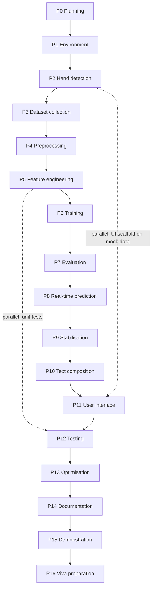

# PHASES.md — Development Roadmap

**Project:** Real-Time Sign Language to Text Conversion System
**Timeline:** 4–6 weeks · 3 members (part-time alongside coursework)
**Document version:** 1.0
**Last updated:** 2026-08-26

> **Current state: Phase 0 COMPLETE. Phases 1–16 NOT STARTED.**
> No code has been written. No data exists. No model has been trained. Every metric in this project
> reads `TBD` until a script in this repository produces it.

Owners: **HT** (ML) · **BT** (data) · **ST** (UI/test) — initials only; the roster is in `PRD.md` §1

---

## Progress tracker

| Phase | Name | Status | Owner | Started | Completed |
|---|---|---|---|---|---|
| 0 | Project planning and architecture | ✅ **COMPLETE** | All | 2026-08-26 | 2026-08-26 |
| 1 | Environment setup | ⬜ Not started | BT | — | — |
| 2 | Hand detection prototype | ⬜ Not started | BT | — | — |
| 3 | Custom dataset collection | ⬜ Not started | BT + all | — | — |
| 4 | Data preprocessing | ⬜ Not started | HT | — | — |
| 5 | Feature engineering | ⬜ Not started | HT | — | — |
| 6 | ML model training | ⬜ Not started | HT | — | — |
| 7 | Model evaluation | ⬜ Not started | HT | — | — |
| 8 | Real-time prediction | ⬜ Not started | HT | — | — |
| 9 | Prediction stabilization | ⬜ Not started | HT | — | — |
| 10 | Text composition | ⬜ Not started | ST | — | — |
| 11 | User interface | ⬜ Not started | ST | — | — |
| 12 | Testing | ⬜ Not started | ST | — | — |
| 13 | Optimization | ⬜ Not started | HT | — | — |
| 14 | Documentation | ⬜ Not started | ST | — | — |
| 15 | Final demonstration | ⬜ Not started | All | — | — |
| 16 | Presentation and viva prep | ⬜ Not started | All | — | — |

---

## Phase dependency graph



The dotted edges are the parallelism that makes 4–6 weeks feasible. Everything else is a hard
dependency.

---

## Calendar — 4-to-6-week plan

| Week | HT (ML) | BT (Data) | ST (UI / Test) |
|---|---|---|---|
| **1** | P1 setup, review architecture | **P1 setup, P2 hand detection** | P1 setup, read DESIGN.md, sketch UI |
| **2** | P4 preprocessing skeleton | **P3 collection (lead)** | P11 UI scaffold on mock data |
| **3** | **P5 features, P6 training** | P3 finish, verify counts | P10 text composer, P12 unit tests |
| **4** | **P7 evaluation, P8 real-time** | Support P7 (recollect weak classes) | P11 wire real inference |
| **5** | **P9 stabilisation, P13 optimisation** | P12 integration tests | P12 UI tests, P14 docs |
| **6** | P14 results write-up | P15 demo rehearsal | **P14 docs, P15 demo, P16 viva prep** |

**If only 4 weeks are available**, compress by starting P3 collection in week 1 immediately after P2
(it is the long-pole task), and run P13 optimisation only if the demo is actually too slow.

### Critical path and parallelism

The **critical path** is P1 → P2 → P3 → P4 → P5 → P6 → P7 → P8 → P9 → P11 → P15. Phase 3 is the
long pole: it is calendar-bound (sessions must be spread across different days for lighting diversity)
rather than effort-bound, so it cannot be compressed by working harder.

**What genuinely runs in parallel:**

- **P11 UI scaffold during P3 collection.** ST builds the entire CustomTkinter layout against a mock
  predictor that returns random labels from `config.yaml`. No model needed. When P8 lands, the mock is
  swapped for the real predictor. This is the single most valuable parallelisation available.
- **P12 unit tests during P5/P6.** Feature normalisation tests, config tests, text composer tests, and
  splitter tests need no model and no camera.
- **P10 text composition any time after P1.** It is pure logic over strings — fully testable in
  isolation.
- **P14 documentation continuously.** Docs are updated at the end of every phase, not written from
  memory in week 6.

**What must not be parallelised:** P6 training before P5 features are frozen, and P9 stabilisation
tuning before P7 tells us how accurate the model actually is.

---

## Phase 0 — Project planning and architecture ✅ COMPLETE

**Objective.** Fix the architecture, configuration, rules and documentation before any code exists, so
that implementation is execution rather than improvisation.

**Why it matters.** Every expensive mistake in this project would be a *data* mistake — collecting
4,000 samples with the wrong normalisation, or with no `session_id`, means re-recording everything.
Deciding the storage schema and split strategy first is what makes that impossible.

**Delivered.**

- Directory scaffold (33 directories, src-layout with `__init__.py` markers)
- `config.yaml` — 13 classes, all thresholds, all paths. Single source of truth.
- `requirements.txt`, `requirements-dev.txt`, `pyproject.toml`, `.gitignore`, `.gitattributes`
- `docs/`: `ARCHITECTURE.md` (14 ADRs, 13 diagrams), `RULES.md`, `PRD.md`, `DATASET.md`, `MODEL.md`,
  `PHASES.md`, `DESIGN.md`, `TESTING.md`, `DEPLOYMENT.md`, `TROUBLESHOOTING.md`, `MEMORY.md`, `README.md`

**Configuration audit.** A self-review of `config.yaml` found and fixed **11 real defects** before any
code depended on them. The full table is in `ARCHITECTURE.md` §13.4. The four most serious:

1. `max_num_hands: 1` made the PRD-required "multiple hands detected" warning **unreachable code** —
   MediaPipe could never return two hands. Fixed to 2 with `multi_hand_policy`.
2. `sessions_per_class_minimum: 4` × `samples_per_session_cap: 80` = 320 < the 330 target — an
   **unsatisfiable** collection plan. Cap raised to 90.
3. `required_consecutive` was a misleading name for majority-vote semantics. Renamed to
   `min_votes_in_window`.
4. The **handedness/flip ordering hazard**: flipping the frame before detection inverts every MediaPipe
   handedness label, silently corrupting left-hand mirroring in a way no test on the saved arrays could
   detect. Fixed with `detect_before_flip: true` and a Phase 2 verification task.

The pattern worth noting: none of these would have crashed. Defects 2 and 4 would have produced
working-looking software built on wrong data.

**Completion criteria.**

- [x] Folder structure exists
- [x] `config.yaml` parses and is internally consistent
- [x] All 14 documents written and mutually consistent
- [x] `.gitignore` excludes data, models, caches, personal data
- [x] No fabricated metric anywhere

**Known gap carried into Phase 1.** `requirements.txt` carries an explicit
`VERIFICATION STATUS: NOT YET VERIFIED ON THIS MACHINE` banner. The pins are reasoned but were not
installed — PyPI was unreachable from the authoring environment. **Phase 1 is the verification gate.**

---

## Phase 1 — Environment setup

**Objective.** A working Python 3.10/3.11 environment on all three machines, with every dependency
verified to actually import, and a lockfile produced.

**Why it matters.** This is the phase that fails silently and wastes days. MediaPipe has hard version
constraints (no Python 3.13 wheels; requires `numpy < 2` because it is built against the numpy 1.x C
ABI). Discovering that in week 4 would be fatal; discovering it in week 1 costs an afternoon.

**Prerequisites.** Phase 0 complete. Python 3.10 or 3.11 installed from python.org **with the "tcl/tk
and IDLE" option checked** (tkinter is not a pip package — CustomTkinter cannot work without it).

**Tasks.**

1. `python --version` → must be 3.10.x or 3.11.x. If 3.12+ or 3.13, install 3.11 alongside.
2. Create and activate a virtual environment.
3. `pip install -r requirements.txt` — **the verification gate.**
4. Verify every critical import (see commands below).
5. **Verify `import tkinter`** — separately, because its absence is an installer-option problem, not a
   pip problem.
6. `pip freeze > requirements.lock.txt` once everything imports.
7. Resolve **OQ-08**: decide whether to exclude `data/` from OneDrive sync or relocate the repo
   outside OneDrive. **Recommended: relocate** to e.g. `C:\dev\sign-language-to-text`.
8. `git init`, first commit.
9. Confirm ownership split from `PRD.md` §1.
10. Implement `utils/paths.py`, `utils/logging_setup.py`, `utils/seeding.py`, `utils/exceptions.py`,
    `config/schema.py`, `config/loader.py` — the foundation every later phase imports.
11. Write `tests/unit/test_config.py` asserting the cross-field invariants (FR-03).

**Files created.** `.venv/`, `requirements.lock.txt`, `src/sign_language/utils/{paths,logging_setup,seeding,exceptions}.py`,
`src/sign_language/config/{schema,loader}.py`, `tests/conftest.py`, `tests/unit/test_config.py`

**Commands.**

```bat
python --version
python -m venv .venv
.venv\Scripts\activate
python -m pip install --upgrade pip
pip install -r requirements.txt
pip install -r requirements-dev.txt

python -c "import cv2, mediapipe, sklearn, numpy, pandas, joblib, yaml; print('core OK')"
python -c "import numpy; print('numpy', numpy.__version__)"
python -c "import mediapipe; print('mediapipe', mediapipe.__version__)"
python -c "import tkinter; print('tkinter OK')"
python -c "import customtkinter; print('customtkinter OK')"
python -c "from sklearn.model_selection import StratifiedGroupKFold; print('StratifiedGroupKFold OK')"

pip freeze > requirements.lock.txt
pytest tests/unit/test_config.py -v
```

**Expected output.** All imports succeed. `numpy` reports 1.x, **not** 2.x. `mediapipe` reports 0.10.x.
`requirements.lock.txt` written. Config tests pass.

**Testing.** `pytest -m unit` green. Config loader raises `ConfigError` (not `KeyError`) on a
deliberately broken config.

**Risks and pitfalls.**

- Python 3.13 installed by default → no MediaPipe wheel. Install 3.11.
- `numpy 2.x` pulled in → MediaPipe crashes with a C-ABI error. Force `pip install "numpy<2"`.
- `import tkinter` fails → re-run the Python installer, tick "tcl/tk and IDLE".
- Anaconda + venv mixing → prefer plain `python -m venv`.
- Long-path errors on Windows → enable long paths or relocate the repo.

**Completion criteria.**

- [ ] Python 3.10/3.11 confirmed on all three machines
- [ ] All imports succeed, including `tkinter` and `customtkinter`
- [ ] `numpy < 2` confirmed
- [ ] `StratifiedGroupKFold` importable (sklearn ≥ 1.3)
- [ ] `requirements.lock.txt` committed
- [ ] `requirements.txt` banner updated from NOT VERIFIED to verified, with date and Python version
- [ ] OneDrive decision made and recorded
- [ ] `utils/` and `config/` modules implemented; config tests pass
- [ ] Git repo initialised, first commit made

**Effort.** 0.5–1 person-day, ×3 machines. Owner **BT**.

**MEMORY.md updates.** Python version, MediaPipe version, numpy version, OS, OneDrive decision, Phase 1
completion date.

---

## Phase 2 — Hand detection prototype

**Objective.** Prove MediaPipe reliably detects the team's hands, and **empirically resolve the
handedness/flip ordering question** before any data is recorded.

**Why it matters.** Everything downstream assumes landmarks arrive correctly labelled. Phase 2 is
cheap; re-collecting 78 sessions is not.

**Prerequisites.** Phase 1 complete.

**Tasks.**

1. Implement `core/camera.py` (`CameraStream`, context manager, guaranteed release) and
   `core/hand_detector.py` (`HandDetector` wrapping MediaPipe).
2. Implement `core/types.py` — `HandLandmarks`, `Prediction`, `FrameResult` dataclasses.
3. `scripts/` smoke script: open camera, detect, draw skeleton, show FPS.
4. **Resolve OQ-04 experimentally.** Hold up a known hand (say the right). Print MediaPipe's handedness
   label with `detect_before_flip: true`, then with `false`. Confirm that detecting before flipping
   gives the correct label and that flipping first inverts it. **Record the observed result in
   `MEMORY.md`.** Do not accept this on reasoning alone.
5. Test `min_detection_confidence` and `min_tracking_confidence` in good and poor light; record what
   works (OQ-03).
6. Test `model_complexity: 0` vs `1` — note the FPS difference.
7. Verify camera backend: try `CAP_DSHOW` vs default on Windows; note open latency.
8. Verify all three members' hands are detected reliably.
9. Note the raw coordinate ranges observed, including how far outside [0,1] values go when the hand is
   partly off-frame — this validates the `coord_min`/`coord_max` choice.

**Files created.** `src/sign_language/core/{types,camera,hand_detector}.py`, a smoke script,
`tests/unit/test_camera_mock.py`

**Commands.**

```bat
python -m sign_language.core.hand_detector --smoke
pytest -m unit -v
```

**Expected output.** Live window with a 21-point skeleton tracking the hand. FPS displayed. Handedness
label printed and **verified correct**. Camera releases cleanly on quit (LED off).

**Testing.** Manual: wave, move near/far, leave frame, show two hands, dim the lights. Automated:
detector logic against a recorded/mock frame, so CI needs no camera.

**Risks and pitfalls.**

- Camera busy (Zoom/Teams holding it) → close other apps.
- 2–5 s open delay on Windows → use `CAP_DSHOW`.
- Poor detection in backlight → note it; it becomes a protocol rule in Phase 3.
- Handedness label opposite to expectation → **this is the bug this phase exists to catch.** Fix the
  ordering, not the mirroring logic.

**Completion criteria.**

- [ ] Camera opens, streams, releases cleanly
- [ ] 21 landmarks detected and drawn for all three members
- [ ] **Handedness verified empirically; result recorded in MEMORY.md**
- [ ] Detection/tracking confidence values chosen and recorded (OQ-03)
- [ ] `model_complexity` decision recorded with observed FPS
- [ ] Observed coordinate ranges recorded
- [ ] "No hand" and "two hands" handled without crashing

**Effort.** 1–1.5 person-days. Owner **BT**.

**MEMORY.md updates.** Handedness finding, chosen confidences, `model_complexity`, camera backend,
baseline FPS, coordinate ranges.

---

## Phase 3 — Custom dataset collection

**Objective.** Build the collection tool and record the actual dataset: 13 classes, ≥ 200 samples each
(330 target), across ≥ 4 sessions each, from 3 signers.

**Why it matters.** This is the project's only irreplaceable artifact and its long pole. A model can be
retrained in minutes; a session cannot be re-recorded once the moment has passed.

**Prerequisites.** Phase 2 complete, handedness verified.

**Tasks.**

1. Implement `data_collection/session.py` — session ids, manifests, `.npz` writing.
2. Implement `data_collection/validator.py` — all validation rules from `config.yaml`
   (`DATASET.md` §8).
3. Implement `data_collection/collector.py` — the capture loop with countdown, FPS limiting, live HUD,
   pause/quit.
4. Implement `scripts/collect_data.py` — CLI with `--class`, `--signer`, `--session-notes`.
5. **Do a 5-sample dry run first.** Inspect the resulting `.npz`: check shapes `(N,21,3)`, dtype
   `float32`, `session_id` present, handedness correct, manifest written. Only then collect at scale.
6. Print reference handshape images (`DATASET.md` §4.1) and agree on each sign as a team **before**
   recording — inconsistent performance is unfixable later.
7. Collect: 13 classes × ~6 sessions, split across 3 signers and **at least two different days**.
8. Use the special `_NEUTRAL` protocol (`DATASET.md` §7.4) — deliberately diverse, not one fixed pose.
9. Record actual counts, rejection rates, and rejection reasons per class.
10. Back up `data/interim/` to external storage. **This is the one irreplaceable directory.**

**Session budget.**

```text
3 signers × 2 sessions each = 6 sessions per class
6 × ~55 accepted samples     = ~330 per class          ✓ target
13 classes × 6               = 78 sessions total
Hard floor: 4 sessions × 50  = 200 per class
```

**Honest wall-clock estimate.** 55 samples at 8 fps is ~7 seconds of capture — but with launching,
countdown, retries and class switching, budget **2–4 minutes per session**. That is **~2.5–5 hours
total**, or **~1–1.5 hours per person**, spread over ≥ 2 days. This is the most tedious phase and the
one most likely to be quietly under-done.

**Files created.** `src/sign_language/data_collection/{session,validator,collector}.py`,
`scripts/collect_data.py`, `data/interim/**`, `data/metadata/**`, `data/raw/**`,
`tests/unit/test_validator.py`

**Commands.**

```bat
python scripts\collect_data.py --class HELLO --signer S1 --target 55
python scripts\collect_data.py --class _NEUTRAL --signer S1 --target 60
python scripts\collect_data.py --list-classes
python scripts\collect_data.py --status
```

**Expected output.** HUD showing class, session, accepted/target, rejection reasons. One `.npz` +
manifest per run. `--status` shows per-class totals.

**Testing.** Validator unit tests with synthetic landmark arrays (all rules). Manual: quit mid-session
and confirm the `.npz` is valid; re-run and confirm the session index increments.

**Risks and pitfalls.**

- **Collecting before the dry run.** Highest-impact mistake in the project. Always validate 5 samples
  first.
- Inconsistent handshapes between members → agree and photograph first.
- All sessions in one sitting → no lighting diversity → grouped split becomes less meaningful. Spread
  across days.
- Very high rejection rate → hand too far/close, or bad light. Fix during the session.
- `_NEUTRAL` collected as one pose → useless rejection class.
- Forgetting to back up.

**Completion criteria.**

- [ ] Dry run validated before bulk collection
- [ ] All 13 classes have ≥ 200 samples (330 target)
- [ ] All 13 classes have ≥ 4 sessions
- [ ] All 3 signers contributed to every class
- [ ] Sessions span ≥ 2 days / ≥ 2 lighting conditions
- [ ] `_NEUTRAL` collected with the diverse protocol
- [ ] Every session has a manifest with `session_id`, `signer_id`, `config_hash`
- [ ] Actual counts recorded in `DATASET.md` §5 and `MEMORY.md`
- [ ] `data/interim/` backed up externally
- [ ] Audit JPEGs spot-checked

**Effort.** Tool 1.5–2 person-days (BT) + collection ~1–1.5 hours each (all three).

**MEMORY.md updates.** Per-class sample and session counts, signers, dates, lighting conditions,
rejection statistics, total dataset size, backup location.

---

## Phase 4 — Data preprocessing

**Objective.** Aggregate 78 session files into `X.npy`, `y.npy`, `groups.npy`, and implement the
leakage-safe splitter.

**Why it matters.** `groups.npy` is what makes honest evaluation possible. This phase is where the
leakage argument becomes code.

**Prerequisites.** Phase 3 complete.

**Tasks.**

1. Implement `preprocessing/dataset_builder.py` — walk `data/interim/`, load, apply features, stack.
2. Implement `preprocessing/splitter.py` — `GroupShuffleSplit` for test, `StratifiedGroupKFold` for CV,
   `LeaveOneGroupOut` for LOSO.
3. Implement all pre-training validation gates (`MODEL.md` §7.1) as **hard failures**.
4. Write `build_manifest.json` recording counts, class distribution, session list, config hash.
5. **Write `tests/unit/test_splitter.py` asserting the three empty intersections.** This is the test
   that permanently prevents a regression to random splitting.
6. Verify `groups` aligns with `X` row-for-row.
7. Print the class distribution and confirm imbalance ratio ≤ 3.0.

**Files created.** `src/sign_language/preprocessing/{dataset_builder,splitter}.py`,
`scripts/build_dataset.py`, `data/features/{X,y,groups}.npy`, `data/features/build_manifest.json`,
`tests/unit/test_splitter.py`

**Commands.**

```bat
python scripts\build_dataset.py
python scripts\build_dataset.py --report
pytest tests\unit\test_splitter.py -v
```

**Expected output.** `X.npy` shape `(N, 63)`, `y.npy` `(N,)`, `groups.npy` `(N,)`. Printed per-class
counts, session counts, imbalance ratio. Split summary showing disjoint session sets.

**Testing.** Splitter tests assert disjoint train/val/test session sets. Builder tests on a synthetic
two-session dataset. A corrupt `.npz` must produce `DatasetError`, not a traceback.

**Risks and pitfalls.**

- Row misalignment between `X` and `groups` → silently wrong grouping. Assert equal lengths.
- Forgetting stratification → a fold missing a class entirely.
- Too few sessions for 5 folds → reduce `cv_folds` **and document it**; never fall back to random.
- Treating a validation failure as a warning.

**Completion criteria.**

- [ ] `X`, `y`, `groups` built with matching lengths
- [ ] All 13 classes present; counts match `--status`
- [ ] Imbalance ratio ≤ 3.0
- [ ] Splitter produces disjoint session sets; **test asserts it**
- [ ] Stratification verified — every fold contains every class
- [ ] LOSO splitter implemented and grouped by `signer_id`
- [ ] `build_manifest.json` written
- [ ] Rebuild is deterministic (delete and rebuild → identical arrays)

**Effort.** 1.5–2 person-days. Owner **HT**.

**MEMORY.md updates.** Final `X` shape, per-class counts, session count, test session ids (so they stay
untouched), `cv_folds` used.

---

## Phase 5 — Feature engineering

**Objective.** Implement the normalisation chain, verify each invariance with tests, and run the
ablations that decide the final feature set.

**Why it matters.** The features determine the accuracy ceiling. A subtly wrong normaliser produces a
model that trains fine and fails live.

**Prerequisites.** Phase 4 complete.

**Tasks.**

1. Implement `features/normalizer.py` — translation, scale, mirror (`MODEL.md` §5).
2. Implement `features/extractor.py` — the single entry point used by **both** training and inference.
3. Implement `features/registry.py` — feature-set versions, width assertions.
4. Write the invariance tests:
   - translation: same gesture at two positions → near-identical vectors
   - scale: same gesture near and far → near-identical vectors
   - mirror: mirrored left input ≈ right input
   - **rotation: rotated input → *different* vector** (asserting the absence of a transformation)
   - width: wrong input shape → `FeatureError`
5. **Ablation A (OQ-05):** 63-dim base vs 83-dim extended. Compare grouped-CV macro-F1.
6. **Ablation B:** 63-dim (with z) vs 42-dim (x/y only). Is z earning its place?
7. Freeze the winning feature set; set `feature_set_version` accordingly.
8. Write `tests/integration/test_no_train_serve_skew.py` — identical output from both paths.

**Files created.** `src/sign_language/features/{normalizer,extractor,registry}.py`,
`tests/unit/test_normalizer.py`, `tests/unit/test_extractor.py`,
`tests/integration/test_no_train_serve_skew.py`

**Commands.**

```bat
pytest tests\unit\test_normalizer.py -v
python scripts\build_dataset.py --feature-set v1-base-63
python scripts\build_dataset.py --feature-set v1-extended-83
python scripts\train_model.py --quick --compare-feature-sets
```

**Expected output.** All invariance tests pass. Ablation table with grouped-CV macro-F1 per feature set.
Decision recorded.

**Testing.** As above. The rotation test is the unusual one and the comment must explain why it exists —
so a future contributor does not "fix" it by adding rotation invariance and silently merge PLEASE with
THANK_YOU.

**Risks and pitfalls.**

- Normalising in the wrong order (scale before translation) → wrong features, no error.
- Dividing by zero when landmarks coincide → use `EPSILON`.
- Mirroring y instead of x.
- Adding rotation invariance "because it seems more invariant" → destroys PLEASE vs THANK_YOU.
- Duplicating normalisation logic in the inference path → train/serve skew.

**Completion criteria.**

- [ ] Normaliser implemented; all invariance tests pass
- [ ] Rotation test asserts features **do** change
- [ ] Feature width asserted; mismatch raises `FeatureError`
- [ ] Ablation A complete; result recorded (even if negative)
- [ ] Ablation B complete; z decision recorded
- [ ] `feature_set_version` frozen
- [ ] Train/serve skew test passes

**Effort.** 2–2.5 person-days. Owner **HT**.

**MEMORY.md updates.** Final feature set and dimensionality, ablation results, `feature_set_version`.

---

## Phase 6 — ML model training

**Objective.** Train and tune all six candidates under grouped CV; select the winner on macro-F1; save
the artifacts with full metadata.

**Prerequisites.** Phase 5 complete, feature set frozen.

**Tasks.**

1. Implement `training/candidates.py` — the six Pipelines (scaler + classifier), with the
   `hidden_layer_sizes` list→tuple conversion for MLP.
2. Implement `training/tuning.py` — `GridSearchCV` with `cv=StratifiedGroupKFold`, `scoring="f1_macro"`.
3. Implement `training/trainer.py` — validation gates, split, train all, select, refit, save.
4. Implement `scripts/train_model.py`.
5. Confirm `StandardScaler` is **inside** every Pipeline (preprocessing-leakage prevention).
6. Apply the global seed; verify two runs give identical results.
7. Write `model_metadata.json` with feature version, git SHA, config hash, dataset counts, metrics,
   candidates compared, runner-up and gap.
8. Save `sign_classifier.joblib` and `label_encoder.joblib` to `models/v1/`.
9. Produce the model comparison table and chart.

**Files created.** `src/sign_language/training/{candidates,tuning,trainer}.py`,
`scripts/train_model.py`, `models/v1/*`, `reports/metrics/model_comparison.json`,
`reports/figures/model_comparison.png`

**Commands.**

```bat
python scripts\train_model.py
python scripts\train_model.py --quick
python scripts\train_model.py --model svm_rbf
```

**Expected output.** Per-candidate grouped-CV macro-F1 with std and fit time; the winner named with the
runner-up gap; three artifacts in `models/v1/`.

**Testing.** Training on a tiny synthetic dataset completes and saves. Validation gates fire correctly
on an under-sized dataset. Reproducibility: two runs, identical metrics.

**Risks and pitfalls.**

- `cv=5` instead of `cv=StratifiedGroupKFold(...)` → **silent leakage**. The single most important line
  to review.
- Scaler fitted outside the Pipeline → preprocessing leakage.
- `probability=True` on SVM makes training much slower — expected, not a bug.
- MLP convergence warnings → raise `max_iter` or accept and note.
- Grid too large → hours of compute and overfitted validation folds.

**Completion criteria.**

- [ ] All 6 candidates trained under grouped CV
- [ ] Scaler inside every Pipeline
- [ ] Winner selected on grouped-CV macro-F1; gap recorded
- [ ] Three artifacts saved in `models/v1/`
- [ ] `model_metadata.json` complete with real values
- [ ] Reproducible across two runs
- [ ] Comparison table and chart saved

**Effort.** 2 person-days. Owner **HT**.

**MEMORY.md updates.** Winner, hyperparameters, CV macro-F1, runner-up gap, training date, artifact
paths. **Real numbers only.**

---

## Phase 7 — Model evaluation

**Objective.** Produce the honest evidence: held-out test metrics, per-class table, confusion matrix,
the leakage comparison, and LOSO.

**Why it matters.** This phase produces the numbers the project will be judged on. It is also where the
leakage argument is *demonstrated* rather than asserted.

**Prerequisites.** Phase 6 complete.

**Tasks.**

1. Implement `training/evaluation.py` — metrics, confusion matrix, classification report, figures.
2. Implement `scripts/evaluate_model.py`.
3. Evaluate the winner **once** on the held-out test sessions.
4. Produce the per-class precision/recall/F1 table.
5. Produce the confusion matrix (counts + row-normalised).
6. **Run the leakage comparison** — grouped vs random split, same model, same hyperparameters. Report
   both and the gap.
7. **Run LOSO** — hold out each signer in turn; report per-signer and mean ± std.
8. Plot a learning curve — would more data help?
9. **Inspect YES / NO / SORRY specifically** (the predicted confusion group).
10. **Inspect `_NEUTRAL` precision and recall specifically.**
11. Check `ACC-03`: every class recall ≥ 0.70.
12. If below `ACC-02` (macro-F1 ≥ 0.75) → trigger the descoping plan, do **not** reframe the metric.

**Files created.** `src/sign_language/training/evaluation.py`, `scripts/evaluate_model.py`,
`reports/metrics/*.json`, `reports/figures/{confusion_matrix,per_class_f1,learning_curve,leakage_comparison}.png`

**Commands.**

```bat
python scripts\evaluate_model.py
python scripts\evaluate_model.py --leakage-comparison
python scripts\evaluate_model.py --loso
python scripts\evaluate_model.py --learning-curve
```

**Expected output.** Full metric set, all figures, the leakage table, LOSO table.

**Testing.** Metric functions verified against hand-computed values on a tiny synthetic confusion
matrix — do not trust a metric function you have not checked once by hand.

**Risks and pitfalls.**

- Evaluating on test repeatedly and tuning against it → the test set stops being held out. **Once.**
- Reporting the random-split number as the result.
- Reporting only macro-F1 and missing a broken class → always read the per-class table.
- Fabricating or rounding up a number. Not negotiable.

**Completion criteria.**

- [ ] Held-out test evaluated exactly once
- [ ] Accuracy, macro P/R/F1, balanced accuracy reported
- [ ] Per-class table complete
- [ ] Confusion matrix saved
- [ ] Leakage comparison reported with the gap
- [ ] LOSO reported per signer with mean ± std
- [ ] Learning curve produced and interpreted
- [ ] YES/NO/SORRY confusion explicitly examined
- [ ] `_NEUTRAL` precision/recall examined
- [ ] `ACC-02` and `ACC-03` checked; failures trigger descoping, not reframing
- [ ] All numbers written to `MEMORY.md` and `MODEL.md` §8.3

**Effort.** 2 person-days. Owner **HT**.

---

## Phase 8 — Real-time prediction

**Objective.** Wire camera → detection → features → model → prediction into a live loop with an OpenCV
HUD. **No stabilisation yet** — the raw behaviour must be seen first.

**Why it matters.** Seeing unstabilised output is what makes Phase 9 concrete: you watch
`HELLO HELLO HELLO HELLO` scroll past and understand exactly what is being fixed.

**Prerequisites.** Phase 7 complete, model saved.

**Tasks.**

1. Implement `inference/predictor.py` — `SignPredictor`: load once, version-gate, predict with
   confidence.
2. Implement `inference/pipeline.py` — orchestrate frame → prediction using the **same**
   `features/extractor.py` as training.
3. Implement `ui/theme.py` and `ui/hud.py` — OpenCV overlay: prediction, confidence bar, FPS, hand
   skeleton.
4. Implement `scripts/run_realtime.py`.
5. Verify the version gate: temporarily change `feature_set_version` and confirm
   `FeatureVersionMismatchError`.
6. Verify `ModelLoadError` when `models/v1/` is missing.
7. Measure raw FPS and inference latency.
8. **Observe and record the unstabilised repeat behaviour** — this is Phase 9's motivation.

**Files created.** `src/sign_language/inference/{predictor,pipeline}.py`,
`src/sign_language/ui/{theme,hud}.py`, `scripts/run_realtime.py`,
`tests/integration/test_inference_pipeline.py`

**Commands.**

```bat
python scripts\run_realtime.py
python scripts\run_realtime.py --show-fps --no-stabilise
```

**Expected output.** Live window; prediction and confidence update per frame; predictions visibly
repeat while a sign is held.

**Testing.** Integration test: synthetic landmarks → prediction, no camera needed. Model tests marked
`@pytest.mark.model` so they skip when no model exists.

**Risks and pitfalls.**

- Reloading the model per frame → catastrophic slowdown. Load once.
- Duplicating normalisation in the inference path → train/serve skew. Import the shared module.
- Forgetting `detect_before_flip` in the live path → handedness inverted at inference only, so the
  model sees mirrored features it was never trained on.
- Live accuracy much worse than test accuracy → possible leakage, or a train/serve skew bug. Investigate;
  do not paper over it.

**Completion criteria.**

- [ ] Model loads once; load time logged
- [ ] Live prediction and confidence displayed
- [ ] Version gate verified to fire
- [ ] Missing model produces a clear message
- [ ] "No hand" and "two hands" handled
- [ ] Raw FPS and latency recorded
- [ ] Unstabilised repeat behaviour observed and noted
- [ ] Shared feature code confirmed (skew test passes)

**Effort.** 2 person-days. Owner **HT**.

---

## Phase 9 — Prediction stabilization

**Objective.** Implement the four-guard stabiliser so one held gesture produces exactly one word, and
tune its parameters against the real model.

**Prerequisites.** Phase 8 complete.

**Tasks.**

1. Implement `inference/stabilizer.py` — `PredictionStabilizer` as the state machine in `MODEL.md` §9.5.
2. Implement all four guards: confidence threshold, rolling-window vote, cooldown, neutral gate; plus
   buffer ageing.
3. Write unit tests driving **synthetic prediction streams** — no camera, fully deterministic:
   - 10× HELLO at 0.9 → exactly one commit
   - HELLO ×5 then NEUTRAL ×5 → no commit (never reached 7)
   - HELLO ×7 with one NO in the middle → still commits (**this is why it is votes, not consecutive**)
   - HELLO commit, then HELLO again with no neutral → no second commit
   - HELLO, NEUTRAL, HELLO → two commits
   - all predictions at 0.5 → no commit
   - NEUTRAL only → no text ever
4. **Tune** `confidence_threshold`, `window_size`, `min_votes_in_window`, `cooldown_seconds` against
   the real model. Record the final values and the reasoning.
5. Measure sign-to-commit latency.
6. Update `config.yaml`, replacing `[TUNE:Phase-9]` starting points with tuned values.

**Files created.** `src/sign_language/inference/stabilizer.py`, `tests/unit/test_stabilizer.py`

**Commands.**

```bat
pytest tests\unit\test_stabilizer.py -v
python scripts\run_realtime.py
python scripts\run_realtime.py --threshold 0.85 --window 12 --votes 8
```

**Expected output.** Holding HELLO for ~1 s appends `HELLO` **once**. Dropping the hand and signing
HELLO again appends a second `HELLO`.

**Risks and pitfalls.**

- Threshold too high → nothing is ever recognised; too low → noise commits.
- Window too large → sluggish; too small → unstable.
- Implementing a strict consecutive run instead of a windowed count → fragile, resets on one bad frame.
- Forgetting to clear the buffer when the hand leaves → a stale vote commits later, seemingly at random.

**Completion criteria.**

- [ ] All four guards implemented
- [ ] All synthetic-stream tests pass, including the one-bad-frame case
- [ ] One held gesture → exactly one word (verified live)
- [ ] Repeat via neutral works
- [ ] `_NEUTRAL` never emits text
- [ ] Parameters tuned; `config.yaml` updated; values recorded with reasoning
- [ ] Sign-to-commit latency measured

**Effort.** 1.5–2 person-days. Owner **HT**.

---

## Phase 10 — Text composition

**Objective.** The text buffer layer: append, backspace-by-word, clear, display formatting, length cap.

**Why it matters.** Small, but it is what turns predictions into the actual deliverable. It is also pure
logic, so it can be built and tested early in parallel.

**Prerequisites.** Phase 1 (that is all — it needs no model and no camera).

**Tasks.**

1. Implement `text/composer.py` — `TextComposer`.
2. `append(label)` respecting `separator`; **`_NEUTRAL` and any non-emitting class append nothing**
   (driven by `emits_text` in the class registry, not a hard-coded name check).
3. `backspace()` removes the last **word** — documented explicitly, since "backspace" suggests a
   character.
4. `clear()`.
5. `display_text()` applies `strip_underscores` (`THANK_YOU` → `THANK YOU`) **for display only** —
   stored labels stay canonical.
6. Enforce `max_length: 500`, trimming from the front.
7. Design the API for future extensions (punctuation, suggestions, TTS) without implementing them.
8. Unit tests for every operation and edge case: backspace on empty, clear on empty, cap behaviour.

**Files created.** `src/sign_language/text/composer.py`, `tests/unit/test_composer.py`

**Commands.**

```bat
pytest tests\unit\test_composer.py -v
```

**Risks and pitfalls.**

- Hard-coding `if label == "_NEUTRAL"` → breaks when a second non-emitting class is added. Use the
  registry flag.
- Mutating the stored label instead of only the display string.
- Unbounded growth over a long session.

**Completion criteria.**

- [ ] Append, backspace-by-word, clear implemented and tested
- [ ] Non-emitting classes produce no text
- [ ] Underscore stripping is display-only
- [ ] Length cap enforced
- [ ] All edge cases tested

**Effort.** 0.5–1 person-day. Owner **ST**.

---

## Phase 11 — User interface

**Objective.** The CustomTkinter desktop application — the project's visible deliverable.

**Why it matters.** This is what the examiner sees first. It should look like an ML application, not a
script with an OpenCV window.

**Prerequisites.** Phase 10 for real integration; **the scaffold can and should be built during
Phase 3** against a mock predictor.

**Tasks.**

1. Implement `ui/desktop_app.py` per `DESIGN.md`: video panel left, prediction and confidence right,
   text buffer across the bottom, controls below.
2. Apply the theme from `config.yaml` — never hard-code a hex colour in a widget.
3. Camera capture on a **worker thread**; all widget updates marshalled to the main thread via
   `after()` (tkinter is not thread-safe).
4. Keep a reference to every Pillow `PhotoImage` — otherwise it is garbage-collected and the video
   panel goes blank, a classic and confusing tkinter bug.
5. Controls: Start/Stop, Clear, Backspace, plus keyboard equivalents for all three.
6. Status indicators: model loaded/missing/mismatched with version, FPS, camera state.
7. Instructions panel and the **academic-prototype disclaimer** (FR-70).
8. All error, loading, and empty states from `DESIGN.md` — no raw tracebacks on screen.
9. Implement `app.py` at the project root as the single entry point.
10. Verify the UI imports inference but **inference never imports UI**.

**Files created.** `src/sign_language/ui/desktop_app.py`, `app.py`

**Commands.**

```bat
python app.py
python app.py --mock          REM UI development without a model
```

**Expected output.** A dark-themed window. Start begins the feed; signs appear in the text panel;
Clear and Backspace work; stopping releases the camera (LED off).

**Testing.** Manual checklist from `TESTING.md` §UI. Automated: composer and stabiliser logic are
already covered; `ui/desktop_app.py` is omitted from coverage by design (`pyproject.toml`).

**Risks and pitfalls.**

- Capturing on the main thread → frozen UI. The most common tkinter+OpenCV mistake.
- Updating widgets from the worker thread → intermittent crashes that are hard to reproduce.
- Losing the `PhotoImage` reference → blank video.
- Leaking the camera on window close → LED stays on. Bind the close event.
- Putting ML logic in the UI module → violates G-08.

**Completion criteria.**

- [ ] All FR-60…FR-70 met
- [ ] Theme read from config
- [ ] UI stays responsive (worker thread + `after()`)
- [ ] Camera released on Stop **and** on window close
- [ ] Error/loading/empty states implemented
- [ ] Keyboard shortcuts work
- [ ] Disclaimer visible
- [ ] `python app.py` is the single entry point
- [ ] No ML logic in `ui/`

**Effort.** 3–4 person-days. Owner **ST**.

---

## Phase 12 — Testing

**Objective.** A test suite that actually protects the properties we care about — especially the
leakage-safe split and the stabiliser.

**Prerequisites.** Phase 11. Many tests are written earlier, in their own phases.

**Tasks.**

1. Consolidate unit tests: config, normaliser, extractor, validator, splitter, stabiliser, composer.
2. Integration tests: build → train → predict on a small synthetic dataset; train/serve skew.
3. Model tests (marked `model`): metrics above thresholds, inference latency, artifact integrity.
4. Camera tests marked `camera` so they skip without hardware.
5. Manual UI checklist executed and recorded.
6. Coverage report; identify meaningful gaps (not chasing a percentage).
7. Confirm markers work: `pytest -m "not camera and not model"` runs clean anywhere.

**Commands.**

```bat
pytest -v
pytest -m unit
pytest -m "not camera and not model"
pytest --cov=src/sign_language --cov-report=term-missing
```

**Completion criteria.**

- [ ] All unit tests pass
- [ ] Integration tests pass
- [ ] Model tests pass (or skip cleanly)
- [ ] `pytest -m "not camera and not model"` passes with no hardware
- [ ] Manual UI checklist completed and recorded
- [ ] Coverage measured; gaps listed with reasons
- [ ] The split-disjointness test and the stabiliser tests are present and passing

**Effort.** 2 person-days. Owner **ST**.

---

## Phase 13 — Optimization

**Objective.** Measure performance properly, then optimise only what the measurements show is slow.

**Prerequisites.** Phase 12.

**Tasks.**

1. Implement `scripts/benchmark.py` — FPS, inference latency, model load time, end-to-end latency,
   peak memory.
2. Measure on each member's machine; **record the hardware alongside every number** (FPS is meaningless
   without it).
3. Profile the frame loop to find the real bottleneck (expected: MediaPipe detection, not the
   classifier).
4. Optimise only if a target is missed. Options: `model_complexity: 0`, lower capture resolution,
   process every Nth frame for detection, smaller `window_size`.
5. Check memory stability over a 10-minute run.
6. Write measured values into `config.yaml` `performance.measured` **via the script**, never by hand.
7. Re-verify accuracy after any optimisation — a speed change that costs accuracy must be a conscious
   trade.

**Commands.**

```bat
python scripts\benchmark.py
python scripts\benchmark.py --duration 600 --report-memory
```

**Completion criteria.**

- [ ] All performance metrics measured on named hardware
- [ ] FPS ≥ 15 and latency ≤ 50 ms, or the shortfall documented with reasons
- [ ] Memory stable over 10 minutes
- [ ] `performance.measured` populated by script
- [ ] `PRD.md` §14 measured column filled
- [ ] Accuracy re-verified after any optimisation

**Effort.** 1–1.5 person-days. Owner **HT**.

---

## Phase 14 — Documentation

**Objective.** Bring all 14 documents to final state with real measured values, and produce the report
material.

**Prerequisites.** Phase 13 (numbers must exist first).

**Tasks.**

1. Replace **every** resolved `TBD` with its real measured value. Sweep with `grep -rn "TBD" docs/`.
2. Update `DATASET.md` §5 data card with actual counts.
3. Update `MODEL.md` §8.3 with actual metrics.
4. Update `PRD.md` §14 with measured performance.
5. Finalise `MEMORY.md`.
6. Resolve or explicitly close every open question in `PRD.md` §21 — including **OQ-01** (a citable
   source for the population/interpreter figures, or the claim is removed).
7. Capture screenshots of the UI in each state.
8. Export figures for the report.
9. Verify cross-document consistency: class counts, feature dims, config keys, phase numbering.
10. Tidy the git history; confirm no data, binaries, or personal data were committed.

**Completion criteria.**

- [ ] No stale `TBD` — every measured value is in
- [ ] Any remaining `TBD` is genuinely future work and labelled as such
- [ ] All documents mutually consistent
- [ ] Screenshots captured
- [ ] Figures exported
- [ ] Open questions resolved or explicitly closed
- [ ] Git history clean

**Effort.** 2 person-days. Owner **ST**, with HT on results.

---

## Phase 15 — Final demonstration

**Objective.** A rehearsed, reliable live demo with a fallback.

**Tasks.**

1. Write a demo script: what is shown, in what order, who narrates.
2. **Rehearse on the actual demo machine, in the actual room.** Lighting differs between rooms and it
   materially affects detection.
3. **Record a backup video** of a successful run. Non-negotiable insurance against camera or driver
   failure (R-07).
4. Prepare a fallback plan for each failure: camera dead → video; model missing → retrain script ready;
   poor lighting → bring a lamp.
5. Prepare printed handshape reference cards for the audience.
6. Decide who signs (whoever is most consistent) and who narrates.
7. Time the demo; keep it tight.
8. Rehearse showing a **failure** gracefully — e.g. deliberately confusing YES and SORRY, and
   explaining why. Volunteering a known limitation is stronger than being caught by it.

**Completion criteria.**

- [ ] Demo script written and rehearsed ≥ 2 times
- [ ] Rehearsed on the demo machine in the demo room
- [ ] Backup video recorded
- [ ] Fallbacks prepared for each failure mode
- [ ] Reference cards printed
- [ ] Roles assigned
- [ ] Failure case rehearsed honestly

**Effort.** 1 person-day, all three.

---

## Phase 16 — Final college presentation and viva preparation

**Objective.** All three members able to defend every part of the project.

**Tasks.**

1. Build the slide deck: problem, dataset methodology, features, models compared, results, **the
   leakage finding**, live demo, limitations, future work.
2. Rehearse the presentation with timing.
3. Work through the question bank below; each member should be able to answer any of them.
4. **Assign the leakage explanation to all three members.** It is the strongest technical point and the
   most likely question.
5. Prepare a one-page results summary handout.
6. Prepare honest answers for weak spots: 3 signers, static only, not authentic ISL, no deaf-user
   validation.

### Viva question bank

Questions only — the answers are in the documents, and the point of the exercise is to be able to
produce them. The pointer says where to look.

**Dataset and data collection**

1. How did you collect your dataset, and why did you not use a public one? → `DATASET.md` §1–2
2. Why did you store hand landmarks instead of raw images? → `DATASET.md` §3
3. If you stored only final feature vectors, what could you no longer do? → `DATASET.md` §3.2
4. Why capture at 8 fps instead of 30? → `DATASET.md` §9.6
5. What is a "session" and why does it matter? → `DATASET.md` §2, §9.5
6. Why at least 4 sessions per class? → `DATASET.md` §9.6
7. Why is `_NEUTRAL` collected differently from the other classes? → `DATASET.md` §7.4
8. How do you reject a bad sample during collection? → `DATASET.md` §8
9. Why allow coordinates outside [0, 1]? → `DATASET.md` §8
10. Are these real Indian Sign Language signs? → `DATASET.md` §4.4

**Data leakage and evaluation**

11. What is data leakage, and how could it occur in this project? → `DATASET.md` §9.2
12. Why is a random train/test split wrong here? → `DATASET.md` §9.2
13. No label touched the features — how is that still leakage? → `DATASET.md` §9.3
14. What is preprocessing leakage and how did you prevent it? → `DATASET.md` §9.4
15. Why is `StandardScaler` inside the Pipeline? → `DATASET.md` §9.4
16. What does `StratifiedGroupKFold` do that `KFold` does not? → `DATASET.md` §9.5
17. What was the gap between grouped and random split scores? → `MODEL.md` §8.3
18. Does session-grouping guarantee generalisation to a new person? → `DATASET.md` §9.8
19. What is leave-one-signer-out and what did it show? → `DATASET.md` §9.8
20. Why macro-F1 rather than accuracy? → `MODEL.md` §8.1, `DATASET.md` §11
21. How many times did you evaluate on the test set? → `PHASES.md` Phase 7

**Features**

22. What exactly does MediaPipe give you? → `MODEL.md` §4.1
23. Why can you not feed raw coordinates to the classifier? → `MODEL.md` §4.2
24. Walk through your normalisation chain. → `MODEL.md` §5.1
25. What does translation invariance destroy, and how did you design around it? → `MODEL.md` §5.2
26. Why divide by max distance rather than a fixed landmark pair? → `MODEL.md` §5.3
27. Why did you **not** normalise rotation? → `MODEL.md` §5.5
28. How do you handle left vs right hands? → `MODEL.md` §5.4
29. What is the flip/handedness ordering bug and why is it dangerous? → `MODEL.md` §5.4
30. How reliable is MediaPipe's z coordinate? → `MODEL.md` §4.3
31. Did the extended 83-dim feature set help? → `MODEL.md` §5.7

**Model**

32. Why classical ML instead of a CNN? → `MODEL.md` §3.3–3.4
33. Are you not using deep learning at all? → `MODEL.md` §3.5
34. Which models did you compare, and why include logistic regression? → `MODEL.md` §6
35. Why did the winner win, and by how much? → `MODEL.md` §8.3
36. Is your confidence score a real probability? → `MODEL.md` §11, threat 4
37. Why does a rejection class exist at all? → `DATASET.md` §4.3
38. What happens if you load a model trained on different features? → `MODEL.md` §7.4

**Real-time system and engineering**

39. How do you stop one held sign producing four words? → `MODEL.md` §9.2
40. Why "7 of the last 10" instead of "7 in a row"? → `MODEL.md` §9.3
41. How can a user sign the same word twice? → `MODEL.md` §9.4
42. What is your FPS and inference latency, on what hardware? → `PRD.md` §14
43. How do you prevent train/serve skew? → `MODEL.md` §5.9
44. Why is nothing hard-coded, and how is that enforced? → `RULES.md`
45. How would you add a 14th sign? → `DATASET.md` §14
46. What happens if the camera is unavailable? → `ARCHITECTURE.md` error matrix
47. Why does the UI use a worker thread? → `PHASES.md` Phase 11
48. What are your privacy guarantees, and is the OneDrive issue resolved? → `DATASET.md` §12

**Limitations and future work**

49. What are the main limitations? → `DATASET.md` §15, `PRD.md` §18
50. What would you do with three more months? → `PRD.md` §19
51. When would deep learning become the right choice? → `MODEL.md` §3.7
52. Could a deaf person use this today? → `PRD.md` §18

**Completion criteria.**

- [ ] Slides complete and rehearsed
- [ ] All three members can answer any question in the bank
- [ ] All three can explain the leakage argument unprompted
- [ ] Results handout prepared
- [ ] Honest answers ready for known weak spots

**Effort.** 2 person-days, all three.

---

## Descoping plan — if time runs short

Decided in advance, so it is a plan rather than a panic. Cut in this order:

**Cut first (no impact on the core marks):** Phase 13 optimisation beyond measurement — measure, report
honestly, skip tuning. The extended 83-dim ablation. The learning curve. Word-suggestion and export
extras. UI polish beyond the functional requirements.

**Cut second (visible but survivable):** Reduce the vocabulary from 12 signs to **8**, dropping in this
order: `SORRY` (confusable with YES/NO), then `NAME`, then `HELP`, then `WATER`. Fewer classes done
properly beats 12 done badly. Drop two of the six candidate models (keep logistic regression as the
baseline, SVM-RBF, random forest, and k-NN). Reduce to 200 samples per class — the hard floor.
Reduce `cv_folds` from 5 to 3 **and document it**.

**Never cut — these are what the project is graded on:**

- Session-grouped splitting and the leakage analysis. This is the project's strongest technical
  contribution.
- Honest, measured evaluation. No fabricated numbers, ever.
- The confusion matrix and per-class metrics.
- A working live demo.
- The stabilisation layer — without it the system visibly does not work.
- `_NEUTRAL`. Removing it makes the system unusable when nobody is signing.
- Documentation of decisions and limitations.
- Dataset backup.

**If accuracy misses `ACC-02` (macro-F1 ≥ 0.75):** reduce the vocabulary and retrain, or collect more
data for the weak classes. **Do not** switch to reporting the random-split score, quietly change the
primary metric, or report validation accuracy as if it were test accuracy. A lower honest number with
a clear explanation of why is worth more than a higher dishonest one — and is far easier to defend when
asked how it was produced.

---

## Revision history

| Version | Date | Change |
|---|---|---|
| 1.0 | 2026-08-26 | Initial roadmap: Phases 0–16, calendar, parallelisation, dependency graph, 52-question viva bank, descoping plan. Phase 0 complete; all others not started. |
