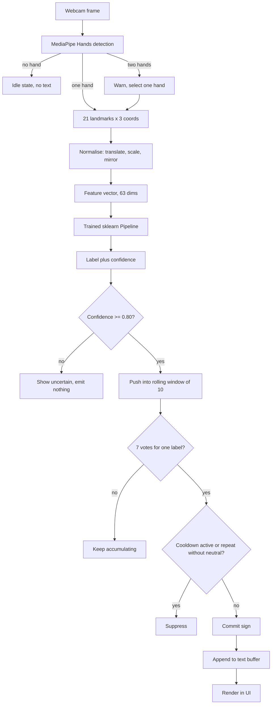

# PRD — Product Requirements Document

**Project:** Real-Time Sign Language to Text Conversion System Using Machine Learning
**Institution:** SRM Institute of Science and Technology
**Course:** Machine Learning (B.Tech CSE) — 80-mark project
**Document version:** 1.0
**Project version:** `0.1.0-alpha`
**Status:** Planning complete (Phase 0). No code, no dataset, no trained model yet.
**Last updated:** 2026-08-26

> **Reading order for a new team member:** this file → `ARCHITECTURE.md` → `DATASET.md` → `PHASES.md`.
> Every numeric value in this document is taken from `config.yaml`, which is the single source of
> truth. If this document and `config.yaml` ever disagree, **`config.yaml` is correct** and this
> document is stale.

---

## 1. Team and ownership

This is the **only** place the team roster is recorded. It is deliberately kept out of source code
(see `RULES.md` §No-Hardcoding) so that no module needs editing if the roster changes.

| Member | Registration number | Proposed primary ownership |
|---|---|---|
| Harshit Tomar | RA2411003030026 | ML pipeline, feature engineering, training and evaluation |
| Bhavishya Tyagi | RA2411003030003 | Dataset collection tooling, preprocessing, data quality |
| Shivank Tyagi | RA2411003030025 | User interface, testing, documentation upkeep |

Ownership is **proposed, not final** — to be confirmed at the start of Phase 1. All three members
must be able to explain the whole system in the viva, so ownership means "responsible for it working",
not "the only person who understands it".

---

## 2. Project overview

The system watches a live webcam feed, recognises a controlled vocabulary of **static, single-hand**
signs, and composes the recognised signs into text in real time.

It works by extracting **21 hand landmarks** per frame with MediaPipe Hands, converting those
landmarks into a normalised numerical feature vector, and classifying that vector with a **classical
scikit-learn model**. Recognised signs pass through a stabilisation layer before any text is emitted,
so that holding one gesture produces one word rather than a stream of repeats.

Three properties define the product:

1. **The dataset is ours.** Nothing in this project depends on a pre-trained sign-language model or a
   downloaded sign dataset. The team records its own samples using a purpose-built collection tool.
2. **It runs entirely offline on a laptop CPU.** No GPU, no cloud service, no network access at
   runtime. Frames never leave the machine.
3. **It is engineered, not scripted.** Configuration is centralised, features are versioned, the
   train/test split is leakage-aware, errors are typed and handled, and behaviour is tested.

### 2.1 What this is *not*

It is not a translator, not an interpreter replacement, and not a product. It is an academic
demonstration of an end-to-end machine learning system, built to a standard where every design
decision can be defended orally.

---

## 3. Problem statement

Deaf and hard-of-hearing people who communicate primarily through sign language face a routine
barrier: most hearing people around them do not sign. In everyday settings — a reception desk, a
pharmacy counter, a college office — communication depends on the availability of a human
interpreter, and interpreters are scarce, must be scheduled in advance, and introduce a third party
into conversations that may be private.

Software that converts signs to on-screen text could reduce dependence on an interpreter for short,
transactional exchanges. The technical obstacles are real and worth studying:

- Sign languages are **visual-spatial**. Meaning is carried by handshape, orientation, location,
  movement, and facial expression together — not by handshape alone.
- Sign languages are **not** manual encodings of spoken language. Indian Sign Language has its own
  grammar and is not a signed form of Hindi or English.
- Large, openly licensed, well-labelled sign datasets are scarce, especially for Indian Sign
  Language, which is precisely why this project collects its own data.

> **Scale of the problem — TBD.** Population figures for deaf and hard-of-hearing people in India,
> and interpreter availability ratios, are frequently quoted in student reports with no source and
> wide variation between them. We will **not** state a number until we can cite a specific,
> retrievable source (e.g. Census of India, NSSO, WHO, or a named peer-reviewed paper). This is
> tracked as an open question in §21 and must be resolved before the Phase 14 report.

### 3.1 The narrower problem this project actually solves

> Given a live webcam feed, recognise which of 12 pre-defined static single-hand signs (or none) is
> currently being held, and append recognised signs to an editable text buffer, at interactive
> frame rates, on a consumer laptop, using a dataset the team recorded itself.

Stating the problem this narrowly is a deliberate choice. A vaguer goal ("convert sign language to
text") would be unachievable in 4–6 weeks and impossible to evaluate honestly.

---

## 4. Target users

| # | Persona | Description | What they need from the system |
|---|---|---|---|
| P1 | **Evaluator / faculty examiner** | Assesses the project for 80 marks. Cares about ML correctness, honesty of results, and software engineering quality. | Reproducible pipeline, real metrics with a defensible evaluation protocol, clear documentation, a working live demo. |
| P2 | **Signing user (demo participant)** | Performs signs in front of the camera. In V1 this is a team member. | Immediate visual feedback, clear indication of confidence, easy correction of mistakes. |
| P3 | **Reading user** | Reads the generated text. | Legible, stable text that does not fill with accidental repeats. |
| P4 | **Future developer** | A student extending this project next semester. | Modular code, centralised configuration, documented decisions, the ability to add a sign without editing source. |

P1 is the primary user for V1. Being honest about that matters: it means evaluation rigour and
documentation quality are *product requirements*, not afterthoughts.

---

## 5. Goals

| ID | Goal | Measure of success |
|---|---|---|
| G-01 | Recognise 12 static single-hand signs plus a neutral/rejection class. | 13 classes trained; per-class metrics reported. |
| G-02 | Build the dataset ourselves with a documented, repeatable protocol. | ≥ 200 samples/class minimum, 330 target, across ≥ 4 sessions/class. |
| G-03 | Evaluate with a protocol that does not leak information between train and test. | Session-grouped split implemented; grouped vs random gap reported. |
| G-04 | Compare multiple classical ML algorithms and justify the winner quantitatively. | 6 candidates compared on grouped CV macro-F1. |
| G-05 | Run real-time inference at interactive speed on a laptop CPU. | ≥ 15 FPS, ≤ 50 ms inference latency. |
| G-06 | Emit stable text — one held gesture yields one word. | Stabilisation layer with threshold, voting, cooldown; verified by test. |
| G-07 | Ship a desktop UI that looks like an ML application, not a script. | CustomTkinter app with all controls in §13. |
| G-08 | Keep ML logic and UI logic separable. | UI imports inference; inference never imports UI. Enforced by test. |
| G-09 | Make adding a 14th sign require no source-code change. | Documented checklist touching only `config.yaml` + data + retrain. |
| G-10 | Process all video locally; never transmit frames. | No network calls in the runtime path; verified by code review. |
| G-11 | Produce documentation sufficient to defend every decision in a viva. | 14 documents complete and mutually consistent. |

---

## 6. Non-goals

Explicitly out of scope for V1. Listing these protects the timeline and is itself a viva talking
point — knowing what you did not attempt, and why, is part of the engineering.

| ID | Non-goal | Reason |
|---|---|---|
| NG-01 | Full Indian Sign Language vocabulary | Thousands of signs; impossible to self-collect in 4–6 weeks. |
| NG-02 | Dynamic (movement-based) signs | Needs temporal modelling (LSTM/GRU/Transformer). Architecture leaves room; V1 does not implement it. |
| NG-03 | Two-handed signs | V1 features describe one hand. Detection is configured for 2 hands only so we can *warn*, not classify. |
| NG-04 | Facial expression / body pose channels | Real sign languages use them; MediaPipe Holistic could add them later. Out of scope now. |
| NG-05 | Sentence grammar, translation, or NLP post-processing | V1 concatenates labels. ISL grammar ≠ English word order; pretending otherwise would be dishonest. |
| NG-06 | Speech output / speech input | Config flags exist (`enable_text_to_speech`) but stay `false`. |
| NG-07 | Mobile or web deployment | Desktop Python only. |
| NG-08 | Cloud training or cloud inference | Contradicts the privacy requirement. |
| NG-09 | Multi-user personalised models | Single shared model in V1. |
| NG-10 | Deep learning on raw images | Analysed and rejected with reasons in `MODEL.md`. |
| NG-11 | Use in medical, legal, emergency, or any safety-critical setting | Accuracy is nowhere near adequate; this must be stated in the UI and the report. |

---

## 7. Functional requirements

Priority uses MoSCoW: **M**ust / **S**hould / **C**ould.

### 7.1 Configuration and startup

| ID | Requirement | Pri | Acceptance criteria |
|---|---|---|---|
| FR-01 | All tunable values load from `config.yaml`. | M | Grepping `src/` finds no literal threshold, resolution, class name, or path outside `config/`. |
| FR-02 | Configuration is validated at startup with typed errors. | M | Invalid config raises `ConfigError` naming the offending key; process exits non-zero without a traceback dump for the user. |
| FR-03 | Cross-field invariants are enforced. | M | `min_votes_in_window ≤ window_size`; `sessions_per_class_minimum × samples_per_session_cap ≥ samples_per_class_target`; `coord_min < coord_max`. Each has a unit test. |
| FR-04 | A global random seed is applied to `random`, `numpy`, and sklearn. | M | Two runs of `train_model.py` on identical data produce identical metrics. |
| FR-05 | Logs go to console and a rotating file. | M | `logs/app.log` created; rotates at 5 MB, 3 backups. |

### 7.2 Camera and hand detection

| ID | Requirement | Pri | Acceptance criteria |
|---|---|---|---|
| FR-06 | Camera opens only when the user explicitly starts it. | M | No `VideoCapture` is constructed during import or app launch; only on Start. |
| FR-07 | Camera release is guaranteed, including on exception. | M | Context manager / `finally`; camera LED off after close. Verified manually. |
| FR-08 | Missing or busy camera produces a readable message, not a crash. | M | `CameraError` surfaces as UI text; app stays responsive. |
| FR-09 | First N frames are discarded during warm-up. | S | `warmup_frames: 5` honoured. |
| FR-10 | Detection runs on the **unflipped** frame; flipping is display-only. | M | `detect_before_flip: true`. Handedness labels verified correct in Phase 2. |
| FR-11 | Up to 2 hands are detected; exactly one is selected for classification. | M | With two hands in frame the UI warns and `multi_hand_policy` selects one. |
| FR-12 | "No hand detected" is a normal state, not an error. | M | UI shows an idle prompt; no exception; no text emitted. |
| FR-13 | Landmark overlay can be toggled. | S | `ui.show_landmarks` respected. |

### 7.3 Dataset collection

| ID | Requirement | Pri | Acceptance criteria |
|---|---|---|---|
| FR-14 | A CLI tool collects samples for a named class. | M | `python scripts/collect_data.py --class HELLO --signer S1` runs. |
| FR-15 | Class name is validated against `dataset.classes`. | M | Unknown class exits with the valid list printed. |
| FR-16 | A countdown precedes capture. | M | `countdown_seconds: 3` shown on screen. |
| FR-17 | Live HUD shows class, session, accepted count, target, rejection reason. | M | All five visible during capture. |
| FR-18 | Capture is rate-limited to `capture_fps`. | M | 8 samples/second, not 30. |
| FR-19 | Every sample is validated before being accepted. | M | Partial landmarks, out-of-bounds coords, too-small/large hand, and near-duplicates are rejected with a counted reason. |
| FR-20 | Collection can be paused and stopped without corrupting the file. | M | Quit key writes a valid `.npz` with whatever was accepted; interrupted files are never half-written. |
| FR-21 | Each run writes exactly one session file plus a JSON manifest. | M | `{CLASS}__{signer}__s{NN}__{timestamp}.npz` + manifest entry. |
| FR-22 | Every sample carries a `session_id`. | M | Required for grouped splitting. Absence is a hard error downstream. |
| FR-23 | A sparse JPEG audit trail is saved. | S | 1 image per 20 samples in `data/raw/`. |
| FR-24 | The config hash is stored in each session file. | S | Detects data collected under different settings. |

### 7.4 Preprocessing and features

| ID | Requirement | Pri | Acceptance criteria |
|---|---|---|---|
| FR-25 | A build step aggregates session files into `X.npy`, `y.npy`, `groups.npy`. | M | Shapes align; `groups` holds session ids. |
| FR-26 | Features are translation-invariant (wrist-centred). | M | Same gesture at two frame positions → near-identical vectors. Unit test. |
| FR-27 | Features are scale-invariant. | M | Same gesture near and far → near-identical vectors. Unit test. |
| FR-28 | Features are **not** rotation-normalised. | M | Rotating the palm changes the vector — this is required to separate PLEASE from THANK_YOU. Unit test asserts the difference. |
| FR-29 | Left hands are mirrored to right-hand canonical form. | M | Mirrored left input ≈ right input. Unit test. |
| FR-30 | Feature vector width is asserted against config. | M | Mismatch raises `FeatureError`, never a silent reshape. |
| FR-31 | The feature set is versioned. | M | `feature_set_version` written into model metadata. |
| FR-32 | Training and inference call the same feature code. | M | Both import `features/extractor.py`. Test asserts identical output for a fixed input. |

### 7.5 Training and evaluation

| ID | Requirement | Pri | Acceptance criteria |
|---|---|---|---|
| FR-33 | Training refuses to run on an inadequate dataset. | M | `DatasetError` if any class < 200 samples, or < 4 sessions, or imbalance ratio > 3.0. |
| FR-34 | The split is grouped by session. | M | No `session_id` appears in more than one of train/val/test. Test asserts empty intersections. |
| FR-35 | Scaling happens inside the sklearn `Pipeline`. | M | Scaler refits per CV fold; no `fit` on full data before splitting. |
| FR-36 | Six candidate models are trained and compared. | M | Comparison table in `reports/metrics/`. |
| FR-37 | Selection uses grouped-CV macro-F1. | M | Winner is the argmax; recorded with the runner-up gap. |
| FR-38 | Accuracy, macro precision/recall/F1, per-class metrics, and a confusion matrix are produced. | M | Saved to `reports/`. |
| FR-39 | The grouped-vs-random leakage comparison is reported. | M | Both numbers side by side; grouped is the headline result. |
| FR-40 | Leave-one-signer-out evaluation is reported. | S | Per-signer scores; expected to be lower than grouped. |
| FR-41 | Model, label encoder, and metadata are saved together. | M | `models/v1/` contains all three. |
| FR-42 | Metadata records feature version, git SHA, timestamp, dataset counts, metrics. | M | Present and non-empty in `model_metadata.json`. |
| FR-43 | Evaluation figures are written as image files. | S | Confusion matrix, model comparison, per-class F1 in `reports/figures/`. |

### 7.6 Real-time inference and stabilisation

| ID | Requirement | Pri | Acceptance criteria |
|---|---|---|---|
| FR-44 | The model loads once at startup, not per frame. | M | Load time logged; single load observed. |
| FR-45 | Loading refuses on feature-version mismatch. | M | `FeatureVersionMismatchError` with both versions named. |
| FR-46 | Missing model produces a clear instruction. | M | `ModelLoadError` → UI says to run training first. |
| FR-47 | Per-frame prediction returns label + confidence. | M | Both shown in UI. |
| FR-48 | Predictions below `confidence_threshold` emit no text. | M | UI shows "uncertain"; buffer unchanged. |
| FR-49 | A sign is committed only on `min_votes_in_window` of `window_size`. | M | 7 of last 10. Unit test with a synthetic prediction stream. |
| FR-50 | A cooldown follows every commit. | M | `cooldown_seconds: 1.2`; no second commit inside it. |
| FR-51 | The same sign repeats only after passing through `_NEUTRAL`. | M | Test: HELLO, HELLO → one word; HELLO, NEUTRAL, HELLO → two. |
| FR-52 | `_NEUTRAL` never produces text. | M | Test asserts empty output for a neutral-only stream. |
| FR-53 | A stale buffer is cleared when the hand disappears. | M | `max_buffer_age_seconds: 2.0`. |

### 7.7 Text composition

| ID | Requirement | Pri | Acceptance criteria |
|---|---|---|---|
| FR-54 | Committed signs append to a buffer with a separator. | M | `"HELLO" + "YOU"` → `"HELLO YOU"`. |
| FR-55 | Backspace removes the last **word**, not the last character. | M | Documented and tested. |
| FR-56 | Clear empties the buffer. | M | Tested. |
| FR-57 | Underscores are stripped for display only. | M | `THANK_YOU` → `THANK YOU`; stored label unchanged. |
| FR-58 | The buffer is capped at `max_length`. | M | Oldest content trimmed; no unbounded growth. |
| FR-59 | Text is copyable / exportable. | C | Copy button or save-to-file. |

### 7.8 User interface

| ID | Requirement | Pri | Acceptance criteria |
|---|---|---|---|
| FR-60 | Live video feed is displayed. | M | Visible and smooth. |
| FR-61 | Detected hand skeleton is overlaid. | M | Landmarks drawn. |
| FR-62 | Current prediction is displayed prominently. | M | Large text. |
| FR-63 | Confidence is displayed numerically and as a bar. | M | Colour-coded by threshold. |
| FR-64 | Generated text panel is visible and scrollable. | M | Present. |
| FR-65 | Clear, Backspace, Start/Stop controls exist. | M | All functional. |
| FR-66 | Model status is shown (loaded / missing / mismatched, version). | M | Visible at all times. |
| FR-67 | On-screen instructions are available. | M | Panel or dialog. |
| FR-68 | FPS is displayed. | S | `ui.show_fps`. |
| FR-69 | The UI never freezes during camera or inference work. | M | Capture on a worker thread; widget updates marshalled to the main thread. |
| FR-70 | A visible disclaimer states this is an academic prototype. | M | Present in the UI. |

---

## 8. Non-functional requirements

| ID | Category | Requirement | Acceptance criteria |
|---|---|---|---|
| NFR-01 | Performance | Interactive frame rate | ≥ 15 FPS end-to-end (target). Measured: **TBD — Phase 13** |
| NFR-02 | Performance | Low inference latency | ≤ 50 ms per prediction (target). Measured: **TBD — Phase 13** |
| NFR-03 | Performance | Fast startup | Model load ≤ 2000 ms (target). Measured: **TBD — Phase 13** |
| NFR-04 | Performance | Bounded memory | No growth over a 10-minute run. Measured: **TBD — Phase 13** |
| NFR-05 | Usability | Runs from one command | `python app.py` |
| NFR-06 | Usability | Errors are actionable | Every user-facing error states what to do next. |
| NFR-07 | Reliability | No unhandled exception in the frame loop | Per-frame try/except; a bad frame is skipped, not fatal. |
| NFR-08 | Reliability | Clean shutdown | Camera and MediaPipe released on every exit path. |
| NFR-09 | Maintainability | Modular | No file > ~400 lines; no module doing two layers' work. |
| NFR-10 | Maintainability | Typed and documented | `mypy --disallow-untyped-defs` clean; Google-style docstrings on public functions. |
| NFR-11 | Maintainability | Linted | `ruff` and `black` clean at line length 100. |
| NFR-12 | Portability | Windows-first, Linux-compatible | `pathlib` everywhere; no OS-specific paths in code. |
| NFR-13 | Portability | CPU-only | No GPU dependency. |
| NFR-14 | Reproducibility | Pinned dependencies | `requirements.txt` ranges + `requirements.lock.txt` from Phase 1. |
| NFR-15 | Reproducibility | Deterministic training | Seed 42; identical metrics on rerun. |
| NFR-16 | Privacy | Frames never leave the machine | No network I/O in the runtime path. |
| NFR-17 | Privacy | Camera off unless requested | Explicit start required. |
| NFR-18 | Privacy | Dataset excluded from version control | `data/` gitignored except metadata. |
| NFR-19 | Privacy | Landmarks logged only at DEBUG | Never at INFO. |
| NFR-20 | Testability | Meaningful automated tests | Unit + integration + model tests; camera-dependent tests marked and skippable. |

---

## 9. User stories

**US-01 — Collect samples for a sign.**
*As a team member, I want to record labelled samples for one sign in one sitting, so that I can build
the dataset incrementally.*
Accepts: one command starts collection; class and count are on screen; bad frames are rejected and
counted; quitting saves a valid session file.

**US-02 — Know why samples were rejected.**
*As a team member, I want to see the rejection reason live, so I can fix my position instead of
collecting garbage.*
Accepts: reason string ("hand too small", "landmarks incomplete", "duplicate") displayed with counts.

**US-03 — Train and compare models.**
*As the ML owner, I want one command to train all candidates and tell me which won and by how much.*
Accepts: comparison table printed and saved; winner serialised with metadata.

**US-04 — Trust the reported accuracy.**
*As the evaluator, I want to know the test set was not contaminated by near-duplicate frames.*
Accepts: split is session-grouped; a test asserts disjoint session sets; grouped and random scores
are reported side by side.

**US-05 — Convert signs to text live.**
*As a signing user, I want to hold a sign and see the word appear once.*
Accepts: one word per held gesture; repeats require passing through neutral.

**US-06 — See when the system is unsure.**
*As a signing user, I want to distinguish "no prediction" from "wrong prediction".*
Accepts: confidence bar plus an explicit "uncertain" state below threshold.

**US-07 — Fix a mistake.**
*As a signing user, I want to remove a wrongly recognised word without starting over.*
Accepts: Backspace removes the last word; Clear empties the buffer.

**US-08 — Control the camera.**
*As a privacy-conscious user, I want the camera on only while I am using it.*
Accepts: Start/Stop toggles capture; stopping releases the device.

**US-09 — Understand system state.**
*As any user, I want to know whether a model is loaded and which version.*
Accepts: status indicator with model version and feature-set version.

**US-10 — Add a new sign later.**
*As a future developer, I want to add a 14th sign without editing Python.*
Accepts: documented path is config edit → collect → build → train → evaluate → bump version.

---

## 10. System workflow

The important detail is that the **only** path to text is through the stabiliser. No branch of the
frame loop writes to the text buffer directly. That is what makes "one gesture, one word" a
structural property rather than a lucky outcome.

---

## 11. Machine learning requirements

| ID | Requirement | Value / note |
|---|---|---|
| MLR-01 | Learning task | Multi-class classification, 13 classes, closed set plus explicit rejection class |
| MLR-02 | Input representation | Normalised MediaPipe hand landmarks, 63 dimensions |
| MLR-03 | Approach | Classical ML (scikit-learn). No TensorFlow/PyTorch. Rationale in `MODEL.md` |
| MLR-04 | Candidates | logistic_regression, knn, svm_rbf, random_forest, extra_trees, mlp |
| MLR-05 | Primary metric | **macro F1** — unweighted, so every class counts equally |
| MLR-06 | Secondary metrics | accuracy, macro precision, macro recall, balanced accuracy |
| MLR-07 | Model selection | Highest grouped-CV macro-F1; ties broken by inference latency |
| MLR-08 | Cross-validation | `StratifiedGroupKFold`, 5 folds, grouped by `session_id` |
| MLR-09 | Hyperparameter search | Grid search, `scoring="f1_macro"`, deliberately small grids |
| MLR-10 | Class imbalance | `class_weight="balanced"`; abort if max/min class ratio > 3.0 |
| MLR-11 | Scaling | `StandardScaler` **inside** the Pipeline, so it refits per fold |
| MLR-12 | Serialisation | `joblib`, full Pipeline as one artifact |
| MLR-13 | Versioning | `feature_set_version` gate; loader refuses a mismatched model |
| MLR-14 | Reproducibility | Seed 42 everywhere |
| MLR-15 | Reported result | The **session-grouped** score. The random-split score is reported only to quantify leakage. |

### 11.1 Accuracy requirements

| ID | Statement |
|---|---|
| ACC-01 | **Target** grouped-CV macro-F1 ≥ 0.85. This is an aspiration, not a promise. |
| ACC-02 | **Minimum acceptable** for the demo: grouped test macro-F1 ≥ 0.75. Below this, the vocabulary is reduced (see the descoping plan in `PHASES.md`) rather than the metric being quietly reframed. |
| ACC-03 | Per-class recall ≥ 0.70 for every class. A high macro average hiding one broken class is a failure. |
| ACC-04 | `_NEUTRAL` must not be a dumping ground: its precision and recall are reported explicitly. |
| ACC-05 | **Measured values: TBD — measure in Phase 7.** No accuracy figure appears anywhere in this project until a script in this repo produces it. |
| ACC-06 | If grouped and random scores differ substantially, the gap is reported as a finding, not hidden. |

> **Honesty note.** At the time of writing, no dataset has been collected and no model has been
> trained. Every metric in this project is `TBD`. `RULES.md` makes fabricating a metric a hard
> violation, and the reason is practical as much as ethical: a fabricated number cannot be defended
> when the examiner asks how it was produced.

---

## 12. Dataset requirements

Full detail in `DATASET.md`; this is the requirement summary.

| ID | Requirement | Value |
|---|---|---|
| DR-01 | Source | Recorded by the team. No public dataset, no pre-trained sign model. |
| DR-02 | Classes | 13 — HELLO, THANK_YOU, PLEASE, YES, NO, SORRY, HELP, NAME, WATER, EAT, I_LOVE_YOU, YOU, _NEUTRAL |
| DR-03 | Sign type | Static, single-hand only |
| DR-04 | Samples per class | 330 target, 200 hard minimum |
| DR-05 | Sessions per class | ≥ 4 (required for grouped CV to be valid) |
| DR-06 | Cap per session | ≤ 90 (stops one session dominating a class) |
| DR-07 | Capture rate | 8 samples/second — deliberately low to reduce near-duplicates |
| DR-08 | Signers | 3 (all team members) — a known limitation, stated in §18 and §15 |
| DR-09 | Primary stored artifact | Hand landmarks, `float32`, shape `(N, 21, 3)`, per-session `.npz` |
| DR-10 | Audit artifact | 1 JPEG per 20 samples |
| DR-11 | Derived artifact | `X.npy` / `y.npy` / `groups.npy`, regenerable from landmarks |
| DR-12 | Required per-sample field | `session_id` — without it the leakage-safe split is impossible |
| DR-13 | Validation | All landmarks present; coords within [-0.5, 1.5]; hand bbox 4–90% of frame; cosine similarity vs previous accepted sample < 0.9995 |
| DR-14 | Variation within a session | Small changes in distance, hand angle, wrist tilt |
| DR-15 | Variation across sessions | Lighting, time of day, background, clothing, signer |
| DR-16 | Consent | All three members are the data subjects and consent explicitly. No bystanders recorded. |
| DR-17 | Storage location | Local disk, `data/`, gitignored. **OneDrive caveat:** the repo currently sits in a OneDrive-synced folder, so `data/` would upload to Microsoft's cloud. Must be excluded from sync or relocated — see `DEPLOYMENT.md`. |
| DR-18 | Measured counts | **TBD — populate in Phase 3** |

---

## 13. User interface requirements

Full design in `DESIGN.md`.

| ID | Requirement |
|---|---|
| UIR-01 | Two-stage plan: an OpenCV HUD for development (Phase 8) and a CustomTkinter desktop app as the deliverable (Phase 11). |
| UIR-02 | Streamlit was considered and rejected: live webcam in Streamlit needs `streamlit-webrtc`/`aiortc`, which adds latency, a browser dependency, and demo-day fragility for no benefit in a local single-user app. |
| UIR-03 | Layout: video left, prediction and confidence right, text buffer across the bottom, controls below. |
| UIR-04 | Dark theme; palette fixed in `config.yaml` (`accent #4F8CFF`, `success #3DD68C`, `warning #F5A623`, `danger #FF5C5C`, `bg #12141A`, `surface #1B1E26`). |
| UIR-05 | Confidence bar is colour-coded: success above threshold, warning near it, danger below. |
| UIR-06 | Every error state has a designed appearance — no silent failures, no raw tracebacks on screen. |
| UIR-07 | Loading and empty states are designed, not accidental. |
| UIR-08 | Font sizes readable from a few metres away, because this will be demonstrated to a room. |
| UIR-09 | Keyboard shortcuts mirror every button. |
| UIR-10 | No ML code in UI modules; the UI calls the inference API only. |

---

## 14. Performance requirements

| ID | Metric | Target | Measured |
|---|---|---|---|
| PR-01 | End-to-end FPS | ≥ 15 | **TBD — Phase 13** |
| PR-02 | Model inference latency | ≤ 50 ms | **TBD — Phase 13** |
| PR-03 | Model load time | ≤ 2000 ms | **TBD — Phase 13** |
| PR-04 | End-to-end latency (frame → text) | ≤ 200 ms | **TBD — Phase 13** |
| PR-05 | Sign-to-commit latency | ~0.9–1.5 s (a consequence of 7-of-10 voting at ~8–15 effective FPS) | **TBD — Phase 13** |
| PR-06 | Peak RSS | ≤ 1.5 GB | **TBD — Phase 13** |
| PR-07 | Memory stability over 10 min | No upward trend | **TBD — Phase 13** |

`config.yaml` stores these as `performance.measured: null` deliberately — `null` rather than the
string `"TBD"` so the schema stays properly typed as `Optional[float]`. Only `scripts/benchmark.py`
writes them. Hardware used for measurement must be recorded alongside the numbers, since FPS is
meaningless without it.

---

## 15. Constraints

| ID | Constraint | Consequence |
|---|---|---|
| C-01 | 4–6 weeks, 3 part-time students | Aggressive scoping; descoping plan prepared in advance |
| C-02 | Consumer laptops, CPU only, integrated webcams | Classical ML; `model_complexity: 0` for MediaPipe |
| C-03 | Windows development environment | `CAP_DSHOW`, CRLF handling, `Segoe UI` |
| C-04 | Python 3.10/3.11 only | MediaPipe has no 3.13 wheels; `requires-python = ">=3.10,<3.12"` |
| C-05 | `numpy < 2.0` required | MediaPipe 0.10.x is built against the numpy 1.x C ABI |
| C-06 | No public dataset | All data self-collected; small and narrow by construction |
| C-07 | Only 3 signers available | Generalisation to unseen people is genuinely limited; LOSO will show this |
| C-08 | Repo lives in a OneDrive-synced, non-ASCII path | Sync/locking hazards; must be documented and mitigated |
| C-09 | Academic honesty | No fabricated results, ever |
| C-10 | Every component must be viva-explainable | Rules out opaque tricks even when they would score better |

---

## 16. Assumptions

| ID | Assumption | Risk if false |
|---|---|---|
| A-01 | MediaPipe Hands detects team members' hands reliably in indoor lighting | Whole pipeline blocked; verified in Phase 2 before any collection |
| A-02 | The 12 chosen signs are separable from normalised landmarks alone | Confusable pairs; mitigated by intrinsic-difference vocabulary design and a Phase 7 confusion-matrix review |
| A-03 | 330 samples/class suffices for classical ML on 63 features | Underfitting; mitigated by learning curves in Phase 7 |
| A-04 | A laptop CPU can sustain ≥ 15 FPS with MediaPipe + sklearn | Demo unusable; mitigated by Phase 13 optimisation |
| A-05 | Team members can perform signs consistently | Noisy labels; mitigated by a written protocol and reference images |
| A-06 | The pinned dependency versions install cleanly | **Unverified** — `requirements.txt` is explicitly marked NOT YET VERIFIED. Phase 1 is the verification gate. |
| A-07 | A camera will be available and working on demo day | Mitigated by recording a backup demo video in Phase 15 |

---

## 17. Risks

| ID | Risk | Likelihood | Impact | Mitigation |
|---|---|---|---|---|
| R-01 | **YES / NO / SORRY confusion.** All three are closed fists differing only by thumb state. | High | High | Flagged as the primary confusion group before data exists. Inspect the confusion matrix in Phase 7. If unresolved, exaggerate thumb extension in the protocol, or drop SORRY (first descope candidate). |
| R-02 | **Data leakage inflating results.** Random splitting near-duplicate frames. | High if unaddressed | Critical — invalidates the whole evaluation | Session-grouped split from day one; `groups.npy` mandatory; test asserts disjoint sessions; grouped-vs-random gap reported. |
| R-03 | **Poor generalisation to unseen signers.** Only 3 signers. | High | Medium | Honestly reported via LOSO; stated as a limitation rather than concealed. |
| R-04 | **Lighting sensitivity.** Model trained in one room, demoed in another. | Medium | High | Vary lighting across sessions by protocol; collect at least one session in the demo room if possible. |
| R-05 | **Dependency breakage** (MediaPipe/numpy/Python version). | Medium | High | Version ranges pinned; Phase 1 verification gate; `requirements.lock.txt` after first success. |
| R-06 | **OneDrive sync corruption or privacy exposure.** Repo is in a synced folder; `data/` would upload to Microsoft's cloud and `.npz` files can be locked mid-write. | Medium | Medium–High | Documented in `DEPLOYMENT.md`; exclude `data/` from sync or relocate the repo; never edit while syncing. |
| R-07 | **Demo-day camera or driver failure.** | Medium | High | Pre-recorded backup video; test on the demo machine beforehand. |
| R-08 | **Scope creep** (dynamic signs, TTS, mobile). | Medium | High | Non-goals are explicit in §6; changes require updating this PRD first. |
| R-09 | **Under-collected dataset** — collection is more tedious than expected. | Medium | High | Honest wall-clock estimate in `PHASES.md`; 200-sample hard floor; parallelise across 3 members. |
| R-10 | **Accuracy below ACC-02.** | Medium | High | Descoping plan: reduce vocabulary rather than misreport. Explicitly permitted and pre-agreed. |
| R-11 | **Feature/model mismatch after retraining** — old model, new features. | Low | High | `feature_set_version` gate raises `FeatureVersionMismatchError` instead of predicting confident nonsense. |
| R-12 | **UI thread blocking** making the app feel broken. | Medium | Medium | Worker thread for capture; widget updates marshalled via `after()`. |
| R-13 | **Uneven workload** across the three members. | Medium | Medium | Per-phase owners and effort estimates in `PHASES.md`. |
| R-14 | **Late documentation** — writing docs after code, from memory. | Medium | Medium | Docs written in Phase 0 and updated per phase; `MEMORY.md` updated at every milestone. |

---

## 18. Known limitations of V1

Stated plainly, because being asked "what are the limitations of your project?" is close to certain
in the viva, and a prepared, specific answer scores better than a vague one.

1. **12 signs, not a language.** A vocabulary this size cannot express meaningful conversation.
2. **Static only.** Many real ISL signs involve movement; those cannot be represented by a single
   frame's landmarks.
3. **Single hand only.** A large fraction of real ISL is two-handed.
4. **Handshape only.** Facial expression and body pose carry grammatical meaning in sign languages
   and are entirely ignored here.
5. **Project-defined vocabulary.** These are static approximations inspired by ISL/ASL handshapes,
   **not** authenticated ISL signs. We do not claim linguistic validity, and we should not.
6. **Three signers.** Hand size, skin tone, and signing style diversity are minimal.
7. **Controlled conditions.** Plain background, indoor lighting, hand facing the camera.
8. **No occlusion handling.** If MediaPipe loses the hand, the system has nothing to classify.
9. **Closed set with one escape hatch.** Anything that is not one of the 12 signs must land in
   `_NEUTRAL` or be rejected by the confidence threshold; there is no true open-set detection.
10. **No validated real-world testing.** No deaf or hard-of-hearing user has evaluated this system.
    Claiming accessibility benefit without that would be unfounded.

---

## 19. Future scope

**V2 — natural next steps.** Expand to 20–30 signs; add two-handed signs (a second feature block and
a wider vector); left/right-specific handling; word suggestions; text-to-speech via `pyttsx3`;
recruit additional signers to make LOSO meaningful; add a proper open-set rejection method.

**V3 — research-scale.** Dynamic signs via landmark sequences and a temporal model (LSTM/GRU/small
Transformer) — the point at which a deep learning framework becomes technically justified; MediaPipe
Holistic for face and pose; sentence-level modelling that respects ISL grammar rather than
concatenating labels; on-device mobile deployment; personalised fine-tuning per user; collaboration
with a qualified ISL interpreter to validate the vocabulary.

The architecture supports this by keeping features versioned and pluggable, keeping the classifier
behind an interface, and keeping the UI decoupled from the model. Adding a temporal model means
adding a feature set and a predictor, not rewriting the application.

---

## 20. Acceptance criteria — "the project is done"

- [ ] All 16 phases in `PHASES.md` are marked complete with dates.
- [ ] Dataset collected: 13 classes, ≥ 200 samples each, ≥ 4 sessions each, counts recorded in `DATASET.md`.
- [ ] `python scripts/build_dataset.py` runs clean and reports real counts.
- [ ] `python scripts/train_model.py` trains all 6 candidates and saves the winner with metadata.
- [ ] Grouped-split metrics reported: accuracy, macro P/R/F1, per-class table, confusion matrix.
- [ ] Grouped-vs-random leakage comparison reported with the gap quantified.
- [ ] LOSO evaluation reported.
- [ ] Grouped test macro-F1 ≥ 0.75 (ACC-02), or the vocabulary was descoped and that decision documented.
- [ ] Every class has recall ≥ 0.70, or the exception is explained.
- [ ] `python app.py` launches the desktop UI and converts live signs to text.
- [ ] Stabilisation verified: one held gesture → one word; repeats need neutral in between.
- [ ] All FR-01…FR-70 met or explicitly waived with reasons.
- [ ] Performance measured on named hardware and recorded in `config.yaml` and `PRD.md` §14.
- [ ] Test suite passes; camera/model-dependent tests skip cleanly without hardware.
- [ ] All 14 documents complete, mutually consistent, no stale `TBD` that has actually been measured.
- [ ] `MEMORY.md` reflects final state.
- [ ] Git history is clean with conventional commits; no data, binaries, or personal data committed.
- [ ] Demo rehearsed; backup video recorded.
- [ ] Viva question bank prepared; all three members can explain the leakage decision unprompted.
- [ ] No fabricated number anywhere in the repository.

---

## 21. Open questions

| ID | Question | Owner | Resolve by |
|---|---|---|---|
| OQ-01 | Citable source for deaf population / interpreter scarcity figures | Shivank | Phase 14 |
| OQ-02 | Do the pinned dependency versions actually install on the team's machines? | Bhavishya | Phase 1 |
| OQ-03 | Optimal `min_detection_confidence` / `min_tracking_confidence` | Bhavishya | Phase 2 |
| OQ-04 | Confirm empirically that detecting before flipping yields correct handedness labels | Bhavishya | Phase 2 |
| OQ-05 | Does the extended 83-dim feature set beat the 63-dim base set? | Harshit | Phase 5 |
| OQ-06 | Final `confidence_threshold`, `window_size`, `min_votes_in_window`, `cooldown_seconds` | Harshit | Phase 9 |
| OQ-07 | Are YES / NO / SORRY separable in practice? | Harshit | Phase 7 |
| OQ-08 | Relocate the repo out of OneDrive, or exclude `data/` from sync? | Harshit | Phase 1 |
| OQ-09 | Can a 4th signer be recruited to make LOSO more informative? | Team | Phase 3 |
| OQ-10 | Which room and machine will be used for the demo? | Team | Phase 15 |

---

## 22. Revision history

| Version | Date | Author | Change |
|---|---|---|---|
| 1.0 | 2026-08-26 | Team | Initial PRD. Scope, requirements FR-01…FR-70, NFR-01…NFR-20, risks, acceptance criteria. All metrics `TBD`. |

---

## 23. Related documents

`ARCHITECTURE.md` (system and module design, ADRs) · `RULES.md` (enforceable development rules) ·
`PHASES.md` (roadmap, Phases 0–16) · `DESIGN.md` (UI/UX) · `DATASET.md` (collection protocol,
leakage) · `MODEL.md` (algorithm choice, features, evaluation protocol) · `TESTING.md` (test
strategy) · `DEPLOYMENT.md` (setup, OneDrive, demo) · `TROUBLESHOOTING.md` (failure catalogue) ·
`MEMORY.md` (live project state) · `README.md` (entry point).
