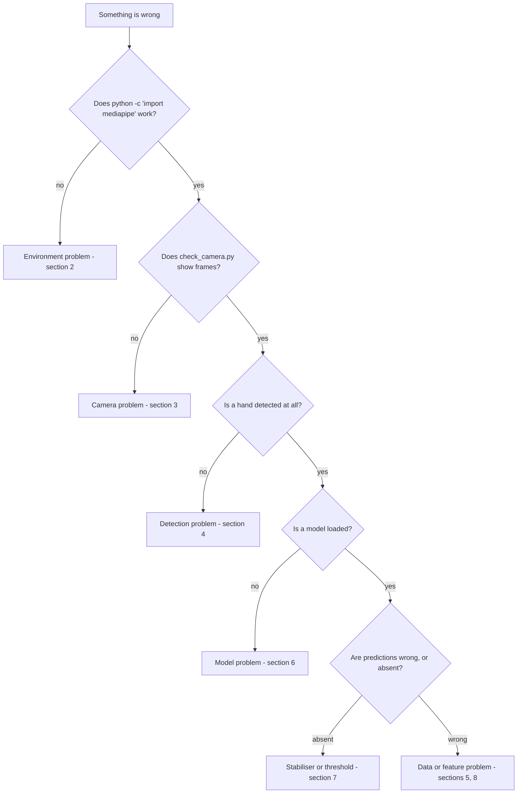

# TROUBLESHOOTING.md — Failure Catalogue and Fixes

**Project:** Real-Time Sign Language to Text Conversion System
**Document version:** 1.0
**Status:** Anticipated failures (Phase 0). **Nothing here has been observed on this machine yet.**
**Last updated:** 2026-08-26

> **What this document is.** A catalogue of failures that are *predictable* from the stack we chose —
> MediaPipe's NumPy ABI constraint, tkinter's threading model, Windows camera backends, and the specific
> ways a small self-collected dataset misleads you. These are anticipated, not experienced.
>
> **What it is not.** A log of bugs we hit. As real failures occur they get appended to §12 with the
> exact error text, the real cause, and the real fix — which is more valuable than anything predicted,
> because a real error message is searchable.

---

## 1. How to diagnose anything in this project

Work outward from the smallest thing that could be wrong. Most time lost on projects like this goes to
debugging layer four while the fault is in layer one.



Then check `logs/app.log`. The log is written specifically so that a failure can be diagnosed after the
fact rather than reproduced live, which matters when the failure happened during a demo.

---

## 2. Environment and installation

### 2.1 `ImportError: numpy.core.multiarray failed to import`

Or: *"A module that was compiled using NumPy 1.x cannot be run in NumPy 2.x."*

**Cause.** NumPy 2.x is installed. MediaPipe 0.10.x is compiled against the NumPy 1.x C ABI. The two are
binary-incompatible — no amount of code changes helps.

**Fix.**

```bat
pip install "numpy>=1.24,<2.0" --force-reinstall
```

`requirements.txt` already pins this. It happens when something else in the environment pulled NumPy
forward, which is the strongest practical argument for the virtual environment in `DEPLOYMENT.md` §3.2.

### 2.2 `ERROR: Could not find a version that satisfies the requirement mediapipe`

**Cause.** Python version. MediaPipe 0.10.x publishes no wheels for Python 3.12 or 3.13.

**Fix.** Check `python --version`. If it is 3.12+, install Python 3.10 or 3.11 and rebuild the venv.
`pyproject.toml` declares `>=3.10,<3.12` so `pip install -e .` will also refuse — that refusal is the
guard working, not a separate bug.

### 2.3 `ModuleNotFoundError: No module named 'tkinter'`

**Cause.** On Windows, the python.org installer's "tcl/tk and IDLE" option was unchecked. On Linux,
tkinter is a separate system package.

**Fix.** Windows: re-run the installer, choose Modify, tick "tcl/tk and IDLE". Linux:
`sudo apt install python3-tk`. This cannot be fixed with pip — tkinter is part of the interpreter
distribution, not a PyPI package, and searching for `pip install tkinter` leads nowhere.

### 2.4 `ModuleNotFoundError: No module named 'sign_language'`

**Cause.** The project was not installed in editable mode, or the venv is not active.

**Fix.** `.venv\Scripts\activate` then `pip install -e .` from the project root. Confirm with
`pip show sign-language-to-text`.

### 2.5 `'python' is not recognized` / wrong Python runs

**Cause.** PATH, or the Microsoft Store Python stub intercepting the command.

**Fix.** `where python` to see what actually resolves. If a `WindowsApps` path appears first, disable
the App Execution Aliases for Python in Windows Settings, or call the interpreter by full path.

### 2.6 `DLL load failed while importing cv2`

**Cause.** Missing Visual C++ runtime, or both `opencv-python` and `opencv-python-headless` installed —
they overwrite each other's `cv2` module and the survivor is often broken.

**Fix.** `pip uninstall opencv-python opencv-python-headless -y` then
`pip install "opencv-python>=4.8,<5.0"`. Install the Microsoft Visual C++ Redistributable if it is
absent. Note that `headless` has no GUI functions at all, so `imshow` fails even when the import
succeeds — a confusing pairing worth knowing about.

### 2.7 Installation is extremely slow or times out

**Cause.** MediaPipe and OpenCV wheels are large (hundreds of MB).

**Fix.** Expect several minutes. `pip install -r requirements.txt --timeout 120`. If it fails
repeatedly, `pip download` on a better connection and install from the local directory.

---

## 3. Camera

### 3.1 Camera does not open — `CameraError`

Most common cause by a wide margin: **another application holds the device**. Zoom, Teams, Discord,
Skype and the Windows Camera app can all hold a webcam while looking idle, and Windows generally does
not allow two processes to open the same camera.

**Fix, in order.** Close every app that could use the camera, including background ones in the tray ·
check Windows Settings → Privacy & security → Camera and confirm desktop app access is allowed ·
try `camera.index: 1` in `config.local.yaml` if there is an external webcam · reboot, which genuinely
does release a stuck device driver.

### 3.2 Camera takes 5–10 seconds to open on Windows

**Cause.** OpenCV's default Media Foundation (MSMF) backend enumerates devices slowly.

**Fix.** `camera.backend: "dshow"` in config, which makes `CameraStream` pass `cv2.CAP_DSHOW`. This is
usually dramatic — seconds to sub-second. The default is `"auto"`; DirectShow is the recommended
Windows setting and `DESIGN.md` §7.1 defines an "Opening camera…" state precisely because this delay
exists at all.

### 3.3 Black or green frames

**Cause.** Frames read before the sensor finished initialising, or a driver quirk.

**Fix.** `camera.warmup_frames: 5` already discards the first frames. Increase to 10–15 if it persists.
If every frame is black, the camera is likely still held by another process (§3.1) — OpenCV can
"succeed" in opening a device it cannot actually read from.

### 3.4 Video is mirrored the wrong way, or handedness looks inverted

**Cause.** The interaction between `flip_horizontal` and `detect_before_flip`.

**Fix.** Config is `flip_horizontal: true` with `detect_before_flip: true`: detection runs on the
**unflipped** frame, and only the displayed image is mirrored. If handedness labels look reversed, this
ordering has been broken somewhere in the frame path.

This is worth stating carefully because it is the most dangerous bug in the whole project. If detection
runs on a mirrored frame, MediaPipe's handedness labels invert, the left-hand mirroring step in the
normaliser then does the wrong thing — and **the saved `.npz` files still look completely valid**. There
is no crash and no warning; the dataset is just quietly wrong, and every downstream number is
meaningless. Phase 2 resolves the ordering empirically and Phase 12 asserts it. If you suspect it,
stop collecting immediately and verify before recording anything further (`MODEL.md` §5.4).

### 3.5 Camera LED stays on after closing the window

**Cause.** `cap.release()` was not called on shutdown.

**Fix.** The app binds `WM_DELETE_WINDOW` to a handler that stops capture. If the LED stays on, that
binding is missing or an exception escaped before release. This is both a bug and a visible privacy
failure, so it is treated as a blocker rather than cosmetic (`DESIGN.md` §9).

### 3.6 Low FPS

Order of likelihood: laptop on battery with aggressive power saving (plug it in — this is often the
whole story) · another CPU-heavy process · `hand_detection.model_complexity` set to `1` instead of `0` ·
capture resolution raised above 1280×720 · a debug build of something. Measure with
`scripts/benchmark.py` rather than guessing; `performance.targets.min_fps` is 15.

---

## 4. Hand detection

### 4.1 No hand detected even though a hand is clearly visible

Checks in order of frequency: **lighting** — MediaPipe degrades badly in dim or strongly backlit
conditions, and moving to face a window fixes more cases than any config change · **distance** — the
validator rejects a bounding box below `0.04` or above `0.90` of the frame, so roughly 40–70 cm from the
camera is the working range · **background** — skin-toned or cluttered backgrounds hurt the palm
detector · **occlusion** — fingers hidden behind the palm cannot be located · **confidence** — lowering
`min_detection_confidence` from `0.7` to `0.5` will detect more hands, but also more false hands, and a
false hand feeds garbage landmarks into the classifier.

### 4.2 Detection flickers on and off

**Cause.** Confidence hovering at the threshold; motion blur.

**Fix.** Improve lighting first — blur from a low shutter speed in dim light is a common hidden cause.
Lower `min_tracking_confidence` slightly (`0.5` → `0.4`); tracking is more forgiving than detection
because it has temporal context. Hold the sign still. The stabiliser's vote-count design already
tolerates occasional dropped frames by construction (`MODEL.md` §9.3).

### 4.3 The wrong hand is used when two hands are visible

**Cause.** Expected behaviour: `multi_hand_policy: "highest_confidence"` picks one, and the clearer hand
is not necessarily the signing hand.

**Fix.** Keep the other hand out of frame. The UI dims the ignored hand so you can see the choice being
made (`DESIGN.md` §5.1). `max_num_hands: 2` is deliberate — detecting both and choosing is better than
detecting one arbitrarily, because at least the decision is visible.

### 4.4 `DetectionError` in the log

**Cause.** MediaPipe returned a result whose structure did not match expectations.

**Fix.** Individual frames are skipped by design; occasional entries are normal. A continuous stream
suggests a version mismatch between the installed MediaPipe and the parsing code — check
`mediapipe.__version__` against `requirements.txt`.

---

## 5. Data collection

### 5.1 Most samples are rejected

Read the reason codes in the session summary; the validator reports why rather than just refusing.
`incomplete_landmarks` → occlusion or partial hand · `out_of_bounds` → hand leaving the frame, since the
validator allows `[-0.5, 1.5]` and beyond that the landmarks are extrapolated guesses · `bbox_too_small`
/ `bbox_too_large` → distance · `duplicate` → the hand was held perfectly still and consecutive frames
exceeded `0.9995` cosine similarity, which is not really an error so much as a reminder that a
motionless hand contributes no new information.

### 5.2 Sessions produce too few samples

**Cause.** `samples_per_session_cap: 90` and `capture_fps: 8` mean roughly 11 seconds of *accepted*
frames per full session; rejections extend the wall-clock time.

**Fix.** Record more sessions rather than longer ones. This is the more valuable choice anyway:
`sessions_per_class_minimum: 4` exists because four short sessions in different conditions carry far
more information than one long session, and the grouped split can only reward variety it actually has
(`DATASET.md` §9.6).

### 5.3 `DatasetError: class X has fewer than N sessions`

**Cause.** `build_dataset.py` enforces `sessions_per_class_minimum: 4`, because a grouped split cannot
be constructed from too few groups.

**Fix.** Record more sessions for that class. Do not lower the minimum to make the error disappear —
that trades a clear failure now for an unquantifiable validity problem later.

### 5.4 A session file will not load

**Cause.** Interrupted write (process killed mid-save), or a OneDrive cloud-only placeholder.

**Fix.** Delete the corrupt file and re-record; a single lost session is cheap. For OneDrive, right-click
the folder → "Always keep on this device". This placeholder behaviour is worth knowing about because the
file *appears* present in Explorer while failing to open, which reads like a code bug (`DEPLOYMENT.md`
§7.1).

### 5.5 `_NEUTRAL` was collected the same way as real signs

**Cause.** Following the normal protocol for a class whose purpose is the opposite.

**Fix.** Re-collect it. `_NEUTRAL` needs deliberately **high** variance — resting hands, mid-transition
shapes, random positions, hands moving into and out of frame. Every other class wants consistency;
`_NEUTRAL` wants everything that is not a sign. Collected too narrowly, it fails to reject the real
resting hands it will encounter in live use, and the classifier will confidently emit a sign whenever
the user's hand is idle (`DATASET.md` §7.4).

---

## 6. Model and training

### 6.1 `DatasetError: no dataset found`

Run `scripts/build_dataset.py` first. See `DEPLOYMENT.md` §4 for the pipeline order.

### 6.2 `ModelLoadError: no trained model found`

Run `scripts/train_model.py`. The app shows a designed guidance screen for this rather than crashing
(`DESIGN.md` §6.1), because it is the state every fresh clone starts in.

### 6.3 `FeatureVersionMismatchError`

**Cause.** `model_metadata.json` records a `feature_set_version` different from the one `config.yaml`
now produces — the feature configuration changed after training.

**Fix.** Retrain (`scripts/train_model.py`). Do **not** set `enforce_feature_version_match: false` to
get past it. The guard exists because serving features in a different order than training produces
**confident, plausible, wrong predictions with no error at all** — this exception is the only thing
standing between you and results that look fine and mean nothing (`MODEL.md` §7.4).

### 6.4 Training takes a very long time

**Cause.** Grid search across six candidates. SVM-RBF scales poorly with sample count and `MLPClassifier`
is the slowest of the six.

**Fix.** Confirm `n_jobs: -1`. For a quick iteration, temporarily narrow `training.candidates` to
`[logistic_regression, random_forest]` — but the reported final comparison must include all six, or the
"we compared multiple algorithms and justified the choice" claim is not true. Real timings: TBD, Phase 6.

### 6.5 Accuracy is suspiciously high (> 0.98)

**Treat this as a bug, not a success.** With a self-collected 13-class dataset and three signers, near-
perfect grouped cross-validation is far more likely to indicate leakage than excellence.

Check: is the split grouped by `session_id`, or did it silently fall back to random · does the
grouped-vs-random comparison show a large gap (a gap is *expected* — the random number should be higher;
if they are identical, grouping probably is not working) · is `StandardScaler` inside the `Pipeline`
rather than fitted on everything beforehand · are train and test session IDs genuinely disjoint (the
Priority-1 test in `TESTING.md` §4.1).

`report_leakage_comparison: true` exists so this question can be answered with a number instead of a
feeling, and so the honest gap can be shown to an examiner rather than hidden.

### 6.6 Accuracy is much lower than the ACC-02 floor of 0.75

Likely causes, in order. **Confusable classes** — YES, NO and SORRY are all fist-based and are the
predicted failure (`PRD.md` R-01); read the confusion matrix before changing anything, because it names
the problem precisely. **Inconsistent collection** — different signers forming a sign differently, which
is real signal loss rather than a modelling problem. **Too few sessions**, so the model saw too little
variation. **A `_NEUTRAL` class collected too narrowly**, which pollutes everything.

The response is to **reduce the vocabulary**, not to redefine the metric or switch to a random split.
`PHASES.md` contains the descoping plan for exactly this contingency; dropping to 8 well-separated signs
with honest numbers is a better project than 12 signs with numbers that cannot be defended.

### 6.7 One class has much worse recall than the rest

Read the confusion matrix to see what it is confused *with*. If two classes trade errors, they are
visually similar under our normalisation. Options: collect more sessions for that pair, replace one with
a more distinct sign, or accept and document it. Per-class recall ≥ 0.70 is ACC-03, and a class that
cannot reach it is a finding worth reporting rather than a failure to hide.

### 6.8 LOSO scores much worse than grouped CV

**This is expected, not a bug.** Leave-one-signer-out measures generalisation to a person the model has
never seen; grouped CV measures generalisation to a new session by a known signer. The gap between them
is one of the most interesting honest results the project can report, and with only three signers the
LOSO number is also very noisy — which is exactly why ACC-06 reports it rather than gating on it
(`MODEL.md` §8).

---

## 7. Real-time inference

### 7.1 Live accuracy is much worse than test accuracy

The most common single cause is **conditions**: lighting, background and distance differing from
collection. Then **your own signing**, which drifts from how you recorded it. Then a genuine
generalisation gap, which is the honest finding.

If it is dramatically worse, suspect the frame-path ordering bug in §3.4 before anything else — a
handedness inversion between collection and inference produces exactly this symptom.

### 7.2 No text appears even though predictions look right

Work through the State panel, which exists for this (`DESIGN.md` §5.4). `Accumulating 4/7` → the sign is
not being held long enough or confidence is dipping below `0.80` on some frames · `Cooldown` → wait 1.2 s
· `Return to neutral` → `require_neutral_between_repeats: true` means the same sign will not fire twice
until a neutral hand is seen · confidence stuck below threshold → improve lighting or lower
`confidence_threshold`, accepting more false commits in exchange.

### 7.3 The same word repeats — `HELLO HELLO HELLO`

**Cause.** The cooldown or the neutral requirement is not working. This is the exact failure the brief
called out by name.

**Fix.** Confirm `cooldown_seconds: 1.2` and `require_neutral_between_repeats: true` are being read from
config and honoured, and that the stabiliser is not being reconstructed each frame — a fresh stabiliser
has no memory of the last commit, so it will commit again immediately. The `TESTING.md` §5.6 suite covers
this case explicitly.

### 7.4 Words commit that were not intended

**Cause.** Threshold too low, or a `_NEUTRAL` class that does not cover real transitions.

**Fix.** Raise `confidence_threshold` toward `0.85`, or raise `min_votes_in_window` from 7 to 8. Both
trade responsiveness for precision, which is usually the right trade for a demonstration. If it happens
mainly *between* signs, the real fix is more `_NEUTRAL` data covering transitions.

### 7.5 Recognition feels sluggish

Partly by design: about 1 second of stabilisation is intentional, and the alternative is text updating
every frame, which is unusable. If it is worse than that, check FPS (§3.6) — at 8 fps, seven votes take
nearly a second longer than at 24 fps, so a frame-rate problem presents as a latency problem.

---

## 8. UI

### 8.1 The video panel is blank but the app is running

**Cause, almost always.** The Pillow `PhotoImage` was garbage-collected because nothing held a reference.

**Fix.** Keep it on the instance: `self._current_photo = photo`. There is no error message for this — the
panel is simply empty — which is why it is worth memorising (`DESIGN.md` §9).

### 8.2 The window freezes or stops responding

**Cause.** Camera capture or inference running on the main thread, blocking the tkinter event loop.

**Fix.** Capture and inference belong on a worker thread; results reach the UI through a queue drained by
`root.after(...)`. This is the single most common tkinter + OpenCV mistake and the reason the threading
model is specified before any UI code is written.

### 8.3 Random crashes with tkinter errors in the traceback

**Cause.** A widget was touched from a non-main thread. Tkinter is not thread-safe, and the resulting
crashes are intermittent and very hard to reproduce, which makes them expensive to diagnose after the
fact.

**Fix.** Every widget update goes through the queue plus `after()` mechanism. No exceptions — a single
"just this one label" shortcut reintroduces the whole class of bug.

### 8.4 Fonts or colours look wrong

**Cause.** "Segoe UI" is unavailable (non-Windows), or a widget hard-codes a colour.

**Fix.** Accept the fallback font. A hard-coded colour is a `RULES.md` violation — every colour comes
from `ui.appearance` via `ui/theme.py`.

### 8.5 Layout breaks when the window is resized

**Cause.** Fixed pixel geometry instead of proportional weights.

**Fix.** Grid weights on the resizable rows and columns; minimum window size 1000×640.

---

## 9. Configuration

### 9.1 `ConfigError` naming a key

The message names the key and the reason. Fix that key in `config.yaml`. Validation is strict on purpose:
an unknown key is an error rather than a silent no-op, because a typo'd key that is quietly ignored means
you spend an hour wondering why your change had no effect.

### 9.2 A config change appears to have no effect

Check that you edited `config.yaml` and not a copy · check whether `config.local.yaml` exists and is
overriding you · restart the app, since config is read once at startup by design · confirm the value
is actually being read by the module rather than shadowed by a literal.

### 9.3 `yaml.scanner.ScannerError`

YAML syntax. Nearly always indentation (tabs are invalid — use spaces), a missing space after a colon, or
an unquoted string containing a colon. Note that YAML has **no tuple type**, which is why
`hidden_layer_sizes` is written as lists and converted to tuples in `training/candidates.py`.

### 9.4 A class name behaves strangely — `True`, `False`, or a directory named `True`

**Cause.** A class name lost its quotes in `config.yaml`. YAML 1.1 resolves the bare tokens `YES`, `NO`,
`ON`, `OFF`, `Y` and `N` to booleans, so `- YES` becomes Python `True` and `- NO` becomes `False`.

**Fix.** Quote it: `- "YES"`. Every class name in `config.yaml` is quoted with a comment explaining why —
the quotes are load-bearing, not stylistic.

Symptoms are indirect because **nothing raises an error**: a `data/raw/True/` directory appears, the label
encoder is fitted on mixed `str` and `bool`, log lines print `True` where a sign name should be, and
membership checks misbehave since `False == 0`. This was audit defect 12 (`ARCHITECTURE.md` §13.4) and it
is the reason `config/loader.py` asserts that every class name is a string at load time.

---

## 10. Git

### 10.1 A large file was accidentally committed

If not yet pushed, `git reset --soft HEAD~1`, fix `.gitignore`, recommit. If pushed, rewriting history is
required and disruptive — check `git status` before committing instead. `.gitignore` already excludes
`data/`, `models/**/*.joblib` and `logs/`.

### 10.2 `model_metadata.json` is being ignored

`.gitignore` excludes `models/` broadly but re-includes metadata with a negation pattern. If it is being
ignored, `git check-ignore -v models/v1/model_metadata.json` shows which rule matched. This file must be
committed — it is the entire record of what was trained (`DEPLOYMENT.md` §6).

### 10.3 Line-ending warnings

Expected on Windows and handled by `.gitattributes` (`* text=auto`). Harmless.

---

## 11. Escalation

If nothing here helps: read `logs/app.log` from the start of the failing run, not just the tail ·
re-run the §1 decision tree from layer one rather than where you assume the fault is · run
`pytest -m "unit or integration"` to check whether the fault is in project logic or in the environment ·
reproduce in isolation with the smallest possible script.

A useful fault report contains: exact error text and full traceback, `python --version`, `pip freeze`,
OS version, what you were doing, what you expected, and the relevant `logs/app.log` excerpt. **Never
attach dataset files or debug images** — they contain images of people's hands.

---

## 12. Observed failures — real log

> Empty. Nothing above has been observed on this machine yet. Real failures are appended here with the
> date, exact error text, actual cause, and actual fix. This section will eventually be the most useful
> part of the document, because everything above it is prediction and everything in it will be fact.

| Date | Phase | Error (verbatim) | Cause | Fix |
|---|---|---|---|---|
| — | — | — | — | — |

---

## 13. Revision history

| Version | Date | Change |
|---|---|---|
| 1.0 | 2026-08-26 | Initial catalogue: diagnostic decision tree, environment/camera/detection/collection/training/inference/UI/config/git sections, escalation, empty observed-failures log. |

---

## 14. Related documents

`DEPLOYMENT.md` (setup and verification) · `DATASET.md` §7–§9 (collection protocol, leakage) ·
`MODEL.md` §5.4, §7.6, §9 (frame ordering, version guard, stabiliser) · `DESIGN.md` §7, §9 (error states,
tkinter hazards) · `TESTING.md` §4 (the tests that catch the validity failures) · `PHASES.md` Phase 1.
